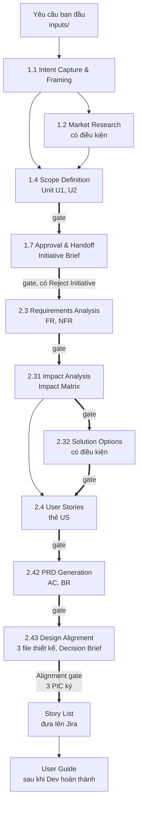
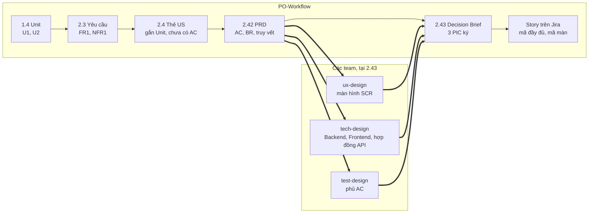

# PO-Workflow

PO-Workflow là quy trình Product Owner (PO) phân tích yêu cầu sản phẩm cùng AI. Quy trình đi từ yêu cầu ban đầu tới PRD theo template chuẩn, sau đó bàn giao cho Design, Tech và QA theo một bộ quy ước chung. AI đảm nhận việc đọc tài liệu, đặt câu hỏi, soạn thảo và tự kiểm tra; PO trả lời câu hỏi, ra quyết định và phê duyệt ở cuối mỗi stage.

Khung phase, stage, gate và thuật ngữ tham khảo [AWS AI-DLC Workflows](https://github.com/awslabs/aidlc-workflows) bản 2.11, trong hai phase thuộc trách nhiệm của PO là Ideation và Inception. Nội dung phân tích nghiệp vụ bám theo BABOK v3 của IIBA; trách nhiệm của PO với backlog đối chiếu với Scrum Guide 2020. Mọi câu trả lời, quyết định và bản đã duyệt được lưu trong repo git của sản phẩm, ghi rõ người quyết định và thời điểm.

| Tài liệu | Người đọc | Nội dung |
|---|---|---|
| README.md | Mọi người | Lý do áp dụng, cơ chế vận hành, kiểm soát chất lượng và chuẩn bàn giao, hướng dẫn sử dụng, mức độ sẵn sàng và kế hoạch áp dụng |
| [USER-GUIDE.md](USER-GUIDE.md) | PO, các PIC, Dev | Thao tác hằng ngày |
| [GLOSSARY.md](GLOSSARY.md) | Mọi người | Thuật ngữ và họ mã |
| [DOMAIN-SETUP.md](DOMAIN-SETUP.md) | Người phụ trách quy trình | Đưa một sản phẩm mới vào quy trình |
| [engine/standards/](engine/standards/) | Design, Tech, QA | Nguyên tắc chia story, quy ước mã, quy ước đặt tên và liên kết, quy tắc bàn giao |
| [AGENTS.md](AGENTS.md) | Công cụ AI | Quy tắc AI phải tuân thủ khi làm việc với PO; `CLAUDE.md` chỉ nạp lại file này |
| [CHANGELOG.md](CHANGELOG.md) | Người phụ trách quy trình | Thay đổi của từng phiên bản quy trình và cách nâng cấp |

## Mục lục

1. [Lý do áp dụng quy trình](#1-lý-do-áp-dụng-quy-trình)
2. [Cơ chế vận hành của quy trình](#2-cơ-chế-vận-hành-của-quy-trình)
3. [Kiểm soát chất lượng và bàn giao cho Design, Tech, QA](#3-kiểm-soát-chất-lượng-và-bàn-giao-cho-design-tech-qa)
4. [Hướng dẫn sử dụng](#4-hướng-dẫn-sử-dụng)
5. [Mức độ sẵn sàng và kế hoạch áp dụng](#5-mức-độ-sẵn-sàng-và-kế-hoạch-áp-dụng)
6. [Cơ sở phương pháp và đối chiếu chuẩn](#6-cơ-sở-phương-pháp-và-đối-chiếu-chuẩn)
7. [Lịch sử và nguồn](#7-lịch-sử-và-nguồn)

## 1. Lý do áp dụng quy trình

### 1.1 Bối cảnh

Sản phẩm đang vận hành đã có người dùng và dữ liệu. Công việc phân tích của PO gồm làm rõ vấn đề, xác định phạm vi, phân tích yêu cầu và ảnh hưởng, đề xuất giải pháp, chia user story và viết PRD. Công việc này diễn ra trong ba điều kiện:

| Điều kiện | Mô tả |
|---|---|
| Hệ thống đang vận hành | Mỗi tính năng phát triển mới có thể tác động tới các tính năng, dữ liệu, thông báo và phân quyền đã có. |
| Nguồn lực hạn chế của PO | PO đảm nhận nhiều vai trò, từ định hướng sản phẩm đến lập kế hoạch, thiết kế mockup và vận hành sprint, nên thời gian dành cho việc làm rõ yêu cầu bị thu hẹp. Đồng thời, việc áp dụng đầy đủ BABOK, Scrum và Design Thinking đòi hỏi nhiều thời gian và nguồn lực, vượt quá khả năng đáp ứng của nhịp độ dự án. |
| Mất thông tin khi chuyển sang ngôn ngữ kỹ thuật | Tài liệu đặc tả đôi khi thiếu bối cảnh nghiệp vụ, dẫn tới việc các bên diễn giải yêu cầu theo những cách khác nhau. |

Quy trình được thiết kế để giúp PO trả lời ba câu hỏi:

1. Tính năng mới tác động tới phần nào của hệ thống hiện có?
2. Mỗi quyết định do ai đưa ra, dựa trên nguồn nào?
3. Design, Tech, QA đã thống nhất thiết kế trước khi phát triển chưa?

### 1.2 Bốn vấn đề quy trình cần giải quyết

| Vấn đề | Mô tả |
|---|---|
| Ảnh hưởng được phát hiện muộn | Ảnh hưởng tới các phần hiện có chỉ được phát hiện sau khi PRD hoàn thành, dẫn tới change request và phải làm lại. |
| Các team lệch định hướng | Design, Tech, QA chỉ tiếp cận PRD khi bắt đầu triển khai; khác biệt về hướng thực hiện chỉ được phát hiện trong quá trình triển khai. |
| Quyết định không được lưu vết | Quyết định nằm rải rác trong tin nhắn, biên bản họp và lịch sử hội thoại với AI. Bản đã duyệt có thể bị ghi đè, câu hỏi đã trả lời bị hỏi lại, lý do của từng rule không được ghi nhận. |
| Cách sử dụng AI chưa được chuẩn hoá | Mỗi PO sử dụng AI theo cách riêng, chưa có quy tắc chung. Khi thiếu thông tin, AI tự bổ sung giá trị có vẻ hợp lý; người đọc khó phân biệt nội dung nào đã được PO xác nhận và nội dung nào do AI suy đoán. |

### 1.3 Cơ chế xử lý tương ứng với từng vấn đề

| Vấn đề | Cơ chế trong quy trình | Kết quả mong đợi |
|---|---|---|
| Ảnh hưởng được phát hiện muộn | AI tra cứu knowledge base của sản phẩm ngay khi phân tích yêu cầu (stage 2.3), sau đó phân tích ảnh hưởng tới hệ thống hiện có (stage 2.31) trước khi lựa chọn giải pháp | Xác định phần bị ảnh hưởng trước khi viết PRD |
| Các team lệch định hướng | Design, Tech, QA thiết kế dựa trên PRD, sau đó cùng PO họp và ký Decision Brief (stage 2.43) trước khi phát triển | Phát hiện sai lệch trước khi phát triển |
| Quyết định không được lưu vết | Lời PO được ghi nguyên văn vào nhật ký quyết định `decisions.md` của từng intent; bản đã duyệt được lưu trong `archive/` và hook ngăn chỉnh sửa | Không hỏi lại câu đã trả lời, không mất bản duyệt |
| Cách sử dụng AI chưa được chuẩn hoá | Quy tắc phân tích gắn sẵn trong từng stage; điểm chưa rõ được đánh dấu `❓PO`, AI tạm dừng cho tới khi PO trả lời | Mọi kết luận đều có nguồn |

Kết quả mong đợi chưa được đo lường. Phương pháp đo được trình bày tại mục 5.5.

### 1.4 Ba mục tiêu của quy trình

| Mục tiêu | Nội dung |
|---|---|
| PO tập trung vào quyết định sản phẩm | AI đảm nhận việc đọc tài liệu, tra cứu và soạn thảo; PO dành thời gian cho định hướng sản phẩm, giá trị kinh doanh và ra quyết định. |
| Chất lượng đầu ra đồng đều giữa các PO | Mọi PO sử dụng cùng quy trình, template và quy tắc phân tích; chất lượng tài liệu không phụ thuộc vào kinh nghiệm cá nhân. |
| Tính nhất quán từ yêu cầu đến kiểm thử | Tiêu chí chấp nhận có mã và kiểm tra được; QA viết test case gắn với từng tiêu chí, Dev bám sát phạm vi đã duyệt. |

Việc áp dụng được mở rộng dần: cá nhân, toàn team, liên team, sau cùng là các team sản phẩm khác. Lộ trình cụ thể được trình bày tại mục 5.

### 1.5 Khác biệt so với sử dụng AI hội thoại

| Khía cạnh | Sử dụng AI hội thoại | PO-Workflow |
|---|---|---|
| Hiểu hệ thống hiện hành | AI suy luận từ kiến thức chung | Đọc knowledge base của sản phẩm, phân tích ảnh hưởng, đọc lại nguồn sống |
| Thông tin còn thiếu | AI tự bổ sung phần còn thiếu | Đánh dấu điểm chưa rõ, tạm dừng cho tới khi PO trả lời |
| Lưu vết quyết định | Phân tán trong lịch sử hội thoại | Ghi nguyên văn, kèm người quyết định và thời điểm |
| Kiểm soát chất lượng | PO tự rà soát thủ công | Script, checklist có mục chặn và AI Reviewer độc lập |
| Truy vết tới kiểm thử | Cấu trúc tài liệu không thống nhất giữa các lần soạn | Mã ổn định; test case gắn mã tiêu chí chấp nhận |
| Thay đổi yêu cầu | Soạn lại hoặc sửa thủ công | Quay lại đúng stage liên quan, giữ nguyên bản đã duyệt |
| Chuyển giao người phụ trách tiếp theo | Bối cảnh không được lưu giữ | Hồ sơ đầy đủ cho từng intent, có bản tóm lược tự động bằng `/po-replay` |

## 2. Cơ chế vận hành của quy trình

### 2.1 Tổng quan

Mỗi yêu cầu là một intent, lưu tại `intents/<YYMMDD-slug>/`. Intent đi qua tối đa 10 stage thuộc hai phase; mỗi stage tạo ra một artifact và kết thúc bằng một gate do PO phê duyệt.

| Đặc điểm | Nội dung |
|---|---|
| Quyết định được lưu vết | Câu trả lời, lời duyệt và bản đã duyệt được lưu trong repo git, ghi rõ người quyết định và thời điểm. |
| Hai phase | Ideation xác định vấn đề và phạm vi. Inception phân tích yêu cầu, ảnh hưởng, giải pháp, viết user story, PRD và thiết kế của các team. |
| Khung AWS và BABOK | Phase, stage, gate theo AWS AI-DLC 2.11; phân tích nghiệp vụ theo BABOK v3; trách nhiệm với backlog theo Scrum Guide 2020. |
| Hiểu hệ thống đang vận hành | AI tra cứu knowledge base của sản phẩm, đối chiếu schema và đặc tả API trước khi đặt câu hỏi cho PO. |

Quy trình có năm đầu ra bàn giao. Các artifact còn lại là bản phân tích nội bộ của PO.

| Đầu ra | Người nhận | Thời điểm |
|---|---|---|
| Initiative Brief | Người quyết định đầu tư | Cuối Ideation, profile L |
| PRD | Design, Tech, QA | Khi stage 2.42 được duyệt |
| Decision Brief | Design PIC, Tech PIC, QA PIC, PO | Sau khi các team viết thiết kế, profile M và L |
| Story List, mỗi user story một story trên Jira | Design, Tech, QA | Sau gate 2.43; với profile S, sau khi PRD được duyệt |
| User Guide | Người dùng cuối | Sau khi Dev hoàn thành |

### 2.2 Vai trò của AI, PO và các vai khác

AI đề xuất, PO quyết định.

| AI đề xuất | PO quyết định |
|---|---|
| Đọc knowledge base, cơ sở dữ liệu, schema, đặc tả API trước khi đặt câu hỏi | Cung cấp yêu cầu gốc và bối cảnh trong `inputs/` |
| Đặt câu hỏi có lựa chọn, kèm đề xuất và nguồn | Trả lời câu hỏi; quyết định phạm vi, nghiệp vụ và mức ưu tiên |
| Soạn artifact theo template, ghi rõ nguồn | Phê duyệt hoặc yêu cầu chỉnh sửa tại mỗi gate |
| Tự kiểm tra bằng script, checklist và AI Reviewer | Quyết định bỏ qua stage, đổi profile, chấp nhận change request |
| Chỉ ra trùng lặp, xung đột và phần còn thiếu | Gửi PRD cho các PIC, đưa story lên Jira |
| Đánh dấu `❓PO` ở phần chưa rõ thay vì suy đoán | Chọn bài học cần lưu giữ cho các lần sau |

Lời PO được ghi nguyên văn vào `decisions.md`. AI tra cứu file này trước khi đặt câu hỏi, nhờ đó không hỏi lại câu đã được trả lời.

Các vai khác trong quy trình:

| Vai | Trách nhiệm | Thời điểm |
|---|---|---|
| AI Reviewer | Agent AI độc lập: đọc artifact, không đọc hội thoại giữa PO và AI; kết luận READY hoặc NOT-READY | Trước gate, theo profile |
| Design PIC | Viết `ux-design.md` từ PRD, đặt mã màn hình `SCR`, ký Decision Brief | Stage 2.43 và trên Jira |
| Tech PIC | Viết `tech-design.md` cho cả Backend và Frontend, ký Decision Brief, chia story thành Unit of work và sub-task | Stage 2.43 và trên Jira |
| QA PIC | Viết `test-design.md` bao phủ từng tiêu chí chấp nhận, ký Decision Brief, viết test case gắn mã tiêu chí chấp nhận | Stage 2.43 và trên Jira |
| Người phụ trách quy trình | Duy trì quy trình và knowledge base của sản phẩm, tổng hợp bài học, hỗ trợ PO | Liên tục |

### 2.3 Phạm vi áp dụng

| Áp dụng cho | Không áp dụng cho |
|---|---|
| Tính năng mới hoặc thay đổi tính năng của sản phẩm | Thay PO ra quyết định về phạm vi, nghiệp vụ và mức ưu tiên |
| Từ một màn hình tới nhiều module; mức độ được xác định bằng profile | Thiết kế kỹ thuật chi tiết: cơ sở dữ liệu, API, thuật toán |
| Từ yêu cầu ban đầu tới PRD và Decision Brief | Xây dựng và vận hành trong phase Construction: code, test, release |
| Story List; User Guide sau khi Dev hoàn thành | Quản lý tiến độ thay cho Jira |
| Change request; đánh giá sau phát hành | Bàn giao tài liệu chưa được duyệt |

Điều kiện bắt đầu: sản phẩm đã có knowledge base. Công tác chuẩn bị được trình bày tại mục 4.2.

### 2.4 Bảy nguyên lý nền

Mọi quy tắc trong quy trình xuất phát từ bảy nguyên lý dưới đây. Khi một quy tắc chưa rõ lý do, người đọc tra nguyên lý tương ứng.

| Nguyên lý | Nội dung | Áp dụng trong quy trình | Nguồn |
|---|---|---|---|
| Human-in-the-loop | AI đề xuất, PO quyết định; không bước nào được thực hiện tiếp khi PO chưa phê duyệt | Gate cuối mỗi stage; lời duyệt ghi nguyên văn vào `decisions.md` | AWS AI-DLC; Paul Fitts, 1951 |
| Requirements Engineering | Khơi gợi, phân tích, đặc tả, kiểm chứng và xác nhận là các việc tách biệt; BABOK v3 tách kiểm chứng chất lượng (7.2) khỏi xác nhận với mục tiêu (7.3) | Questions file, phân tích yêu cầu và ảnh hưởng, PRD, checklist, AI Reviewer | IREB CPRE; Wiegers; BABOK v3 |
| Context Engineering | AI được cung cấp đúng và đủ thông tin cho công việc đang thực hiện | Bước Load đầu mỗi stage đọc knowledge base của sản phẩm, nhật ký quyết định và bài học | Anthropic, 2025 |
| Quality Gate | Mỗi đầu ra được kiểm tra trước khi làm nền tảng cho đầu ra tiếp theo | Script kiểm tra, checklist có mục chặn, AI Reviewer, năm lựa chọn tại gate | Stage-Gate, Robert G. Cooper, 1986 |
| Iterative Refinement | Mức chi tiết tăng theo mức chắc chắn | Profile S, M, L; thẻ user story trước, PRD sau, thiết kế của các team sau PRD | PMBOK, progressive elaboration |
| Requirement Traceability | Yêu cầu, user story, rule và tiêu chí chấp nhận truy được về nhau và về nguồn | Mã ổn định, thẻ nguồn, bảng truy vết, mã đầy đủ khi bàn giao | Gotel và Finkelstein, 1994; ISO/IEC/IEEE 29148 |
| Responsible AI | AI không tự điền khi thiếu thông tin; con người chịu trách nhiệm cuối | Ký hiệu `❓PO`, đọc lại nguồn sống, chỉ bàn giao bản đã duyệt | NIST AI RMF 1.0, 2023 |

Từ các nguyên lý trên, quy trình đặt bốn quy tắc làm việc cho mọi stage:

- AI không tự điền dữ kiện. Khi thiếu thông tin nhỏ, AI ghi giả định. Khi thiếu thông tin làm thay đổi phạm vi, rule, dữ liệu hoặc luồng, AI ghi câu hỏi mở và tạm dừng. Ô không suy ra được được đánh dấu `❓PO`.
- AI dừng ở mức phân tích nghiệp vụ. Khi cần xác định sự tồn tại của một cơ chế kỹ thuật, AI đặt câu hỏi cho PO. Một endpoint có trong đặc tả API chưa chứng minh tính năng còn hoạt động.
- Knowledge base là bản chụp tại một thời điểm. Schema dữ liệu, đặc tả API và tài liệu người dùng là nguồn sống; khi yêu cầu liên quan tới vùng nào, AI đọc lại nguồn của vùng đó. Nguồn quá 30 ngày chưa đối chiếu cũng phải được đọc lại.
- Câu trả lời và quyết định của PO được ghi nguyên văn. AI tra cứu nhật ký quyết định trước khi đặt câu hỏi để không hỏi lại.

### 2.5 Mười stage trong hai phase

Mỗi stage kết thúc bằng một gate do PO phê duyệt.



Số 1.1, 1.2, 1.4, 1.7, 2.3, 2.4 giữ theo AWS. Bốn stage do PO-Workflow bổ sung mang số thập phân để xếp vào giữa: 2.31 và 2.32 sau 2.3, 2.42 và 2.43 sau 2.4. Các stage AWS giao cho kiến trúc sư, delivery, design hoặc developer, gồm 1.3, 1.5, 1.6, 2.1, 2.2 và 2.5 tới 2.9, không thuộc quy trình của PO.

| Stage | Mục đích | Artifact chính | Profile | Nguồn |
|---|---|---|---|---|
| 0 Khởi tạo | Dựng thư mục intent, cấp mã tính năng, chọn profile | `intent.md`, `state.md`, `decisions.md` | Mọi profile | AWS Initialization |
| 1.1 Intent Capture & Framing | Xác định vấn đề, mục tiêu đo được, các bên liên quan; tách giải pháp người yêu cầu đề xuất khỏi vấn đề | `intent-statement.md` | M, L | AWS |
| 1.2 Market Research | So sánh với sản phẩm khác theo khía cạnh đã chọn | `competitive-analysis.md` | L, có điều kiện | AWS |
| 1.4 Scope Definition | Xác định In, Out, Potential; chia nhu cầu thành Unit có mức ưu tiên | `scope-document.md` | M, L | AWS |
| 1.7 Approval & Handoff | Tóm tắt Ideation thành một trang để quyết định tiếp tục hoặc dừng | `initiative-brief.md` | L | AWS |
| 2.3 Requirements Analysis | Chuyển phạm vi thành yêu cầu có mã; tra cứu knowledge base để tìm trùng lặp và rule chi phối | `requirements.md` | S, M, L | AWS |
| 2.31 Impact Analysis | Xác định phần nào của hệ thống đang vận hành bị ảnh hưởng; tìm xung đột | `impact-matrix.md` | M, L | PO-Workflow |
| 2.32 Solution Options | So sánh các hướng giải quyết theo bảy tiêu chí | `solution-options.md` | L, có điều kiện | PO-Workflow |
| 2.4 User Stories | Chia yêu cầu thành user story; mỗi US một thẻ chín mục đủ để viết PRD | `stories.md` | M, L | AWS |
| 2.42 PRD Generation | PRD theo template chuẩn, chi tiết từng US, có tiêu chí chấp nhận, trường hợp ngoại lệ, yêu cầu chuyển đổi và truy vết | `prd.md` | S, M, L | PO-Workflow |
| 2.43 Design Alignment | Ba team viết thiết kế từ PRD; AI đối chiếu và viết Decision Brief; tổ chức họp, 3 PIC ký | `decision-brief.md` | M, L | PO-Workflow |

Mỗi stage ghi điểm khác AWS ở dòng "Lệch so với AWS" của file stage trong `engine/stages/`. Hai stage gốc của AWS được điều chỉnh: 1.4 gộp intent backlog vào scope document, và 2.4 không viết tiêu chí chấp nhận, không sử dụng nhiều agent cùng góp ý.

### 2.6 Lựa chọn profile theo quy mô yêu cầu

Khi tạo intent, AI quét nhanh yêu cầu và knowledge base, đề xuất profile kèm lý do; PO có quyền thay đổi. Khi chưa xác định rõ giữa hai profile, chọn profile lớn hơn. Việc đổi profile trong quá trình thực hiện do PO quyết định và được ghi nhận bằng lệnh `po-tools.py profile`.

| Profile | Tiêu chí | Stage thực hiện | AI Reviewer | Số gate |
|---|---|---|---|---|
| S, nhỏ | Thoả mãn tất cả: một màn hình, không đổi data model, không đổi rule có sẵn, không tác động tới module khác, không liên quan tính năng ẩn, không tích hợp bên ngoài, không chuyển đổi dữ liệu | 2.3 và 2.42, PRD rút gọn | 2.42 | 2 |
| M, vừa | Thoả mãn tất cả: tối đa hai module, thêm field nhưng không đổi quan hệ bảng, không xung đột, hướng giải quyết đã rõ ràng | 1.1 và 1.4 duyệt chung, 2.3, 2.31, 2.4, 2.42, 2.43 | 2.3, 2.4, 2.42 | 6 |
| L, lớn hoặc phức tạp | Có ít nhất một yếu tố: từ ba module trở lên, đổi data model, xung đột với rule hiện có, liên quan tính năng ẩn, nhiều hướng giải quyết, tích hợp bên ngoài, chuyển đổi dữ liệu, thao tác không hoàn tác được | Đủ 10 stage; 1.2 và 2.32 khi cần | 1.1, 2.3, 2.4, 2.42 | 8 đến 10 |

Depth quyết định mức chi tiết của artifact. Template đánh dấu mục tuỳ chọn bằng `<!-- tuỳ chọn -->`; mục không có dấu là bắt buộc.

| Depth | Mục bắt buộc | Mục tuỳ chọn |
|---|---|---|
| Minimal | Viết ngắn, chỉ ghi điều đã quyết định | Bỏ qua |
| Standard | Viết đầy đủ | Viết khi có nội dung |
| Comprehensive | Viết đầy đủ | Viết toàn bộ; mục không áp dụng ghi lý do |

### 2.7 Bảy bước trong mỗi stage

Mọi stage thực hiện cùng bảy bước, định nghĩa một lần trong `engine/protocol/stage-protocol.md`.

| Bước | AI thực hiện | PO thực hiện |
|---|---|---|
| 1. Load | Đọc trạng thái, quyết định trước đó, artifact đầu vào, knowledge base và bài học | |
| 2. Ask | Lập bảng độ phủ các chủ đề của stage, đặt câu hỏi cho mọi chủ đề đầu vào chưa được trả lời; mỗi câu ghi rõ người trả lời, tối đa bốn lựa chọn, đề xuất kèm nguồn và cờ chặn; phân tích câu trả lời mơ hồ, mâu thuẫn và hỏi tiếp | Trả lời câu hỏi |
| 3. Confirm | Tóm tắt câu trả lời | Xác nhận hoặc yêu cầu sửa |
| 4. Generate | Soạn artifact theo template, ghi thẻ nguồn ở mỗi khẳng định; tại 1.1 và 2.3, trình bày giả định để PO chấp nhận hoặc chuyển thành câu hỏi | Xác nhận giả định |
| 5. Verify | Chạy script kiểm tra và checklist, gọi AI Reviewer theo profile | |
| 6. Learn | Ghi quan sát vào `memory.md` của intent | |
| 7. Gate | Trình thông điệp hoàn thành, đề nghị PO chọn bài học và phê duyệt; ghi kết quả bằng script | Chọn bài học; phê duyệt hoặc chọn phương án khác |

Tại bước Ask, stage tạm dừng khi còn câu hỏi chặn chưa được trả lời. PO chọn một trong ba cách trả lời cho cả intent: Guide me, AI hỏi từng câu trong hội thoại; Edit file, PO điền trực tiếp vào questions file; Chat, PO trả lời bằng ngôn ngữ tự nhiên trong một lượt và AI tách theo từng câu. Câu trả lời luôn được ghi vào questions file trước khi kết thúc lượt, để không bị mất khi phiên làm việc được nén.

### 2.8 Chuỗi đầu ra

Mỗi stage tạo ra một đầu ra có mã: Unit ở 1.4, yêu cầu chức năng ở 2.3, user story ở 2.4, tiêu chí chấp nhận và business rule trong PRD ở 2.42, sau đó ba file thiết kế của các team và Decision Brief ở 2.43. Các team thiết kế dựa trên PRD chi tiết, vì một bản định hướng ngắn không đủ để làm Technical Design, Test Design và UI/UX Design. PRD chỉ chứa yêu cầu; thiết kế được lưu trong file riêng của từng team.



Sau bàn giao, story trên Jira mang mã đầy đủ và mã màn hình; Tech PIC phân chia Unit of work tại 2.43; QA viết test case mã `TC` gắn tag mã tiêu chí chấp nhận. Dev phân chia sub-task trên Jira; việc này nằm ngoài phạm vi của PO.

Unit trong PO-Workflow là nhóm user story theo giá trị và mức ưu tiên; AWS gọi khái niệm này là proto-Unit. Trong phase Construction, Dev chia việc theo kiến trúc và có thể khác cách nhóm của PO.

### 2.9 Nội dung từng stage

#### 0 Khởi tạo, lệnh /new-intent

AI dựng thư mục intent từ template và cấp mã tính năng dạng `<mã sản phẩm>-F<NNN>`; mã sản phẩm lấy từ `domain/domain.md`. Khi chưa có mô tả yêu cầu, AI đặt sẵn mẫu `inputs/request.md` để người yêu cầu điền: hiện trạng, điều cần thay đổi, trong và ngoài phạm vi, điều không được thay đổi, mốc thời gian, câu hỏi mở. AI quét nhanh đầu vào và knowledge base để ước lượng vùng bị tác động, đề xuất profile và ghi quyết định chọn profile thành `DEC1`.

#### 1.1 Intent Capture & Framing

AI tách giải pháp người yêu cầu nêu sẵn khỏi vấn đề. "Thêm nút export" là một giải pháp; vấn đề có thể là "không lấy được dữ liệu để đối chiếu". Câu hỏi tập trung vào vấn đề theo góc nhìn người dùng, cách xử lý hiện tại, tiêu chí đo lường thành công, lý do thực hiện vào thời điểm này, các bên liên quan và phạm vi loại trừ. Artifact `intent-statement.md` có thẻ nguồn ở mọi khối khẳng định và mục Assumptions & Open Questions. PO xác nhận vấn đề và mục tiêu.

#### 1.2 Market Research

Stage có điều kiện, thực hiện khi PO cần so sánh với sản phẩm khác hoặc khi cách làm phổ biến trên thị trường ảnh hưởng tới phạm vi. Danh sách sản phẩm so sánh mặc định ghi trong `domain.md`; PO chọn sản phẩm và khía cạnh so sánh. AI trích nguồn kèm link và ngày đọc, không suy diễn tính năng từ tên menu. Artifact gồm bảng so sánh, điểm nên và không nên áp dụng, và đối chiếu với yêu cầu hiện tại.

#### 1.4 Scope Definition

AI phân loại In, Out, Potential và chia nhu cầu thành Unit mã `U1`, `U2`, sắp xếp theo MoSCoW. Bốn quy tắc chia: theo cơ chế thay vì theo màn hình; xác định hạng mục nền; tách riêng hạng mục tác động toàn hệ thống như phân quyền, bật tắt, lịch sử; phụ thuộc chỉ đi một chiều. Hạng mục Won't vẫn được định nghĩa để bước phân tích ảnh hưởng quét đúng phạm vi. PO quyết định MoSCoW, phụ thuộc và mốc thời gian. Profile M duyệt 1.1 và 1.4 chung một gate và thực hiện phase check Ideation tại gate đó.

#### 1.7 Approval & Handoff

AI tóm tắt phase Ideation thành Initiative Brief một trang: vấn đề và mục tiêu, phạm vi, Unit và mức ưu tiên, rủi ro lớn, quyết định đã đưa ra, khuyến nghị tiếp tục hoặc dừng. Đây là gate duy nhất có lựa chọn Reject Initiative; PO quyết định tiếp tục, chỉnh sửa hoặc dừng. Trước gate, AI kiểm tra ranh giới phase: mọi mục tiêu có hạng mục phục vụ, mọi Unit truy về một mục tiêu, phạm vi loại trừ không mâu thuẫn với phạm vi thực hiện, câu hỏi chặn đã được đóng.

#### 2.3 Requirements Analysis

Với từng hạng mục, AI tra cứu knowledge base trước khi hỏi: tính năng đã tồn tại chưa, rule nào chi phối, có tính năng ẩn liên quan không, thông báo nào liên quan, hạng mục có nằm trong vùng knowledge base chưa bao phủ không. Yêu cầu trùng lặp với tính năng đã có được nêu ngay, kèm mã trong knowledge base. Sau đó AI quét sáu chiều theo AWS và corner checklist của sản phẩm để tìm phần còn thiếu. Artifact `requirements.md` có yêu cầu chức năng mã `FR1`, `FR1.1` viết theo mẫu EARS, kèm mức ưu tiên và cờ Existing, New, Changed; yêu cầu phi chức năng có chỉ số đo; ràng buộc; câu hỏi mở `OQ1`; phạm vi loại trừ; nguồn đã đọc. Yêu cầu mô tả điều phải đúng, không đề cập tới bảng, endpoint hoặc thuật toán. PO trả lời câu hỏi chặn và duyệt danh sách FR.

#### 2.31 Impact Analysis

AI lập Related Features Map từ yêu cầu, knowledge base, schema và đặc tả API để PO rà soát; rà soát một bản nháp giúp phát hiện thiếu sót dễ hơn so với liệt kê từ đầu. Sau khi PO xác nhận bản đồ, AI lập Impact Matrix theo năm bước: hiện trạng và phụ thuộc, trạng thái mong muốn, ma trận 12 vùng, chuyển đổi dữ liệu, các câu kiểm riêng của sản phẩm ghi trong `domain.md`. Xung đột theo bốn chiều rule, quy trình, dữ liệu, phân quyền được chuyển cho PO quyết định, mỗi xung đột một dòng quyết định. Ảnh hưởng được xét theo hai chiều: từ tính năng mới sang phần hiện có và ngược lại.

#### 2.32 Solution Options

Stage có điều kiện, thực hiện khi có từ hai hướng giải quyết hoặc PO chưa có hướng. AI xây dựng phương án từ các hướng khác nhau: đổi quy trình, cấu hình, mở rộng tính năng có sẵn, làm mới, cắt giảm phạm vi; luôn có phương án giữ nguyên để so sánh. Mọi phương án được chấm theo bảy tiêu chí có trọng số: phù hợp nghiệp vụ, tác động người dùng, tác động hệ thống và dữ liệu, công sức, rủi ro, phụ thuộc, nợ kỹ thuật. Công sức và rủi ro ghi Cao, Trung bình, Thấp kèm lý do, không ước lượng số giờ. PO chọn phương án và ghi trade-off.

#### 2.4 User Stories

AI chia yêu cầu thành user story theo `engine/standards/story-splitting.md`. Mỗi US gắn một Unit, và mỗi yêu cầu chức năng có ít nhất một US bao phủ. Mỗi US có một thẻ chín mục: vai và mục tiêu, bối cảnh, luồng chính, nhánh đáng kể, rule đã biết, dữ liệu và vùng bị tác động, ngoài phạm vi, phụ thuộc, điểm chưa rõ. Thẻ đủ để viết PRD mà không phải mở lại requirements, và chưa có tiêu chí chấp nhận. Các PIC không xem thẻ ở bước này; họ đọc PRD chi tiết một lần tại 2.43. Script truy vết báo yêu cầu chưa có US và US không truy về yêu cầu nào. PO duyệt danh sách và từng thẻ.

#### 2.42 PRD Generation

Bước hỏi của stage này là Field Intake. AI tra cứu Impact Matrix, data model, đặc tả API và knowledge base, phân loại mỗi màn hình là màn mới, sửa màn có sẵn hoặc chỉ đọc, sau đó lập một bảng field, rule, validate để PO duyệt. Với field đã có, AI chỉ hỏi phần thay đổi. Field Intake bắt buộc với cả profile S, vì đây là bước dễ phát sinh sai sót nhất, kể cả với yêu cầu nhỏ.

PRD theo template chuẩn `engine/templates/prd.md`, dùng chung cho mọi sản phẩm. Template lấy thành phần từ artifact của AWS AI-DLC, ISO/IEC/IEEE 29148, mẫu câu EARS, GitHub Spec Kit và bốn loại yêu cầu của BABOK; cơ sở của từng mục ghi tại `engine/standards/adr/0004-template-prd-chuan.md`. PRD có 11 mục:

1. Bối cảnh và mục tiêu
2. Tiêu chí thành công đo được, mã `SC<n>`
3. Ngoài phạm vi
4. Giải pháp tổng thể, gồm rule dùng chung, quy tắc tính toán, quyền theo vai, vòng đời trạng thái
5. Units
6. Yêu cầu theo user story
7. Yêu cầu phi chức năng
8. Chuyển đổi và triển khai
9. Giả định
10. Câu hỏi mở
11. Truy vết

Mục 1 đến 5 tóm tắt từ artifact đã duyệt; mục 7 đến 11 áp dụng cho toàn bộ tính năng. Mỗi US ở mục 6 có mười mục con: user story kèm mức ưu tiên, tiền điều kiện, luồng chính, business rule, tiêu chí chấp nhận, giao diện và validate, dữ liệu, yêu cầu phi chức năng riêng nếu có, trường hợp ngoại lệ lấy từ Impact Matrix, ngoài phạm vi của US. Business rule mã `BR<US>.<n>` viết theo BABOK 10.9, ghi loại định nghĩa hoặc hành vi; rule dùng chung cho nhiều US mang mã `BR0.<n>`. Tiêu chí chấp nhận mã `AC<US>.<n>` viết theo Given/When/Then, xem mục 3.8.

Một dữ kiện chỉ được ghi ở một nơi: nội dung thông báo ghi tại bảng giao diện, quy tắc nghiệp vụ ghi tại business rule, tiêu chí chấp nhận dẫn chiếu tới hai nơi trên bằng mã và không sao chép nội dung. Khi một dữ kiện thay đổi, chỉ cần sửa tại một nơi.

Sơ đồ theo `engine/standards/diagrams.md`, viết bằng Mermaid ngay trong file. Bảng là nguồn chính, sơ đồ là bản vẽ từ bảng, theo cách AWS áp dụng. Tính năng có đối tượng thay đổi trạng thái thì PRD bắt buộc có vòng đời trạng thái: bảng chuyển trạng thái và sơ đồ `stateDiagram-v2`; `po-tools.py check` đối chiếu từng chuyển trạng thái giữa hai bên và báo trạng thái không tới được hoặc không có đường ra. Sơ đồ phụ thuộc Unit được vẽ khi có từ ba Unit; sơ đồ luồng được vẽ khi luồng chính có từ hai điểm rẽ nhánh. Lệnh `check` còn kiểm tra cú pháp của mọi sơ đồ theo bảng lỗi đã thử trên Mermaid 11 tại mục 6 của chuẩn, để sơ đồ hiển thị đúng.

PRD được viết trước khi các team thiết kế. Với điểm phụ thuộc thiết kế hoặc kỹ thuật mà artifact đã duyệt chưa đề cập, AI ghi đề xuất có đánh dấu kèm câu hỏi gắn tên PIC; các team trả lời tại 2.43. PRD không có mục Database và API, không thiết kế bảng hoặc thuật toán; hằng số ghi rõ là giá trị cố định hoặc cấu hình; field đã có không được mô tả như field mới. PO duyệt Field Intake và PRD.

#### 2.43 Design Alignment

Stage thực hiện ở profile M và L, sau khi PRD được duyệt. Design PIC, Tech PIC, QA PIC đọc PRD và mỗi người viết một file trong intent:

| File | Người viết | Nội dung |
|---|---|---|
| `inception/ux-design/ux-design.md` | Design PIC | Danh sách màn hình có mã `SCR`, luồng màn hình, accessibility |
| `inception/tech-design/tech-design.md` | Tech PIC, cùng người phụ trách Backend và Frontend | Thành phần bị tác động ở hai phía, quyết định kỹ thuật, hợp đồng API giữa hai phía, dữ liệu và xử lý ở Backend, màn hình và component ở Frontend, cách đáp ứng BR, NFR, TR, Unit of work và độ lớn |
| `inception/test-design/test-design.md` | QA PIC | Chiến lược kiểm thử, kế hoạch bao phủ từng tiêu chí chấp nhận, vùng hồi quy |

Mỗi file có mục Ý kiến về PRD với lập trường Đồng ý, Đề xuất sửa hoặc Phản đối. AI của PO chỉ tạo khung file, không viết và không sửa nội dung.

Script đối chiếu ba file với PRD: US có giao diện đã có màn hình chưa, tiêu chí chấp nhận đã có trong kế hoạch kiểm thử chưa, US đã có trong thiết kế kỹ thuật chưa, mỗi màn hình đã có ở phần Frontend chưa, file có được lập từ bản PRD hiện tại không. AI xét thêm mâu thuẫn giữa các thiết kế, độ lớn so với mốc thời gian, và ý kiến của các team. Kết quả là Decision Brief: phần tổng hợp tối đa 1.500 từ, chỉ ghi điểm cần người quyết định, kèm bảng Ký.

Trước khi gửi Decision Brief cho các PIC, AI chạy `po-tools.py sign-start` để ghi lại bản được gửi. Chữ ký chỉ được tính khi tên người ký trùng tên PIC tại `intent.md`, cột Bản trùng bản đã gửi, và Decision Brief không bị sửa sau lần gửi đó. Khi Decision Brief được sửa sau khi gửi, các PIC ký lại. Trường hợp PIC không truy cập được repo, PIC gửi nội dung cho PO và PO dán nguyên văn kèm "(ghi theo tên, ngày)". Buổi họp diễn ra trên Decision Brief; quyết định làm thay đổi yêu cầu được thực hiện qua change request trên PRD. Gate là Alignment gate: Approve khi cả ba PIC ghi Đồng ý hoặc Có ý kiến; khi PIC quá hạn chưa ký, PO được chọn Accept as-is kèm lý do. Story List chỉ được tạo sau gate này. Lý do lựa chọn cách làm này và so sánh với AWS được ghi tại `engine/standards/adr/0003-thiet-ke-cua-team-va-decision-brief.md`.

## 3. Kiểm soát chất lượng và bàn giao cho Design, Tech, QA

Đầu ra do AI soạn thảo và PO phê duyệt được kiểm tra qua gate và ba lớp kiểm tra, có khả năng truy vết tới kiểm thử, sau đó được bàn giao cho Design, Tech, QA theo một chuẩn chung. Chuẩn đầy đủ nằm trong `engine/standards/`.

### 3.1 Gate sau mỗi stage

Mọi stage chỉ được chuyển tiếp khi PO đã phê duyệt. Thông điệp tại gate gồm năm phần: stage đã hoàn thành; bảng artifact, tóm tắt bằng số liệu; kết quả review và finding còn mở; đường dẫn tới artifact; stage kế tiếp và người thực hiện.

| Lựa chọn của PO | Trường hợp áp dụng | Hệ quả |
|---|---|---|
| Approve | Luôn có | Script ghi phiên bản, lưu bản chụp bản duyệt, ghi quyết định, chuyển sang stage kế tiếp |
| Request Changes | Luôn có | PO nêu nội dung cần sửa; AI chỉnh sửa và trình lại |
| Accept as-is | Từ lần Request Changes thứ ba; tại Alignment gate, có ngay khi PIC quá hạn chưa ký | Chấp nhận bản hiện tại kèm điều kiện và lý do |
| Add stage | Ideation và Inception | Thực hiện thêm một stage ngoài profile |
| Reject Initiative | Chỉ áp dụng tại 1.7 | Dừng intent |

PO phê duyệt bằng ngôn ngữ tự nhiên. Với câu trả lời như "Ok nhưng đổi tên trường X", AI chỉnh sửa trước, xác nhận lại bằng một câu hỏi và chỉ ghi nhận Approve khi PO trả lời. Khi PO yêu cầu thêm một việc mà không nêu lời duyệt, gate vẫn mở.

Bản nháp mang phiên bản 0.x. Lần duyệt đầu là 1.0; mỗi lần duyệt lại sau change request tăng số phụ, ví dụ 1.0 thành 1.1. Bản trong `archive/` không bao giờ bị sửa.

### 3.2 Quyết định chỉ đến từ PO

AWS giữ bước kiểm tra có người thật ở mọi mức cấu hình; PO-Workflow áp dụng cùng nguyên tắc bằng ba lớp:

1. Hook của Claude Code ghi mỗi lượt PO nhập hoặc chọn vào `.po/turns.jsonl`. Lệnh `po-tools.py approve` chỉ ghi nhận khi lời duyệt có nguyên văn trong một lượt nhập của PO sau lần sửa artifact cuối cùng.
2. Lời chấp nhận chung chỉ áp dụng cho cảnh báo thông thường của bước kiểm tra bằng máy. Ba loại mục sau phải được sửa, hoặc PO quyết định riêng từng mục bằng một câu nêu rõ mã: câu hỏi chặn chưa được trả lời, ví dụ `Q3`; liên kết truy vết ở trạng thái GAP hoặc ORPHAN, ví dụ `FR4`; mã có trong bản duyệt trước nhưng không còn trong bản hiện tại, ví dụ `US2`. Ví dụ lời PO: "Hoãn Q3 sang đợt sau, FR4 làm ở intent khác."
3. Năm quyết định ngoài gate chỉ được ghi bằng lệnh của `po-tools.py`, kèm lời PO trong ba lượt nhập gần nhất. Mỗi lệnh thêm một dòng vào `decisions.md`; hook ngăn AI sửa thủ công các dòng tương ứng trong `state.md`.

| Quyết định ngoài gate | Lệnh |
|---|---|
| Bỏ qua một stage | `po-tools.py skip` |
| Đổi profile | `po-tools.py profile` |
| Bật, tắt AI Reviewer và nghi thức khác | `po-tools.py switch` |
| Nhận, Hoãn, Bác, Đóng change request | `po-tools.py cr` |
| Mở lại gate đã ghi nhầm Approve | `po-tools.py reopen` |

Khi sử dụng công cụ AI không có hook, PO tự chạy các lệnh này trong terminal; script coi người nhập lệnh trong terminal là PO.

### 3.3 Ba lớp kiểm tra trước khi mở gate

| Lớp | Công cụ | Nội dung kiểm tra |
|---|---|---|
| 1. Script | `po-tools.py check` | Các nội dung có thể kiểm tự động: heading bắt buộc theo template; thẻ nguồn; `[Qn]` và `[DECn]` có thật; thẻ US đủ chín mục; chữ mẫu còn sót; mục không được có trong PRD; mã AC không trùng; tiêu chí chấp nhận theo Given/When/Then; vòng đời trạng thái khớp sơ đồ; cú pháp mọi sơ đồ Mermaid; US thiếu dòng Ưu tiên hoặc thiếu AC cho trường hợp lỗi; mã có trong bản duyệt trước nhưng không còn trong bản hiện tại; US giữ mã nhưng đổi hẳn tên. Tại 2.43, kiểm tra thêm độ phủ của ba file thiết kế, giới hạn số từ và chữ ký của Decision Brief |
| 1. Script | `po-tools.py trace` | Yêu cầu sang US, US sang yêu cầu, BR sang AC, US trong PRD; báo GAP và ORPHAN; dừng với lỗi khi không đọc được mã nào |
| 2. Checklist | Checklist trong `engine/verification/` | Các nội dung cần đánh giá chuyên môn. Gate chỉ mở khi mọi mục BLOCK đã đạt; ví dụ mục BLOCK: mọi business rule đều có tiêu chí chấp nhận, mỗi user story có tiêu chí cho trường hợp lỗi |
| 3. AI Reviewer | Agent review độc lập | Agent chỉ đọc file, không tiếp cận hội thoại, sử dụng tiêu chí của Product Lead của AWS; kết luận READY hoặc NOT-READY với finding mức Critical, Major, Minor |
| Chặn | Hook `engine/scripts/po-hook.py` | AI không tự ghi duyệt, không sửa artifact đã duyệt, không sửa dòng quyết định cũ, không tự bỏ qua stage, đổi profile, tắt nghi thức, đổi trạng thái change request hoặc mở lại stage; AI Reviewer chỉ ghi file review của mình |

Ba mức finding của AI Reviewer:

| Mức | Ý nghĩa | Chặn READY |
|---|---|---|
| Critical | Tài liệu thiếu hoặc mâu thuẫn cơ bản, không thể triển khai | Có |
| Major | Tài liệu triển khai được nhưng sẽ phải làm lại hoặc gây hiểu lầm | Có, khi có quá hai Major |
| Minor | Nội dung nên sửa | Không |

AI Reviewer chỉ nhận đường dẫn file và kết quả kiểm tra bằng máy. Trước khi gọi reviewer, `po-tools.py review-start` ghi dấu phiên bản artifact; nếu artifact thay đổi sau mốc đó, lệnh approve yêu cầu review lại hoặc lời chấp nhận của PO. Kết luận READY khi không có lỗi Critical và có tối đa hai lỗi Major đã có phương án xử lý. Finding dựa trên sở thích chủ quan chỉ được xếp tối đa ở mức Minor. Từ lần review thứ hai, reviewer nhận sổ finding của stage; finding đã được PO quyết định sẽ không bị đánh giá lại. AI không tự sửa theo finding; PO quyết định chỉnh sửa hoặc ghi nhận Accepted risk.

Phase check thực hiện ở ranh giới phase: Ideation tại 1.7, hoặc tại gate chung của 1.1 và 1.4 với profile M; Inception tại gate cuối của phase, tức 2.43 với profile M, L và 2.42 với profile S. `po-tools.py status` phát hiện thêm artifact đã duyệt bị sửa ngoài change request, artifact được lập trên bản cũ của đầu vào, và nguồn knowledge base quá hạn đối chiếu.

Bản thân các script cũng được kiểm tra. `po-tools.py selftest` chạy 137 tình huống mẫu trong `engine/tests/fixtures/`; mỗi tình huống là một intent nhỏ dựng sẵn, kèm lệnh cần chạy và kết quả đúng. Lần sửa quy trình nào làm thay đổi kết quả của một tình huống thì selftest báo lỗi trước khi bản mới được phát hành. Selftest còn kiểm tra mọi lệnh đều có tình huống kiểm, tài liệu chỉ nhắc lệnh và đường dẫn có thật; GitHub Actions chạy lại ở mỗi lần đẩy lên. Người sửa quy trình thực hiện theo `AGENTS.md`, mục Sửa engine.

### 3.4 Truy vết từ yêu cầu tới kiểm thử

Mỗi tiêu chí chấp nhận truy được về yêu cầu gốc: `FR1` ở 2.3, user story `US1` bao phủ FR1 ở 2.4, business rule `BR1.1`, `BR1.2` của US1 và tiêu chí chấp nhận `AC1.1`, `AC1.2` dẫn chiếu tới BR ở 2.42, sau đó test case `TC-APP-F004-001` của QA gắn tag mã AC.

| Trạng thái truy vết | Ý nghĩa | Xử lý |
|---|---|---|
| OK | Liên kết đầy đủ | Không cần xử lý |
| GAP | FR chưa có user story, hoặc BR chưa có tiêu chí chấp nhận | Chỉnh sửa, hoặc PO quyết định riêng cho từng mã |
| ORPHAN | User story không truy về FR, hoặc BR không thuộc user story nào | Chỉnh sửa, hoặc PO quyết định riêng cho từng mã |
| Deferred | Hoãn sang đợt sau | Ghi lý do |
| N/A | Không áp dụng | Ghi lý do |

Lệnh `po-tools.py trace intents/<slug> --write` ghi bảng truy vết vào intent. Mã đã cấp không thay đổi và không được tái sử dụng; script chặn khi một mã trong bản đã duyệt bị mất. PRD sử dụng mã ngắn như `US1`, `AC1.1`; Story List chuyển sang mã đầy đủ như `US-APP-F004-01`, xem mục 3.7.

### 3.5 Đầu ra PO bàn giao cho từng team

Ba PIC nhận PRD sau khi PRD được phê duyệt, soạn thiết kế thuộc phạm vi của mình và ký Decision Brief tại 2.43 trước khi story được bàn giao cho Dev.

| Team | Đầu vào | Nơi nhận | Thời điểm |
|---|---|---|---|
| Design | PRD kèm bảng giao diện để viết `ux-design.md`; Decision Brief; story trên Jira có mã màn hình | `inception/`, Jira | Khi PRD được duyệt |
| Tech, gồm Backend và Frontend | PRD, Impact Matrix, danh sách màn hình của ux-design để viết `tech-design.md`; Decision Brief; story trên Jira để chia Unit of work và sub-task | `inception/`, Jira | Khi PRD được duyệt |
| QA | PRD kèm tiêu chí chấp nhận có mã để viết `test-design.md`; Decision Brief; story trên Jira để gắn test case | `inception/`, Jira | Khi PRD được duyệt |
| Agent AI của Dev | PRD theo tag của bản đã duyệt; ba file thiết kế; bảng chỉ mục; story trên Jira | Repo, `intents/INDEX.md`, Jira | Sau gate 2.43; profile S sau gate 2.42 |

PO làm việc với các team tại hai mốc:

| Mốc | Thời điểm | Đầu vào | Kết quả |
|---|---|---|---|
| Checkpoint | Stage 2.43, sau khi PRD được duyệt | PRD đã duyệt; ba file thiết kế; Decision Brief | Họp trên Decision Brief, 3 PIC ký; cỡ story và thay đổi PRD được thống nhất |
| Bàn giao cho Dev | Sau gate 2.43; profile S sau gate 2.42 | Story List trên Jira | Story đạt điều kiện sẵn sàng, xem mục 3.10 |

Các team đọc PRD chi tiết một lần, thiết kế, sau đó giải quyết mọi điểm vướng mắc trên một tài liệu ngắn.

### 3.6 Nguyên tắc chia story

Story là đơn vị nghiệm thu. Mỗi story là một việc người dùng thực hiện trọn vẹn được và kiểm tra được bằng tiêu chí chấp nhận; mọi phần việc của Design, Tech, QA truy về story qua mã. PO chia story một lần tại 2.4. Story List giữ nguyên cách chia này, mỗi US tương ứng một story; các team dùng story để chia việc của mình và không chia lại story.

Nguyên tắc đầy đủ nằm trong `engine/standards/story-splitting.md`:

1. Mỗi story là một mục tiêu hoàn chỉnh của một vai, đi trọn từ giao diện tới rule và dữ liệu, và đạt bộ tiêu chí INVEST.
2. Cách chia: xây dựng bản đồ story theo vai và bước trong hành trình người dùng; mỗi ô "vai và mục tiêu" là một story ứng viên.
3. Dấu hiệu story quá lớn: tên có chữ "và" nối hai việc, nhiều hơn một vai cùng hưởng giá trị, luồng chính hơn bảy bước, gồm cả cấu hình và sử dụng, tác động tới hơn hai module, hơn sáu tiêu chí chấp nhận, Tech PIC ước lượng hơn một sprint. Script cảnh báo hai dấu hiệu: chữ "và" trong tên story tại 2.4 và hơn sáu AC tại 2.42.
4. Tám cách tách, áp dụng theo thứ tự: theo bước trong luồng, theo vai, theo biến thể nghiệp vụ, theo biến thể dữ liệu, theo thao tác xem, tạo, sửa, xoá, luồng đơn giản trước, đảm bảo đúng trước và tối ưu sau, theo kênh.
5. Không chia theo màn hình, tầng kỹ thuật, từng business rule, việc thuần kỹ thuật hoặc người thực hiện.
6. Mỗi story thuộc đúng một Unit.

Cỡ story được xác nhận tại checkpoint. Tech PIC ghi trong `tech-design.md` story nào quá lớn để hoàn thành trong một sprint; Decision Brief đưa nội dung này ra họp; story cần tách được xử lý qua change request trên PRD trước khi tạo Story List, và phần tách ra nhận mã mới.

| Team | Chia việc theo | Quan hệ với story |
|---|---|---|
| Design | Màn hình, mã `SCR` | Một màn hình có thể phục vụ nhiều story |
| Dev | Unit of work, sau đó là sub-task trên Jira | Một Unit of work gồm một hoặc nhiều story; thiết kế chi tiết thực hiện theo Unit trong tài liệu của Dev |
| QA | Tiêu chí chấp nhận | Mỗi tiêu chí chấp nhận có ít nhất một test case |

AWS AI-DLC áp dụng cách tương tự: story tại 2.4, Unit of work tại 2.7 kèm bảng ghép Unit với story, thiết kế chi tiết tại 3.1 theo từng Unit. PO-Workflow giữ sáu cách tách của AWS và bổ sung hai cách: theo vai và luồng đơn giản trước. Bảng so sánh nằm ở mục 10 của `engine/standards/story-splitting.md`.

### 3.7 Mã chung và quy ước liên kết

PRD và artifact của PO sử dụng mã ngắn để dễ đọc. Khi tạo Story List, script chuyển sang mã đầy đủ có mã tính năng; từ đó mọi team chỉ sử dụng mã đầy đủ.

| Đối tượng | Mã đầy đủ | Ví dụ | Người cấp |
|---|---|---|---|
| Tính năng | `<SP>-F<NNN>` | `APP-F004` | PO, khi tạo intent |
| User story | `US-<tính năng>-<NN>` | `US-APP-F004-01` | PO, tại 2.4 |
| Tiêu chí chấp nhận | `AC-<tính năng>-<NN>.<n>` | `AC-APP-F004-01.1` | PO, tại 2.42 |
| Business rule | `BR-<tính năng>-<NN>.<n>` | `BR-APP-F004-01.2` | PO, tại 2.42 |
| Yêu cầu phi chức năng | `NFR-<tính năng>-<NN>` | `NFR-APP-F004-03` | PO, tại 2.3 |
| Yêu cầu chuyển đổi | `TR-<tính năng>-<NN>` | `TR-APP-F004-01` | PO, tại 2.31 |
| Câu hỏi trên story | `Q-<tính năng>-<NN>.<n>` | `Q-APP-F004-01.3` | Người đặt câu hỏi |
| Màn hình | `SCR-<tính năng>-<NN>` | `SCR-APP-F004-02` | Design PIC |
| Test case | `TC-<tính năng>-<NNN>` | `TC-APP-F004-001` | QA PIC |
| Nhánh code | `<loại>/<key Jira>-<mô tả>` | `feat/APP-123-khoa-tai-khoan` | Dev |
| Commit | Trailer `Refs`, `Feature`, `Story`, `Implements` | `Implements: AC-APP-F004-01.1` | Dev |

Mã đã cấp không thay đổi và không được tái sử dụng. Khi tách một story, phần tách ra nhận số mới; AC chuyển đi nhận mã mới và dòng cũ ghi "chuyển sang", để test case gắn mã cũ vẫn truy được tới mã mới. Script đối chiếu mã của mỗi bản với bản đã duyệt trước và chặn khi một mã bị mất. Chi tiết nằm ở `engine/standards/id-conventions.md`.

Cách mã xuất hiện ở từng nơi nằm ở `engine/standards/naming-conventions.md`:

| Nơi | Quy ước |
|---|---|
| Figma | Frame của mỗi màn hình đặt tên bắt đầu bằng mã màn hình, ví dụ `SCR-APP-F004-02 Màn đăng nhập` |
| Nhánh code | Key Jira viết hoa để Jira tự liên kết nhánh với story |
| Commit | Conventional Commits, kèm trailer `Refs`, `Feature`, `Story`, `Implements` |
| Test tự động | Gắn tag mã AC đầy đủ, ví dụ `@AC-APP-F004-01.1` trong Cucumber hoặc Playwright |
| Đặc tả API | Mỗi operation có trường `x-requirements` liệt kê mã US, BR mà operation đó phục vụ |
| File truy vết | Theo khuôn `traceability.json` của AWS, sử dụng mã đầy đủ, mỗi tính năng một file |
| Frontmatter | Khoá dùng chung `feature`, `inputs`, `implements` ở đầu file |

Nhờ đó, agent của từng team tìm được mọi file liên quan tới một mã bằng `git grep`, và liệt kê được các vị trí cần sửa khi PRD thay đổi. Khi team sử dụng AWS AI-DLC, Spec Kit, Kiro hoặc OpenSpec, mã riêng của công cụ được ghi kèm mã đầy đủ trong ngoặc trên cùng dòng, vì các công cụ này không đọc được mã đầy đủ.

### 3.8 Tiêu chí chấp nhận trong PRD

Tiêu chí chấp nhận là thoả thuận giữa PO và QA về điều kiện nghiệm thu một story. Business rule định nghĩa quy tắc; bảng giao diện đặc tả màn hình; mỗi tiêu chí chấp nhận viết theo cấu trúc Given/When/Then, có kết quả đạt hoặc không đạt, mô tả hành vi mà người dùng quan sát được, và ghi rõ business rule được kiểm tra. Cấu trúc này theo kỹ thuật Acceptance and Evaluation Criteria của BABOK (10.1) và cách viết tiêu chí của AWS; QA chuyển trực tiếp được thành kịch bản kiểm thử.

```
- AC1.1 Khoá tài khoản ở lần nhập sai thứ 5 · Theo BR1.2
  - Given người dùng đã nhập sai mật khẩu 4 lần liên tiếp
  - When người dùng nhập sai lần thứ 5
  - Then hệ thống khoá tài khoản và hiển thị câu thông báo của bảng giao diện
- AC1.2 Đăng nhập đúng trước lần thứ 5 · Theo BR1.1
  - Given người dùng đã nhập sai 4 lần
  - When người dùng nhập đúng
  - Then số lần nhập sai được đặt lại về 0
```

Độ phủ bắt buộc: luồng chính và mỗi nhánh đáng kể trong thẻ US có ít nhất một tiêu chí; mỗi US có ít nhất một tiêu chí cho trường hợp lỗi hoặc bị từ chối; mỗi ngưỡng số có tiêu chí tại giá trị biên, theo hướng dẫn yêu cầu của AWS; mỗi business rule có ít nhất một tiêu chí dẫn chiếu tới. Validate của cùng một màn hình gom thành một tiêu chí dẫn chiếu tới bảng giao diện, để số test case không tăng theo số field. Tại 2.43, QA PIC lập kế hoạch bao phủ từng tiêu chí trong `test-design.md` và ghi tiêu chí nào không kiểm thử được ở mục Ý kiến về PRD. AWS giao việc đánh giá khả năng kiểm thử cho quality agent tại 2.4; PO-Workflow thực hiện việc này tại 2.43 vì tiêu chí chấp nhận được viết trong PRD.

### 3.9 Story List

Mỗi US trong PRD tương ứng một story trên Jira. Lệnh `/po-stories` đưa story lên Jira theo một trong hai cách với cùng nội dung; PO chọn một cách cho mỗi dự án Jira.

| Cột | Nội dung |
|---|---|
| Project key, Project name, Project type | Dự án Jira, lấy từ frontmatter `domain/domain.md` |
| Issue Type | `Story`, thay đổi được bằng khoá `jira_story_type` của `domain.md` |
| Summary | Tên user story |
| Priority | Từ dòng Ưu tiên của US: Must chuyển thành Highest, Should thành High, Could thành Medium |
| Description | Mô tả, tiền điều kiện, kịch bản, tiêu chí chấp nhận, giao diện và validate, business rule, dữ liệu, yêu cầu phi chức năng, ngoài phạm vi, tham chiếu tới PRD, tag và mã màn hình lấy từ `ux-design.md`; cú pháp Jira, mã đầy đủ |
| Epic Link | Mã Epic ở dòng Jira Epic của `intent.md`; nhiều Epic thì ghi `U2: <mã Epic>` để gán theo Unit |
| Labels, ba cột | Mã tính năng, mã story, mã tính năng kèm Unit |
| Comment | Nguồn PRD và tag, kết quả điều kiện sẵn sàng, câu hỏi còn mở, nhắc Dev điền story point và thứ tự |

Cách 1, Jira MCP, dùng lệnh `po-tools.py jira-sync`. Script lập kế hoạch và ghi kết quả; AI gọi Jira qua MCP. Mỗi lần chạy, script đối chiếu PRD với `stories/jira-map.json` và xếp mỗi story vào một việc: tạo, cập nhật, giữ nguyên, hoặc gắn nhãn `removed-from-prd` khi story không còn trong PRD; issue không bao giờ bị xoá. Story chưa đạt điều kiện sẵn sàng vẫn được đưa lên Jira, gắn nhãn `not-ready` và comment ghi lý do. Trước khi cập nhật, script đối chiếu bản trên Jira với bản đã đẩy lần trước; issue đã bị sửa thủ công thì PO chọn giữ nguyên hoặc ghi đè. PO xác nhận bằng lời trước khi AI đẩy story; kết quả ghi vào `jira-map.json` và một DEC. Story nêu ở Tiền điều kiện trở thành liên kết "is blocked by". Mã issue không được ghi vào PRD.

Cách 2, file CSV: AI sinh `intents/<intent>/stories/story-list-prd-v<phiên bản>.csv` theo mẫu import của Jira; PO nhập file vào dự án Jira.

Trên Jira, Design gắn mã màn hình và link thiết kế, Tech gom story vào Unit of work, chia sub-task và ước lượng story point, QA viết test case gắn mã AC. Câu hỏi nghiệp vụ được ghi bằng comment trên story; câu trả lời làm thay đổi PRD được xử lý qua change request. PO chỉ thay đổi nội dung story thông qua change request. Quy tắc đầy đủ nằm ở `engine/standards/handoff-rules.md`; quyết định và nguồn tham khảo ở `engine/standards/adr/0002-story-tren-jira.md`.

### 3.10 Điều kiện sẵn sàng, tag và chỉ mục

Một story được bàn giao cho Dev khi đạt đủ bảy điều kiện:

1. PRD đã duyệt.
2. Với profile M, L: 2.43 Design Alignment đã duyệt, tức các team đã thiết kế và đã thống nhất trên Decision Brief.
3. US có ít nhất một tiêu chí chấp nhận.
4. Mọi business rule của US đều có ít nhất một tiêu chí chấp nhận dẫn chiếu tới.
5. US không còn `❓PO`, và mục Câu hỏi mở của PRD không còn câu chặn gắn với US đó.
6. US có bảng giao diện thì có màn hình tương ứng trong `ux-design.md`; Story List lấy mã màn hình `SCR` từ đó.
7. Các US mà mục Tiền điều kiện yêu cầu phải hoàn thành trước cũng đạt các điều kiện trên.

Đây là phần thuộc trách nhiệm của PO trong Definition of Ready của AWS. Hai điều kiện còn lại của AWS là thiết kế đã được xem và story đã được ước lượng; Design và Dev thực hiện hai việc này trên Jira. Lệnh `po-tools.py dor intents/<intent>` in story nào đạt, story nào chưa đạt và lý do; kết quả cũng ghi ở cột Comment. Độ phủ test case do QA theo dõi trên Jira.

Mỗi lần duyệt PRD hoặc Decision Brief, script in tên tag dạng `<intent>/prd-v1.0` hoặc `<intent>/decision-brief-v1.0`. PO commit artifact vừa duyệt, gắn tag và đẩy tag lên. File CSV của Story List được commit cùng PRD với profile S, cùng Decision Brief với profile M, L. Lệnh `po-tools.py index --write` sinh `intents/INDEX.md` gồm mã tính năng, bản PRD đã duyệt, ngày duyệt, service bị tác động, tag, nơi đăng bản đọc nếu có, số story đạt điều kiện sẵn sàng và số story đã đẩy lên Jira. Agent AI của Dev đọc PRD theo tag, nên luôn lấy đúng phiên bản đã duyệt.

### 3.11 Thay đổi yêu cầu và các bước sau PRD

`/change-request` phân loại thay đổi trước. Thay đổi nhỏ trong stage đang mở chỉ cần sửa và trình lại gate. Thay đổi liên quan tới stage đã duyệt thì AI ghi `CR<n>` ở trạng thái chờ PO quyết định, đánh giá các mã bị tác động, mục tiêu bị ảnh hưởng, công sức và độ khẩn; PO quyết định Nhận, Hoãn hoặc Bác. Khi PO nhận, lệnh `po-tools.py cr` mở lại stage thấp nhất bị sai lệch; AI lưu bản chụp artifact bị tác động với nhãn pre-CR, sửa phần bị tác động và trình lại gate. Change request được đóng sau khi các stage liên quan được duyệt lại.

| Loại thay đổi | Quay lại stage |
|---|---|
| Vấn đề, mục tiêu | 1.1 |
| Phạm vi | 1.4 |
| Yêu cầu mới | 2.3 |
| Ảnh hưởng mới | 2.31 |
| Hướng giải quyết | 2.32 |
| Danh sách user story | 2.4 |
| Chi tiết user story | 2.42 |
| Thiết kế của các team, quyết định trong buổi họp | 2.43, PIC ký lại |

Sau khi PRD được duyệt lại thành bản mới, ví dụ 1.1, PO chạy lại `/po-stories`. Với cách Jira MCP, `jira-sync` cập nhật đúng các story thay đổi, tạo story mới, gắn nhãn `removed-from-prd` cho story bị loại bỏ, và comment trên từng story ghi bản PRD mới cùng các mã thêm, bỏ. Với cách CSV, `/po-stories` sinh file CSV mới và đối chiếu với bản trước, in story nào thay đổi, story nào mới, story nào bị loại bỏ; PO sửa story trên Jira theo danh sách đó và nhập riêng các story mới. Với cả hai cách, PO thông báo cho các PIC cần xem xét lại. Test case ghi bản PRD đã dùng khi chạy, để xác định kết quả còn hiệu lực với bản PRD hiện tại.

`/generate-user-guide` soạn hướng dẫn cho người dùng cuối từ PRD đã duyệt, sau khi Dev hoàn thành, theo `engine/templates/user-guide.md`, lưu tại nơi ghi trong `domain/domain.md`. Sau đó AI cập nhật knowledge base với rule mới và field đã thay đổi, để lần phân tích ảnh hưởng tiếp theo không dựa trên dữ liệu cũ.

`/po-evaluate` thực hiện sau khi tính năng phát hành, theo thời điểm đo ghi ở PRD mục 2. AI hỏi số liệu thực tế của từng tiêu chí thành công, so với giá trị hiện tại và mục tiêu, tìm hạn chế của giải pháp và của tổ chức; PO quyết định giữ nguyên, cải tiến, điều chỉnh vận hành hoặc quay lui. Đây là nhóm Đánh giá giải pháp của BABOK v3, chương 8.

### 3.12 Nguồn chính thức, phiên bản và quyền truy cập

| Nơi | Vai trò | Nội dung |
|---|---|---|
| Repo Git | Soạn và duyệt | Artifact, quyết định, chữ ký của các PIC, Story List. Bản đã duyệt có tag và bản chụp trong `archive/` |
| Jira | Bàn giao | Story được đẩy qua Jira MCP hoặc nhập từ Story List; các team phân chia công việc và theo dõi trên Jira |
| Wiki của công ty | Bản đọc, tuỳ chọn | Repo sản phẩm có thể xuất bản đọc ra Wiki; bản này chỉ để đọc, không chỉnh sửa tại đó |

Quy trình không tự đăng tài liệu lên Wiki. Khi team cần bản đọc ở nơi khác, người phụ trách quy trình thêm lệnh đăng cho repo của sản phẩm và ghi nơi đăng ở khoá `published` của frontmatter; `po-tools.py status` báo khi bản đăng lệch phiên bản với file.

Quy ước Git: pull trước khi làm việc, commit và push sau khi hoàn tất; không chỉnh sửa `archive/`; khi gặp xung đột, liên hệ AI hoặc người phụ trách. Tên file cố định; phiên bản ghi ở đầu file. Mỗi gate lưu bản chụp bản duyệt vào `archive/`; trước mỗi change request, artifact bị tác động được lưu bản chụp với nhãn pre-CR.

Ký hiệu trong tài liệu:

| Ký hiệu | Ý nghĩa |
|---|---|
| `❓PO` | Điểm chưa rõ, không được sử dụng làm căn cứ |
| `BR-<MODULE>-NN` | Rule đã có trong tài liệu chính thức của sản phẩm |
| `KB-<MODULE>-NN` | Rule do AI trích từ văn xuôi, chưa được duyệt; PO xác nhận trước khi sử dụng |
| Hidden | Tính năng có code nhưng đang ẩn |

File CSV lưu trong `intents/<intent>/stories/` của repo PO, mỗi phiên bản PRD một file; `jira-map.json` của cách Jira MCP cũng nằm tại đây. Các PIC cần quyền ghi repo để viết file thiết kế và ký Decision Brief, nên họ cũng đọc được phần làm việc nội bộ của PO. Trước khi cấp quyền, PO rà soát thông tin nhạy cảm như tài khoản môi trường thử nghiệm; workflow gitleaks quét mỗi lần đẩy lên. AI chỉ đọc nguồn ghi trong `domain.md`; không đưa dữ liệu cá nhân của người dùng hoặc khách hàng vào `inputs/`.

### 3.13 Ví dụ minh hoạ

Ví dụ sau xử lý yêu cầu khoá tài khoản qua câu hỏi và quyết định.

| Bước | Nội dung |
|---|---|
| 1. Đầu vào `inputs/request.md` | Đội bảo mật đề nghị khoá tài khoản khi người dùng đăng nhập sai nhiều lần liên tiếp, để chặn việc đoán mật khẩu. |
| 2. Tạo intent | PO chạy `/new-intent Khoá tài khoản khi đăng nhập sai`. AI cấp mã tính năng `APP-F004`, xác định vùng bị ảnh hưởng gồm module tài khoản và module thông báo, đề xuất profile M vì có hai module, thêm trạng thái khoá và chưa đổi quan hệ bảng. PO trả lời "Đồng ý M." và AI ghi `DEC1`. |
| 3. Câu hỏi Q2 | "Tài khoản bị khoá được mở bằng cách nào?" với các lựa chọn A. Tự mở sau 30 phút [đề xuất], B. Chỉ admin mở được, C. Cả hai. Câu hỏi có cờ chặn. PO trả lời C, "tự mở sau 30 phút, admin mở được ngay", và AI ghi `DEC4`. |
| 4. Yêu cầu `requirements.md` | `FR2` · Khi tài khoản bị khoá đủ 30 phút, hệ thống phải tự mở khoá; admin mở được ngay. `[Q2] [DEC4]` |

AI ghi nguyên văn lời PO vào `decisions.md`, sau đó soạn FR theo mẫu EARS kèm thẻ nguồn dẫn chiếu tới câu hỏi và quyết định.

Diễn tiến của user story US1 qua ba stage:

| Stage | Nội dung |
|---|---|
| 2.4 · Thẻ US, nhu cầu | Tài khoản bị khoá tạm thời khi người dùng nhập sai nhiều lần, nhằm bảo vệ tài khoản. Khoá ở lần nhập sai thứ 5, tự mở sau 30 phút. Việc gửi email thông báo khoá chưa được xác định `❓PO`. Chưa có tiêu chí chấp nhận. |
| 2.42 · PRD, chi tiết để phát triển và kiểm thử | BR1.1 Đếm số lần nhập sai liên tiếp; đăng nhập thành công thì đặt lại về 0. BR1.2 Khoá 30 phút ở lần nhập sai thứ 5; admin có thể mở khoá ngay. AC1.1 Given đã nhập sai 4 lần, When nhập sai lần thứ 5, Then khoá tài khoản và báo lỗi; theo BR1.2. |
| 2.43 · Thiết kế, hướng triển khai của các team | Design PIC: màn hình đăng nhập SCR1 hiển thị thông báo khoá. Tech PIC: Backend lưu số lần nhập sai và thời điểm khoá; Frontend hiển thị thông báo theo mã lỗi. QA PIC: kiểm thử AC1.1 ở lần thứ 5, kiểm thử giá trị biên ở lần thứ 4. |

Truy vết: FR1, FR2 → US1 → BR1.1, BR1.2 → AC1.1, AC1.2. Khi bàn giao, US1 được chuyển thành `US-APP-F004-01`.

## 4. Hướng dẫn sử dụng

Mục này trình bày cam kết của PO, công tác chuẩn bị và cách thực hiện một intent. Thao tác chi tiết nằm trong [USER-GUIDE.md](USER-GUIDE.md).

### 4.1 Năm cam kết của PO khi sử dụng quy trình

| Cam kết | Nội dung |
|---|---|
| Trả lời câu hỏi chặn | Intent tạm dừng ở stage hiện tại cho tới khi PO trả lời hoặc quyết định hoãn từng câu; câu không chặn có thể trả lời theo đề xuất. |
| Phê duyệt tại mọi gate | AI không tự chuyển stage. Profile S có 2 gate, M có 6 gate, L có từ 8 đến 10 gate. |
| Phối hợp với các PIC tại 2.43 | Với profile M và L, ba PIC thiết kế dựa trên PRD và ký Decision Brief trước khi tạo story. |
| Duy trì repo là nguồn chính thức | Pull trước khi làm việc, commit sau khi hoàn tất, không chỉnh sửa `archive/`, gắn tag cho PRD và Decision Brief đã duyệt. |
| Chọn bài học tại gate | Bài học được áp dụng từ stage kế tiếp cho mọi intent của toàn team. |

Thời gian của PO tập trung vào phân tích và quyết định; phần soạn tài liệu do AI đảm nhận.

### 4.2 Công tác chuẩn bị trước intent đầu tiên

Thực hiện một lần cho mỗi sản phẩm, người phụ trách quy trình phối hợp với PO:

| Bước | Công việc | Người thực hiện |
|---|---|---|
| 1 | Tạo repo sản phẩm từ repo PO-Workflow, xác định mã sản phẩm | Người phụ trách |
| 2 | Liệt kê nguồn: tài liệu người dùng, schema, đặc tả API | PO cùng Dev |
| 3 | Chạy `/new-domain` để tạo `domain.md`, khai báo dự án Jira | Người phụ trách |
| 4 | Xây dựng knowledge base cùng AI, PO duyệt từng file | PO |
| 5 | Soạn corner checklist cho sản phẩm | PO |
| 6 | Thực hiện thử một intent profile S tới PRD | PO |

Các thông tin cần xác định cho từng sản phẩm: người phụ trách knowledge base, thời gian xây dựng, mã sản phẩm, dự án Jira nhận Story List, các nguồn AI được phép đọc. Hướng dẫn chi tiết nằm trong [DOMAIN-SETUP.md](DOMAIN-SETUP.md).

Knowledge base của sản phẩm nằm trong thư mục `domain/`, theo `engine/standards/domain-kb.md`:

| Thành phần | Nội dung |
|---|---|
| `domain.md` | Manifest: nguồn tài liệu, bản đồ knowledge base, dữ kiện cho từng stage, dự án Jira, mã sản phẩm |
| Các file knowledge base | Glossary, mô hình khái niệm, mỗi module một file, data model, phân quyền, tích hợp, sự kiện, yêu cầu phi chức năng, định hướng sản phẩm |
| `corner-checklist.md` | Các corner case thường bị bỏ sót của sản phẩm; AI rà soát khi viết yêu cầu và PRD |

Nguồn sống là nguồn còn được cập nhật: schema, đặc tả API, tài liệu người dùng. Bản chốt là nguồn không còn file gốc để đối chiếu; khi có nghi ngờ, AI hỏi PO thay vì tự suy luận. Vùng knowledge base chưa bao phủ được đánh dấu `❓PO`, và AI không kết luận "không ảnh hưởng" cho vùng đó. Knowledge base được đối chiếu với nguồn sống theo chu kỳ 30 ngày.

Trên thiết bị của mỗi PO:

| Bước | Công việc |
|---|---|
| 1 | Cài đặt Claude Code bản terminal, desktop hoặc extension cho IDE; công cụ AI khác đọc `AGENTS.md` |
| 2 | Cài đặt Git, đề nghị cấp quyền repo, cấu hình `git config user.name` và `user.email` |
| 3 | Clone repo sản phẩm |
| 4 | Mở đúng thư mục gốc của repo, sau đó mở phiên Claude Code mới |
| 5 | Yêu cầu Python 3.9 trở lên; chạy `python3 engine/scripts/po-tools.py doctor`, nhập một câu bất kỳ và kiểm tra dòng Hook ghi lượt PO ở trạng thái Đạt |

Nếu Claude Code được mở ở thư mục cha, hook sẽ không hoạt động và lệnh duyệt bị từ chối.

### 4.3 Tạo intent và thực hiện từng stage

PO bắt đầu bằng `/new-intent <tên>`. AI cấp mã tính năng, đề xuất profile, số stage và số gate; PO đồng ý, đổi profile hoặc đổi depth. Sau khi tạo intent, PO thực hiện ba việc:

1. Trả lời câu hỏi chọn profile.
2. Lưu tài liệu đầu vào trong `inputs/`: mô tả yêu cầu, email, biên bản họp, hình ảnh.
3. Bổ sung link Figma, Jira và tên các PIC vào `intent.md`.

Ở các lần tiếp theo, PO gọi `/po <intent>`; AI thực hiện stage kế tiếp hoặc tiếp tục stage đang dang dở. Khi thực hiện nhiều intent song song, cần ghi rõ tên intent.

| Lệnh | Mục đích |
|---|---|
| `/new-intent <tên>` | Tạo intent, chọn profile |
| `/po <intent>` | Thực hiện hoặc tiếp tục stage; lệnh chính |
| `/po-status` | Trạng thái mọi intent |
| `/po-stories <intent>` | Đưa story lên Jira qua MCP hoặc CSV |
| `/po-review <file>` | Review độc lập |
| `/po-replay <intent>` | Tóm lược khi chuyển giao người phụ trách |
| `/change-request` | Thay đổi sau khi duyệt |
| `/po-evaluate` | Đánh giá sau phát hành |
| `/generate-user-guide` | Soạn User Guide |
| `/new-domain` | Xây dựng knowledge base cho sản phẩm mới |

Bốn lệnh đầu được sử dụng thường xuyên. Stage không có lệnh riêng, tương tự lệnh `/aidlc` của AWS. Bảng lệnh của `po-tools.py` và các tình huống thường gặp nằm trong [USER-GUIDE.md](USER-GUIDE.md).

### 4.4 Ba bước PO cần đặc biệt lưu ý

| Stage | Bước | Lý do |
|---|---|---|
| 2.31 | Related Features Map | AI lập bản đồ các tính năng liên quan; PO bổ sung phần còn thiếu. Rà soát một bản nháp giúp phát hiện thiếu sót dễ hơn so với liệt kê từ đầu. |
| 2.42 | Field Intake | Mỗi màn hình có một bảng trường dữ liệu, được PO duyệt trước khi AI viết PRD. Bước này bắt buộc với cả profile S vì dễ phát sinh sai sót nhất. |
| 2.43 | Decision Brief | Ba PIC soạn thiết kế dựa trên PRD; AI đối chiếu và soạn bản tóm tắt tối đa 1.500 từ. Gate chỉ mở khi có đủ ba chữ ký, đúng người và đúng phiên bản đã gửi. |

### 4.5 Cấu trúc repo và nâng cấp

| Thư mục | Nội dung | Thuộc về |
|---|---|---|
| `engine/` | Stage, lệnh, protocol, template, checklist, agent, script, chuẩn bàn giao, kiến thức vai PO | Quy trình dùng chung |
| `domain/` | Knowledge base của sản phẩm theo `engine/standards/domain-kb.md` | Sản phẩm |
| `intents/` | Hồ sơ từng yêu cầu | Sản phẩm |
| `memory/` | `team.md` bài học dùng chung; `project.md` bài học của sản phẩm | Cả hai |
| `.claude/` | Cấu hình riêng cho Claude Code: lối tắt cho lệnh và cho AI Reviewer trỏ tới file trong `engine/`; quyền và hook trong `settings.json` | Công cụ |
| `.po/` | Sổ ghi các lượt nhập của PO trên thiết bị đang sử dụng, để kiểm tra lời duyệt; không commit | Công cụ |
| `AGENTS.md`, `CLAUDE.md` | Quy tắc cho AI; `CLAUDE.md` nạp lại `AGENTS.md` | Quy trình dùng chung |

Khi sử dụng công cụ AI khác Claude Code, AI đọc `AGENTS.md` trước, sau đó đọc lệnh hoặc stage cần thực hiện trong `engine/commands/`, `engine/stages/`.

Mỗi intent có cấu trúc:

```
intents/<YYMMDD-slug>/
├── intent.md        bối cảnh, mã tính năng, người phụ trách, liên kết Figma, Jira
├── state.md         trạng thái từng stage, việc kế tiếp, phiên bản, nhật ký
├── decisions.md     quyết định nguyên văn, change request, sổ rủi ro
├── memory.md        quan sát của AI trong quá trình làm việc
├── inputs/          yêu cầu gốc và tài liệu đầu vào
├── ideation/  inception/   artifact theo stage, gồm ba file thiết kế
├── stories/         Story List, bảng đối chiếu story với issue Jira
├── design/          ảnh thiết kế, mockup PO dùng làm tham chiếu
├── user-guide/      User Guide soạn sau khi Dev hoàn thành
├── evaluation/      đánh giá giải pháp sau phát hành
├── reviews/         review của AI Reviewer, dấu bản review, dấu bản gửi ký
├── verification/    phase check, kết quả kiểm tra bằng máy
└── archive/         bản đã duyệt và bản trước change request, không chỉnh sửa
```

Trạng thái stage trong `state.md`: `[ ]` chưa thực hiện, `[-]` đang thực hiện, `[?]` chờ duyệt, `[R]` đang sửa, `[x]` đã duyệt, `[S]` bỏ qua.

Khi quy trình có bản mới, người phụ trách quy trình cập nhật repo của sản phẩm theo DOMAIN-SETUP.md mục 2: `po-tools.py engine-check` báo file nào của quy trình đã bị sửa thủ công, bài học trong `memory/team.md` được gộp theo dòng, và `po-tools.py selftest` xác nhận script vẫn chạy đúng sau khi cập nhật. Dòng Tương thích của mỗi bản trong CHANGELOG cho biết các intent đang thực hiện có cần chuyển đổi. Intent tạo từ bản cũ được chuyển đổi bằng `po-tools.py migrate`: lệnh đổi đường dẫn và thuật ngữ trong file đang dùng, cấp mã tính năng còn thiếu, chuyển file câu hỏi theo định dạng cũ, lưu lại bản chụp bản duyệt kèm một dòng quyết định, và không chỉnh sửa `archive/` hoặc `reviews/`.

## 5. Mức độ sẵn sàng và kế hoạch áp dụng

### 5.1 Mức độ sẵn sàng

| Mức | Phạm vi | Điều kiện | Hiện trạng |
|---|---|---|---|
| 1 | Cá nhân | Một PO tự thực hiện trọn vẹn intent tới PRD với mọi profile | Đạt |
| 2 | Team | Design, Tech, QA thiết kế dựa trên PRD, duyệt Decision Brief, triển khai story trên Jira | Đạt |
| 3 | Liên team PO | Nhiều PO làm việc song song trên một repo mà không xung đột | Chưa kiểm chứng |
| 4 | Nhân rộng | Team sản phẩm khác tự xây dựng knowledge base và vận hành quy trình mà không cần sửa quy trình | Chưa kiểm chứng |

Đánh giá trên bản 2.1.0. Công cụ cho mức 3 và mức 4 đã có: USER-GUIDE, `doctor`, `/po-replay`, bài học chung trong `team.md`, kiểm tra trùng mã tính năng, DOMAIN-SETUP.md, `/new-domain`, MANIFEST, `engine-check`, `migrate`. Quy trình vẫn thay đổi nhanh, nên chưa nên đưa cho team sản phẩm khác trước khi đạt mức 3.

### 5.2 Đầu ra cho người đọc và cho máy đọc

Đầu ra của quy trình phục vụ ba hình thức trao đổi: giữa con người với nhau, giữa con người với AI, và giữa các công cụ của các team.

| Hình thức | Mô tả | Thành phần |
|---|---|---|
| Người với người | Người đọc tự diễn giải nội dung do người viết soạn | PRD và Decision Brief viết bằng ngôn ngữ tự nhiên, mã kèm nội dung; bản đã duyệt có tag git |
| Người với máy | AI soạn theo template, con người phê duyệt, máy kiểm tra trước | Questions file có định dạng cố định; script `check`, `trace`, `approve`; AI Reviewer độc lập; quyết định chỉ được ghi khi có lời PO |
| Máy với máy | Agent của các team khác đọc đúng bản đã duyệt, trích nội dung theo mã, kiểm tra và cập nhật ngược dữ liệu | Đã có: mã đầy đủ ổn định với biểu thức chính quy chung, tag cho bản duyệt, `intents/INDEX.md`, Story List qua CSV hoặc Jira MCP, quy ước liên kết ở frontmatter, git và test, khuôn `traceability.json` của AWS. Chưa có: agent của Dev và QA sử dụng trong thực tế; cập nhật ngược từ Jira về repo |

Đầu ra đã được thiết kế để máy đọc, nhưng hiện mới được kiểm tra bằng script của chính PO-Workflow.

### 5.3 Lộ trình áp dụng theo bốn giai đoạn

| Giai đoạn | Thời gian | Nội dung |
|---|---|---|
| 1. Chuẩn bị | Tuần [__] | Xác định người phụ trách, xây dựng knowledge base tối thiểu, cài đặt môi trường cho PO |
| 2. Làm quen | Tuần [__] | Mỗi PO thực hiện một intent profile S với một yêu cầu nhỏ thực tế; người phụ trách tham gia tại các gate |
| 3. Chuẩn hoá | Tuần [__] | Mỗi PO thực hiện một intent profile M tới story trên Jira; người phụ trách cùng review tại 2.3, 2.42, 2.43 |
| 4. Tự vận hành | Liên tục | PO tự thực hiện intent mới; hằng tháng đo chỉ số, đối chiếu knowledge base với nguồn sống, điều chỉnh quy trình khi cần |

Các mốc thời gian cần được thống nhất với nhóm PO trước khi triển khai.

### 5.4 Kế hoạch áp dụng theo mô hình ADKAR

| Giai đoạn | Mục tiêu | Hoạt động |
|---|---|---|
| Awareness | PO hiểu lý do cần áp dụng quy trình | Tài liệu này; bối cảnh và bốn vấn đề tại mục 1 |
| Desire | PO mong muốn sử dụng | Ví dụ một intent từ yêu cầu tới PRD; phần việc AI đảm nhận |
| Knowledge | PO nắm được cách sử dụng | USER-GUIDE.md và hướng dẫn tại mục 4 |
| Ability | PO tự thực hiện được | Một intent S có người phụ trách hỗ trợ, sau đó một intent M thực tế |
| Reinforcement | Duy trì và cải tiến | Bài học tại gate, review hằng tháng, chỉ số đo lường |

Ability là giai đoạn dễ bị bỏ qua nhất: việc đọc tài liệu là chưa đủ, mỗi PO cần tự thực hiện ít nhất một intent với sự tham gia của người phụ trách.

### 5.5 Chỉ số đo lường thành công

Hiện chưa có số liệu nền. Đề xuất đo số liệu nền trên [__] intent đầu tiên, sau đó đặt mục tiêu. Mọi chỉ số đều lấy được từ file trong repo hoặc từ Jira.

| Chỉ số | Cách đo | Mục tiêu |
|---|---|---|
| Change request sau khi PRD đã duyệt, mỗi intent | Bảng Change requests trong `decisions.md` | [__] |
| Số lần trình lại gate, trung bình mỗi stage | `archive/` và nhật ký trong `state.md` | [__] |
| Thời gian từ tạo intent tới PRD được duyệt | `state.md`, theo profile | S [__] · M [__] · L [__] ngày |
| Số finding Critical và Major mỗi lượt review | `reviews/` | [__] |
| Story đạt điều kiện sẵn sàng ở lần kiểm tra đầu | `po-tools.py dor` | [__]% |
| Số câu hỏi Dev và QA hỏi lại về phạm vi sau bàn giao | Comment trên story Jira | [__] |
| Yêu cầu mới được xử lý trên PO-Workflow | Thư mục `intents/` | [__] trên [__] |
| PO tự thực hiện một intent M không cần hỗ trợ | Người phụ trách xác nhận | [__] PO |

### 5.6 Đo lường và cải tiến liên tục

Chu trình cải tiến gồm năm bước: PO thực hiện intent; chọn bài học tại gate; ghi bài học vào `memory/`; review hằng tháng; điều chỉnh quy trình, knowledge base và template. Sau bước 5, chu trình quay lại bước 1 ở intent tiếp theo.

| Nguồn số liệu có sẵn trong repo | Nội dung review hằng tháng |
|---|---|
| `/po-status`: trạng thái mọi intent | Chỉ số đo lường so với tháng trước |
| Bảng Change requests: số change request sau PRD | Bài học mới nào cần trở thành quy tắc |
| `archive/`, `state.md`: số lần trình lại gate | Các vùng knowledge base lệch so với nguồn sống |
| `trace`, `dor`: truy vết, điều kiện sẵn sàng | Template và checklist cần chỉnh sửa |

## 6. Cơ sở phương pháp và đối chiếu chuẩn

### 6.1 Đối chiếu với BABOK v3 và Scrum Guide 2020

Quy trình sử dụng hai chuẩn để rà soát độ phủ công việc của PO: BABOK v3 cho phân tích yêu cầu và Scrum Guide 2020 cho trách nhiệm của PO với backlog. Kỹ thuật cụ thể như phỏng vấn, khung ưu tiên, cách viết user story lấy từ gói kiến thức vai Product của AWS AI-DLC trong `engine/knowledge/`.

BABOK v3 chia công việc phân tích thành sáu nhóm nghiệp vụ:

| Nhóm nghiệp vụ theo BABOK v3 | Việc chính | Trong PO-Workflow | Mức đáp ứng |
|---|---|---|---|
| Lập kế hoạch và giám sát | Chọn cách tiếp cận, cách làm việc với các bên liên quan, quản trị quyết định, quản lý thông tin, cải tiến cách làm | Profile S, M, L chọn độ sâu cho từng yêu cầu; gate và `decisions.md` là khung quản trị quyết định; cấu trúc intent quản lý thông tin; bài học ghi tại gate | Một phần. Có phân tích các bên liên quan với mức ảnh hưởng và thái độ (3.2). Người quyết định cuối cùng tại 1.7 ghi ở `intent.md`, nhưng PO vẫn là người duyệt gate (3.3). Cải tiến qua bài học, chưa có số đo (3.5) |
| Khơi gợi và cộng tác | Chuẩn bị và tiến hành khơi gợi, xác nhận kết quả, truyền đạt, cộng tác với các bên | Tra cứu knowledge base trước khi hỏi; questions file ghi rõ người trả lời; bước tóm tắt để PO xác nhận; buổi họp với các team trên Decision Brief | Có |
| Phân tích chiến lược | Phân tích hiện trạng, xác định trạng thái mong muốn, đánh giá rủi ro, xác định chiến lược thay đổi | 1.1 vấn đề, hiện trạng, mục tiêu SMART; 1.2 so sánh với sản phẩm khác; 1.4 phạm vi và Unit; sổ rủi ro mã `RK`; 1.7 Initiative Brief kèm khuyến nghị tiếp tục hoặc dừng | Có; 1.2 thực hiện khi cần |
| Phân tích yêu cầu và định nghĩa thiết kế | Đặc tả và mô hình hoá yêu cầu, kiểm chứng và xác nhận, xác định phương án, đề xuất giải pháp | 2.3 yêu cầu chức năng theo mẫu EARS và phi chức năng; 2.31 phân tích ảnh hưởng; 2.32 so sánh phương án có trọng số, luôn có phương án giữ nguyên; 2.4 user story; 2.42 PRD với business rule theo BABOK 10.9, ma trận quyền, tiêu chí chấp nhận Given/When/Then, sơ đồ trạng thái | Có; 2.32 thực hiện khi có nhiều hướng giải quyết |
| Quản lý vòng đời yêu cầu | Truy vết, duy trì, sắp ưu tiên, đánh giá thay đổi, phê duyệt | Mã ổn định và bảng truy vết; dòng Ưu tiên của từng user story; change request được đánh giá và PO quyết định Nhận, Hoãn hoặc Bác trước khi sửa; bản duyệt lưu trong `archive/` và gắn tag | Có |
| Đánh giá giải pháp | Đo hiệu quả sau khi đưa vào sử dụng, phân tích hạn chế, đề xuất hành động | Tiêu chí thành công có giá trị hiện tại, mục tiêu, thời điểm đo; `/po-evaluate` đo lại sau phát hành và PO quyết định hành động | Có, chưa áp dụng thực tế |

BABOK v3 nêu thêm sáu nhóm năng lực nền. Quy trình hỗ trợ PO thể hiện các năng lực này nhất quán; phần đánh giá và quyết định vẫn thuộc về PO.

| Năng lực nền theo BABOK v3 | Quy trình hỗ trợ bằng |
|---|---|
| Tư duy phân tích và giải quyết vấn đề | Tách vấn đề khỏi giải pháp tại 1.1; phân tích ảnh hưởng theo 12 vùng tại 2.31; so sánh phương án theo bảy tiêu chí tại 2.32; corner checklist của sản phẩm |
| Phẩm chất cá nhân | Quyết định ghi nguyên văn kèm người quyết định và thời điểm; AI không tự duyệt; `state.md` ghi việc kế tiếp và người thực hiện |
| Kiến thức nghiệp vụ | Knowledge base của sản phẩm; đọc lại nguồn sống khi yêu cầu có liên quan |
| Kỹ năng giao tiếp | Template thống nhất; Decision Brief tối đa 1.500 từ; văn phong bàn giao có mã kèm nội dung |
| Kỹ năng tương tác | Questions file ghi rõ người trả lời; buổi họp trên Decision Brief; ý kiến phản đối ghi nguyên văn |
| Công cụ và công nghệ | Công cụ AI, script kiểm tra, Git, Jira qua MCP hoặc import CSV |

Scrum Guide 2020 giao cho PO bốn trách nhiệm với backlog. PO có thể giao việc cho người khác nhưng vẫn chịu trách nhiệm cuối cùng.

| Trách nhiệm của PO theo Scrum Guide 2020 | Trong PO-Workflow |
|---|---|
| Xây dựng và truyền đạt mục tiêu sản phẩm | Mục tiêu đo được của từng intent tại 1.1; định hướng sản phẩm trong knowledge base; Initiative Brief tại 1.7 |
| Tạo và truyền đạt các hạng mục backlog | PRD và Story List; mỗi story có tiêu chí chấp nhận và business rule có mã |
| Sắp thứ tự các hạng mục backlog | MoSCoW cho Unit tại 1.4; dòng Ưu tiên của từng user story chuyển thành Priority trên Jira |
| Bảo đảm backlog minh bạch và được hiểu | Repo là nguồn chính thức, bản duyệt có tag git; `intents/INDEX.md`; Decision Brief cho các team |

Kỹ thuật AI sử dụng, lấy từ `engine/knowledge/`:

| Nhóm kỹ thuật | Kỹ thuật | Stage |
|---|---|---|
| Khơi gợi yêu cầu | Phỏng vấn, workshop, quan sát, phân tích tài liệu, prototype | 1.1, 2.3 |
| Nghiên cứu thị trường | Phân tích đối thủ, SWOT, build vs buy, ước lượng thị trường | 1.2 |
| Sắp ưu tiên | MoSCoW, WSJF, RICE, Kano | 1.4, 2.4 |
| Sản phẩm | Persona, MVP, story mapping | 1.1, 1.4, 2.4 |
| User story | INVEST, cách tách story, Given/When/Then, Definition of Ready | 2.4, 2.42 |

### 6.2 Đối chiếu với AWS AI-DLC

Bảng dưới cho biết mỗi thành phần của AWS AI-DLC 2.11 được giữ, điều chỉnh hoặc loại bỏ trong PO-Workflow, và cơ chế nào thay thế.

| AWS AI-DLC 2.11 | PO-Workflow |
|---|---|
| Space, intent, record dir | Mỗi sản phẩm một repo; mỗi yêu cầu là một intent trong `intents/`, ngoài thư mục công cụ |
| Phase Initialization | `/new-intent` |
| Phase Ideation, stage 1.1, 1.2, 1.4, 1.7 | Giữ tên, nghi thức và artifact; 1.3, 1.5, 1.6 ngoài phạm vi PO |
| Phase Inception, stage 2.3, 2.4 | Giữ; 2.1 thay bằng knowledge base của sản phẩm; 2.5 tới 2.9 là việc của Design và Dev |
| Plugin | Không sử dụng cơ chế plugin. Bốn stage bổ sung mang nhãn `po-workflow`; điểm lệch ghi trong từng file stage |
| Scope và depth | Profile S, M, L và depth |
| Lệnh `/aidlc` | Lệnh `/po` |
| Core và harness | `engine/` chứa toàn bộ quy trình; `.claude/` chỉ chứa lối tắt và hook cho Claude Code; công cụ AI khác đọc `AGENTS.md` |
| Product Agent, Product Lead | AI trong phiên làm vai Product; AI Reviewer là agent review độc lập |
| proto-Unit | Unit, nhóm user story theo giá trị và mức ưu tiên |
| Engine điều phối, sensor | Thay bằng `po-tools.py` cho phần tất định: `check` thay sensor, `approve` và `next` cho điều phối, `status` phát hiện sai lệch |
| HUMAN_TURN | Hook ghi lượt nhập của PO; `approve` và các lệnh quyết định yêu cầu lời PO có trong sổ ghi |
| ENGINE_OWNED_STATE_TRANSITIONS | Bỏ qua stage, đổi profile, Switches, trạng thái change request, mở lại stage chỉ thực hiện qua lệnh có lời PO; hook ngăn sửa thủ công |
| Sensor chặn, Fix hoặc Override | Approve chặn câu hỏi chặn chưa trả lời, GAP, ORPHAN, mã bị mất; PO vượt từng mục bằng lời có nêu mã, được ghi lại |
| Review receipt, `aidlc-review-freeze` | `review-start` ghi dấu artifact trước review; `sign-start` ghi dấu bản Decision Brief gửi ký |
| Guard theo scope | AWS tắt sẵn phần lớn guard ở 10 trong 11 scope nhưng giữ kiểm tra có người thật; PO-Workflow bật các guard vì đã gặp sự cố một bản đã duyệt bị ghi đè 15 lần. Không sử dụng: sổ audit 119 sự kiện, sensor chạy ở mỗi lần ghi, statusline |
| Test suite, CI, release metadata | 137 tình huống kiểm thử tự chứa với domain mẫu; selftest báo lệnh chưa có ca kiểm, tài liệu nhắc lệnh hoặc đường dẫn không tồn tại, VERSION lệch CHANGELOG; CI chạy selftest và `engine-check --strict`. Không sử dụng: chia tầng smoke, unit, integration, shard, live test, build binary |
| Memory team và project | `memory/team.md` và `memory/project.md` |
| Construction, Operation | Ngoài phạm vi |

### 6.3 Cơ sở phương pháp và quy tắc rút từ sự cố

| Cơ chế | Nguồn | Ý tưởng gốc |
|---|---|---|
| Ideation trước, Inception sau, mỗi stage một artifact | AWS AI-DLC Workflows | Vòng đời phát triển có AI, con người duyệt ở mỗi stage |
| Gate giữa các stage | Stage-Gate, Robert G. Cooper, 1986 | Mỗi giai đoạn kết thúc bằng quyết định tiếp tục, dừng hoặc làm lại |
| Profile S, M, L | Rolling wave planning, PMBOK | Mức chi tiết tỉ lệ với mức bất định |
| Impact Matrix | Bohner và Arnold, 1996 | Trước khi sửa, xác định phần bị ảnh hưởng |
| Unit | Modular decomposition, David Parnas, 1972 | Chia thành phần ghép lỏng, thay đổi được mà không kéo theo phần khác |
| `decisions.md` | Architecture Decision Record, Michael Nygard, 2011 | Ghi quyết định kèm bối cảnh |
| Mã không đổi, không tái sử dụng | ISO/IEC/IEEE 29148 mục 5.2.8.2; BABOK v3 3.4 | Mã định danh của yêu cầu là khoá truy vết lâu dài |
| Tiêu chí chấp nhận có mã, mỗi tiêu chí một test case | ISO/IEC/IEEE 29148 | Yêu cầu phải kiểm chứng được |

Chi phí sửa một lỗi yêu cầu tăng theo giai đoạn phát hiện, như Barry Boehm chỉ ra năm 1981. Gate là điểm dừng bắt buộc vì lỗi lan theo chuỗi: requirements sai thì Impact Matrix phân tích nhầm phạm vi, và Impact Matrix thiếu sót thì PRD thiếu rule.

Một số quy tắc được bổ sung sau khi gặp lỗi trong quá trình áp dụng:

| Quy tắc | Lỗi được ngăn |
|---|---|
| Đánh dấu `❓PO` thay vì suy đoán | AI điền một giá trị có vẻ hợp lý, Dev thực hiện theo, tới khi kiểm thử mới phát hiện giá trị đó không tồn tại |
| Yêu cầu liên quan tới vùng nào thì đọc lại nguồn của vùng đó | 4 rule trong knowledge base sai so với hệ thống |
| Endpoint có trong đặc tả API chưa chứng minh tính năng còn hoạt động | 6 lần kết luận nhầm vì thấy endpoint trong khi tính năng đã gỡ khỏi giao diện |
| Lưu bản chụp bản duyệt trước khi sửa tiếp; artifact đã duyệt chỉ được sửa sau khi stage được mở lại | Một bản đã duyệt bị ghi đè 15 lần liên tiếp |
| Các team thiết kế dựa trên PRD và thống nhất trên Decision Brief trước khi tạo Story List | 4 change request phát sinh sau khi PRD đã viết, do lệch định hướng với Design và Dev |
| Thiết kế kỹ thuật nằm ở `tech-design.md`, không viết vào PRD | Thiết kế kỹ thuật ghi đè mất ràng buộc nghiệp vụ và định nghĩa chỉ số trong PRD |
| Script truy vết dừng khi không đọc được mã | Script cũ báo đạt khi mã viết trong dấu backtick, vì không đọc ra mã nào |
| Mã của bản trước phải còn trong bản sau | Một lần sửa PRD xoá 5 mã AC và BR mà không ghi lại |

## 7. Lịch sử và nguồn

Luồng đầu tiên chạy từ tháng 9/2026. Ngày 09/10/2026, quy trình được chuẩn hoá theo AWS AI-DLC và kiến thức của sản phẩm được tách khỏi phần quy trình dùng chung. Bản 2.1.0, từ ngày 19/10/2026, chuyển engine ra khỏi thư mục công cụ, bổ sung script kiểm tra và duyệt, bổ sung chuẩn bàn giao cho các team, đối chiếu lại với AWS 2.11 và BABOK v3, và tách phần quy trình dùng chung thành repo riêng. Từ ngày 23/10/2026, story được đẩy trực tiếp lên Jira qua MCP bên cạnh cách import CSV. Từ ngày 27/10/2026, script kiểm tra cú pháp mọi sơ đồ Mermaid trước khi PO duyệt. Chi tiết nằm trong [CHANGELOG.md](CHANGELOG.md).

- AWS AI-DLC Workflows 2.11, commit `0488aff`, https://github.com/awslabs/aidlc-workflows, giấy phép MIT-0. Repo lấy từ đó cấu trúc phase và stage, nghi thức stage và gate, vai Product Lead, cách tách core và harness, vòng học team và project, gói kiến thức vai PO trong `engine/knowledge/`.
- BABOK v3 của IIBA: phân loại yêu cầu (2.3), quản lý thông tin (3.4), truy vết (5.1), đánh giá thay đổi (5.4), kiểm chứng và xác nhận (7.2, 7.3), đánh giá giải pháp (chương 8), các kỹ thuật 10.1, 10.9, 10.26, 10.38, 10.39, 10.44.
- Template PRD: ISO/IEC/IEEE 29148:2018 mục 5.2.5, 5.2.6, 9.6; EARS của Mavin và cộng sự, RE'09; template spec của GitHub Spec Kit. Chi tiết tại ADR 0004.
- Quy ước đặt tên và liên kết: Conventional Commits 1.0.0, Conventional Branch 1.1.0, `git interpret-trailers`, tài liệu liên kết issue của Atlassian Jira, OpenAPI 3.1.1, MADR 4.0.0. Chi tiết tại `engine/standards/naming-conventions.md`.
