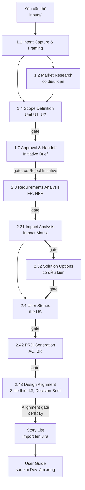
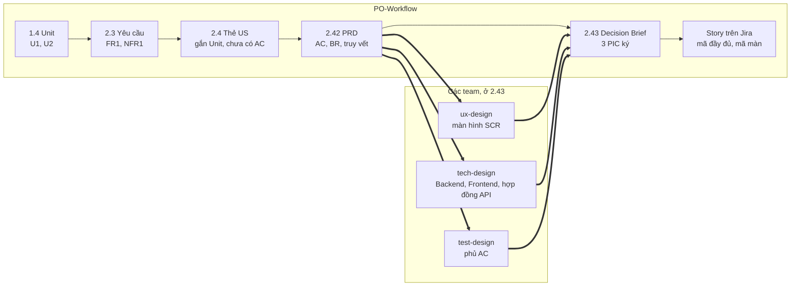

# PO-Workflow

PO-Workflow là quy trình để PO phân tích yêu cầu cùng AI, đi từ một yêu cầu thô tới PRD theo template chuẩn chung, sau đó bàn giao cho Design, Tech và QA theo một chuẩn chung. AI đọc tài liệu, đặt câu hỏi, soạn bản nháp và tự kiểm; PO trả lời, quyết định và duyệt ở cuối mỗi bước.

Khung phase, stage, gate và thuật ngữ tham khảo [AWS AI-DLC Workflows](https://github.com/awslabs/aidlc-workflows) bản 2.11, giới hạn trong hai phase thuộc phạm vi PO là Ideation và Inception. Quy trình viết bằng Markdown và một script Python, không cài engine của AWS. Engine không phụ thuộc sản phẩm và không phụ thuộc công cụ AI; dữ kiện của sản phẩm nằm trong domain pack.

| Tài liệu | Dành cho | Nội dung |
|---|---|---|
| README.md, file này | Mọi người | Phương pháp, từng stage, chuẩn bàn giao, mức độ sẵn sàng áp dụng |
| [USER-GUIDE.md](USER-GUIDE.md) | PO, các PIC | Thao tác hằng ngày |
| [GLOSSARY.md](GLOSSARY.md) | Mọi người | Thuật ngữ và họ mã |
| [DOMAIN-SETUP.md](DOMAIN-SETUP.md) | Người phụ trách quy trình | Đưa một sản phẩm mới vào quy trình |
| [engine/standards/](engine/standards/) | Design, Tech, QA | Nguyên tắc chia story, quy ước mã, quy tắc bàn giao, quyết định giao việc trên Jira |
| [AGENTS.md](AGENTS.md) | Công cụ AI | Luật làm việc cho AI; `CLAUDE.md` chỉ nhập lại file này |
| [CHANGELOG.md](CHANGELOG.md) | Người phụ trách quy trình | Phiên bản engine và cách nâng cấp |

## Mục lục

1. [Phạm vi, đầu ra và giá trị](#1-phạm-vi-đầu-ra-và-giá-trị)
2. [Nguyên lý nền](#2-nguyên-lý-nền)
3. [Quy trình](#3-quy-trình)
4. [Từng stage](#4-từng-stage)
5. [Kiểm tra chất lượng](#5-kiểm-tra-chất-lượng)
6. [Đầu ra chuẩn cho các phase sau](#6-đầu-ra-chuẩn-cho-các-phase-sau)
7. [Sau PRD](#7-sau-prd)
8. [Cấu trúc repo và nâng cấp](#8-cấu-trúc-repo-và-nâng-cấp)
9. [Mức độ sẵn sàng áp dụng](#9-mức-độ-sẵn-sàng-áp-dụng)
10. [Đối chiếu với AWS AI-DLC](#10-đối-chiếu-với-aws-ai-dlc)
11. [Phương pháp luận và quy tắc rút từ sự cố](#11-phương-pháp-luận-và-quy-tắc-rút-từ-sự-cố)
12. [Lịch sử và nguồn](#12-lịch-sử-và-nguồn)

## 1. Phạm vi, đầu ra và giá trị

### Phạm vi

Một yêu cầu là một intent, lưu tại `intents/<YYMMDD-slug>/`. Intent đi qua 10 stage chia làm 2 phase. Ideation xác định vấn đề và phạm vi; Inception chuyển phạm vi thành yêu cầu, phân tích ảnh hưởng lên hệ thống đang chạy, đề xuất và chọn phương án giải pháp, chia user story, viết PRD chi tiết, sau đó các team thiết kế từ PRD và thống nhất trên Decision Brief. Mỗi stage sinh một artifact và kết thúc bằng một gate do PO duyệt.

Phần lớn sản phẩm dùng quy trình này đã có người dùng và dữ liệu. Vì vậy quy trình dành nhiều công sức cho việc xác định tính năng mới chạm tới những gì đang chạy, trước khi viết chi tiết.

### Đầu ra bàn giao

Đầu ra bàn giao gồm 5 loại. Mọi artifact khác là bản phân tích nội bộ của PO.

| Đầu ra | Người nhận | Khi nào |
|---|---|---|
| Initiative Brief | Người quyết định đầu tư | Cuối Ideation, profile L |
| PRD | Design, Dev, QA | Khi 2.42 được duyệt; các team thiết kế từ bản này |
| Decision Brief | Design PIC, Tech PIC, QA PIC, PO | Sau khi các team viết thiết kế, profile M và L |
| Story List để import lên Jira, mỗi user story một dòng | Design, Tech, QA | Sau gate 2.43; profile S thì sau khi PRD được duyệt |
| User Guide | Người dùng cuối | Sau khi Dev làm xong |

Ngoài phạm vi: thiết kế kỹ thuật chi tiết, cách Dev chia việc và triển khai trong phase Construction, vận hành sau phát hành.

### Giá trị của quy trình

Mỗi giá trị dưới đây gắn với một cơ chế cụ thể của quy trình. Cột cuối ghi bằng chứng hiện có, theo đánh giá ở mục 9. Quy trình mới được áp dụng cho 1 PO trên 1 sản phẩm, nên phần lớn giá trị hiện dựa trên thiết kế và chưa được đo lường.

| Giá trị | Cơ chế | Bằng chứng hiện có |
|---|---|---|
| PO tập trung vào phân tích và ra quyết định | AI đọc tài liệu, đặt câu hỏi và soạn artifact theo template; PO trả lời và duyệt tại gate. Lời duyệt phải có trong lượt nhập của PO; AI không tự duyệt được | 3 intent đã áp dụng; 2 PRD đã được duyệt |
| AI đảm nhận phần phân tích nghiệp vụ | Tra cứu knowledge base của sản phẩm trước khi đặt câu hỏi, rà soát ảnh hưởng theo 12 vùng, đối chiếu corner checklist; AI Reviewer đánh giá độc lập và không thấy nội dung hội thoại | Mục 11 ghi các lỗi phát sinh khi áp dụng thực tế và quy tắc được bổ sung để ngăn từng lỗi |
| Tính nhất quán từ yêu cầu tới kiểm thử | Mã định danh ổn định cho FR, US, BR, AC; mỗi US có tiêu chí chấp nhận cho nhánh lỗi; QA lập kế hoạch kiểm thử phủ từng AC; story trên Jira và test case trỏ về mã đầy đủ | Script `trace` và `dor` kiểm tra được; chưa có test case nào của QA áp dụng chuẩn này |
| Quy trình được chuẩn hoá và đóng gói để dùng chung | Engine tách khỏi domain pack; có hướng dẫn dựng domain, lệnh nâng cấp engine và 124 ca kiểm thử tự động cho chính quy trình | Chưa áp dụng cho sản phẩm thứ hai; mục 9 khuyến nghị chưa mở rộng sang team khác trước khi đạt mức team và liên team |
| Quyết định được lưu giữ khi chuyển giao người phụ trách | `decisions.md` ghi nguyên văn quyết định, người quyết định và thời điểm; `/po-replay` tóm lược diễn biến của intent cho người tiếp nhận | Hai intent thí điểm giữ đầy đủ quyết định qua hai lần nâng cấp engine |
| Ảnh hưởng lên hệ thống hiện hành được đánh giá trước khi đặc tả | Phân tích ảnh hưởng thực hiện trước khi chọn giải pháp; nguồn sống như schema, API spec được đọc lại khi intent chạm tới vùng liên quan | Một intent phát hiện 4 rule trong knowledge base không khớp với hệ thống |
| Các team rà soát và thống nhất trong một vòng | Các team thiết kế từ PRD chi tiết, mỗi team một file; AI tổng hợp các điểm cần quyết định vào Decision Brief cho buổi họp quyết định | Luồng áp dụng từ 20/10/2026, chưa có intent nào hoàn thành |
| Thay đổi yêu cầu được kiểm soát | Change request quay về đúng stage bị ảnh hưởng và lưu bản đã duyệt trong `archive/`; Story List mới được so sánh với bản trước và liệt kê các story thay đổi | Một intent thí điểm ghi nhận 14 change request, mỗi change request có trạng thái và quyết định kèm theo |

### Điểm khác biệt so với việc dùng trực tiếp AI hội thoại

Bảng sau so sánh PO-Workflow với cách PO dùng trực tiếp một công cụ AI hội thoại để soạn PRD.

| Khía cạnh | Dùng trực tiếp AI hội thoại | PO-Workflow |
|---|---|---|
| Hiểu biết về hệ thống hiện hành | AI suy luận từ kiến thức chung | Đọc knowledge base của sản phẩm, phân tích ảnh hưởng, đọc lại nguồn sống |
| Xử lý thông tin còn thiếu | AI có xu hướng tự bổ sung cho đủ nội dung | Ghi `❓PO` hoặc câu hỏi chặn và dừng chờ PO trả lời |
| Lưu vết quyết định | Phân tán trong lịch sử hội thoại | Ghi nguyên văn kèm người quyết định và thời điểm; AI không tự duyệt |
| Kiểm soát chất lượng trước khi bàn giao | PO tự rà soát | Script kiểm tra, checklist có điều kiện chặn, AI Reviewer đánh giá độc lập |
| Truy vết từ yêu cầu tới kiểm thử | Cấu trúc khác nhau giữa các lần soạn | Mã định danh ổn định, Story List import trực tiếp lên Jira, test case trỏ về mã |
| Thay đổi yêu cầu | Soạn lại hoặc sửa thủ công | Change request quay về đúng stage, lưu bản đã duyệt |
| Chuyển giao người phụ trách | Mất bối cảnh | Hồ sơ intent đầy đủ, `/po-replay` tóm lược diễn biến |

## 2. Nguyên lý nền

Mọi quy tắc trong quy trình xuất phát từ 7 nguyên lý. Gặp một quy tắc chưa rõ lý do, tìm nguyên lý tương ứng ở bảng dưới.

| Nguyên lý | Ý chính | Áp vào quy trình | Nguồn |
|---|---|---|---|
| Human-in-the-loop | AI đề xuất, PO quyết định | Gate cuối mỗi stage; lời duyệt ghi nguyên văn vào `decisions.md` | AWS AI-DLC; Paul Fitts, 1951 |
| Requirements Engineering | Khơi gợi, phân tích, đặc tả, xác nhận là bốn việc tách biệt; BABOK v3 tách thêm kiểm chứng chất lượng (7.2) khỏi xác nhận với mục tiêu (7.3) | Questions file, phân tích yêu cầu và ảnh hưởng, PRD, checklist và AI Reviewer | IREB CPRE, Wiegers; BABOK v3 |
| Context Engineering | AI làm tốt khi được nạp đúng và đủ thông tin | Bước Load đầu mỗi stage đọc domain pack, nhật ký quyết định, bài học | Anthropic, 2025 |
| Quality Gate | Mỗi đầu ra là nền cho đầu ra sau, nên phải được kiểm trước khi đi tiếp | Script kiểm, checklist có mục chặn, AI Reviewer, năm lựa chọn tại gate | Stage-Gate, Robert G. Cooper, 1986 |
| Iterative Refinement | Chi tiết tăng theo mức chắc chắn | Profile S, M, L; thẻ user story trước, PRD chi tiết sau, thiết kế của các team sau PRD | PMBOK, progressive elaboration |
| Requirement Traceability | Yêu cầu, user story, rule, tiêu chí chấp nhận truy được về nhau và về nguồn | Mã ổn định, thẻ nguồn, bảng truy vết, mã đầy đủ khi bàn giao | Gotel và Finkelstein, 1994; ISO/IEC/IEEE 29148 |
| Responsible AI | AI không tự điền khi thiếu thông tin; người chịu trách nhiệm cuối | Ký hiệu `❓PO`, đọc lại nguồn sống, chỉ đăng bản đã duyệt | NIST AI RMF 1.0, 2023 |

Từ các nguyên lý trên, quy trình rút ra 4 quy tắc làm việc áp cho mọi stage:

- AI không tự điền dữ kiện. Thiếu thông tin nhỏ thì ghi giả định; thiếu thông tin làm đổi phạm vi, rule, dữ liệu hoặc luồng thì ghi câu hỏi mở và dừng; ô không suy ra được thì đánh dấu `❓PO`.
- AI dừng ở mức phân tích. Cần biết một cơ chế kỹ thuật có tồn tại hay không thì hỏi PO. Có endpoint trong API spec không có nghĩa là tính năng còn hoạt động.
- Knowledge base là bản chụp. Schema dữ liệu, API spec, tài liệu người dùng là nguồn sống; yêu cầu chạm tới vùng nào thì đọc lại nguồn vùng đó, và quá 30 ngày kể từ lần đối chiếu cuối cũng phải đọc lại.
- Câu trả lời và quyết định của PO được ghi nguyên văn. AI tra nhật ký quyết định trước khi hỏi để không hỏi lại.

### Nghiệp vụ và năng lực của PO theo BABOK v3 và Scrum Guide

Quy trình dùng hai chuẩn để soát độ phủ nghiệp vụ của PO: BABOK v3 của IIBA cho công việc phân tích yêu cầu, và Scrum Guide 2020 cho trách nhiệm của PO với backlog. Kỹ thuật cụ thể như phỏng vấn, khung ưu tiên, cách viết user story lấy từ knowledge pack vai Product của AWS AI-DLC trong `engine/knowledge/`.

BABOK v3 chia công việc phân tích thành 6 nhóm nghiệp vụ. Bảng sau cho biết quy trình đáp ứng từng nhóm ở stage nào.

| Nhóm nghiệp vụ theo BABOK v3 | Việc chính | Trong PO-Workflow | Mức đáp ứng |
|---|---|---|---|
| Lập kế hoạch và giám sát | Chọn cách tiếp cận, xác định cách làm việc với các bên liên quan, quản trị quyết định, quản lý thông tin, cải tiến cách làm | Profile S, M, L chọn độ sâu cho từng yêu cầu; gate và `decisions.md` là khung quản trị quyết định; cấu trúc intent quản lý thông tin; bài học ghi lại tại gate | Một phần: phân tích các bên liên quan có mức ảnh hưởng và thái độ (3.2); go/no-go ở 1.7 vẫn do PO duyệt, người quyết cuối chỉ ghi ở `intent.md` (3.3); cải tiến quy trình qua bài học, chưa có số đo (3.5) |
| Khơi gợi và cộng tác | Chuẩn bị và tiến hành khơi gợi, xác nhận kết quả, truyền đạt thông tin, cộng tác với các bên liên quan | Tra knowledge base trước khi hỏi; file câu hỏi gắn người trả lời; bước tóm tắt để PO xác nhận; buổi họp với Design, Tech, QA trên Decision Brief | Có |
| Phân tích chiến lược | Phân tích hiện trạng, xác định trạng thái mong muốn, đánh giá rủi ro, xác định chiến lược thay đổi | 1.1 vấn đề, hiện trạng và mục tiêu SMART; 1.2 so sánh với sản phẩm khác; 1.4 phạm vi và Unit; sổ rủi ro mã `RK` trong `decisions.md`; 1.7 Initiative Brief với khuyến nghị đi tiếp hay dừng | Có; 1.2 chạy khi cần |
| Phân tích yêu cầu và định nghĩa thiết kế | Đặc tả và mô hình hoá yêu cầu, kiểm chứng và xác nhận yêu cầu, xác định phương án giải pháp, phân tích giá trị và đề xuất giải pháp | 2.3 yêu cầu chức năng theo mẫu EARS và phi chức năng; 2.31 phân tích ảnh hưởng; 2.32 so sánh phương án có trọng số, luôn có phương án giữ nguyên; 2.4 user story; 2.42 PRD với business rule theo BABOK 10.9, ma trận quyền, tiêu chí chấp nhận Given/When/Then, sơ đồ trạng thái; checklist chất lượng theo 7.2 và AI Reviewer | Có; 2.32 chạy khi có nhiều hướng giải |
| Quản lý vòng đời yêu cầu | Truy vết, duy trì, sắp ưu tiên, đánh giá thay đổi, phê duyệt yêu cầu | Mã ổn định và bảng truy vết; dòng Ưu tiên của từng user story; change request được đánh giá và PO quyết Nhận, Hoãn hoặc Bác trước khi sửa; duyệt tại gate; bản duyệt lưu trong `archive/` và gắn tag | Có |
| Đánh giá giải pháp | Đo hiệu quả của giải pháp sau khi đưa vào sử dụng, phân tích hạn chế, đề xuất hành động | Tiêu chí thành công có giá trị hiện tại, mục tiêu, thời điểm đo; `/po-evaluate` đo lại sau phát hành, phân tích hạn chế của giải pháp và của tổ chức, PO quyết hành động | Có, từ ngày 20/10/2026; chưa chạy thật lần nào |

BABOK v3 cũng nêu 6 nhóm năng lực nền. Quy trình hỗ trợ PO thể hiện các năng lực này một cách nhất quán; phần đánh giá và quyết định vẫn do PO đảm nhận.

| Năng lực nền theo BABOK v3 | Nội dung | Quy trình hỗ trợ bằng |
|---|---|---|
| Tư duy phân tích và giải quyết vấn đề | Tư duy hệ thống, ra quyết định, giải quyết vấn đề | Tách vấn đề khỏi giải pháp ở 1.1; phân tích ảnh hưởng theo 12 vùng ở 2.31; so sánh phương án theo 7 tiêu chí ở 2.32; corner checklist của sản phẩm |
| Phẩm chất cá nhân | Đạo đức nghề nghiệp, trách nhiệm cá nhân, sự tin cậy, tổ chức công việc | Quyết định ghi nguyên văn kèm người quyết định và thời điểm; AI không tự duyệt; `state.md` ghi việc kế tiếp và người thực hiện |
| Kiến thức nghiệp vụ | Hiểu ngành, tổ chức và giải pháp đang có | Knowledge base của sản phẩm trong domain pack; đọc lại nguồn sống như schema, API spec khi yêu cầu chạm tới |
| Kỹ năng giao tiếp | Viết, trình bày, lắng nghe | Template thống nhất cho mọi artifact; Decision Brief tối đa 1.500 từ; văn phong bàn giao có mã kèm nội dung |
| Kỹ năng tương tác | Điều phối, thuyết phục, làm việc nhóm, thương lượng và giải quyết bất đồng | File câu hỏi gắn người trả lời; buổi họp thống nhất trên Decision Brief; ý kiến phản đối được chép nguyên văn |
| Công cụ và công nghệ | Công cụ văn phòng, công cụ phân tích, công cụ giao tiếp | Claude Code, script kiểm tra, Git, Jira qua import CSV |

Scrum Guide 2020 giao cho PO 4 trách nhiệm với backlog. PO có thể giao việc cho người khác nhưng vẫn chịu trách nhiệm cuối.

| Trách nhiệm của PO theo Scrum Guide 2020 | Trong PO-Workflow |
|---|---|
| Xây dựng và truyền đạt rõ mục tiêu sản phẩm | Mục tiêu đo được của từng intent ở 1.1; định hướng sản phẩm trong knowledge base của domain pack; Initiative Brief ở 1.7 |
| Tạo và truyền đạt rõ các hạng mục backlog | PRD và Story List import lên Jira; mỗi story có tiêu chí chấp nhận và business rule có mã |
| Sắp thứ tự các hạng mục backlog | MoSCoW cho Unit ở 1.4; dòng Ưu tiên của từng user story chuyển thành Priority trên Jira |
| Bảo đảm backlog minh bạch, dễ thấy và được hiểu | Repo là nguồn chính thức, bản duyệt có tag git; `intents/INDEX.md`; Decision Brief cho các team |

Kỹ thuật theo thực hành ngành mà AI dùng, lấy từ knowledge pack trong `engine/knowledge/`:

| Nhóm kỹ thuật | Kỹ thuật | Stage dùng |
|---|---|---|
| Khơi gợi yêu cầu | Phỏng vấn, workshop, quan sát, phân tích tài liệu, prototype | 1.1, 2.3 |
| Nghiên cứu thị trường | Phân tích đối thủ, SWOT, build vs buy, ước lượng thị trường | 1.2 |
| Sắp ưu tiên | MoSCoW, WSJF, RICE, Kano | 1.4, 2.4 |
| Sản phẩm | Persona, MVP, story mapping | 1.1, 1.4, 2.4 |
| User story | INVEST, cách tách story, Given/When/Then, Definition of Ready | 2.4, 2.42 |

## 3. Quy trình

### 3.1 Sơ đồ



### 3.2 10 stage

Số stage 1.1, 1.2, 1.4, 1.7, 2.3, 2.4 giữ theo AWS. 4 stage do PO-Workflow thêm mang số thập phân để xếp vào giữa: 2.31 và 2.32 sau 2.3, 2.42 và 2.43 sau 2.4. Số 2.41 từng dùng cho HLD Brief, đã bỏ ngày 20/10/2026 và không dùng lại. Định danh của stage là slug, ví dụ `impact-analysis`; số chỉ để hiển thị thứ tự. Các stage AWS giao cho kiến trúc sư, delivery, design hoặc developer, như 1.3, 1.5, 1.6, 2.1, 2.2 và 2.5 tới 2.9, không có trong repo này.

| Stage | Mục đích | Artifact chính | Profile | Nguồn |
|---|---|---|---|---|
| 0 Khởi tạo | Dựng thư mục intent, cấp mã tính năng, chọn profile | `intent.md`, `state.md`, `decisions.md` | mọi profile | AWS Initialization |
| 1.1 Intent Capture & Framing | Xác định vấn đề, mục tiêu đo được, stakeholder; tách giải pháp người yêu cầu đề xuất khỏi vấn đề | `intent-statement.md` | M, L | AWS |
| 1.2 Market Research | So sánh với sản phẩm khác theo khía cạnh đã chọn | `competitive-analysis.md` | L, có điều kiện | AWS |
| 1.4 Scope Definition | Chốt In, Out, Potential; chia nhu cầu thành Unit có ưu tiên | `scope-document.md` | M, L | AWS |
| 1.7 Approval & Handoff | Tóm tắt Ideation thành một trang để quyết định đi tiếp hay dừng | `initiative-brief.md` | L | AWS |
| 2.3 Requirements Analysis | Chuyển phạm vi thành yêu cầu có mã; tra KB tìm trùng lặp và rule chi phối | `requirements.md` | S, M, L | AWS |
| 2.31 Impact Analysis | Xác định phần nào của hệ thống đang chạy bị ảnh hưởng; tìm conflict | `impact-matrix.md` | M, L | PO-Workflow |
| 2.32 Solution Options | So sánh các hướng giải theo bảy tiêu chí | `solution-options.md` | L, có điều kiện | PO-Workflow |
| 2.4 User Stories | Chia yêu cầu thành user story; mỗi US một thẻ chín mục đủ để viết PRD | `stories.md` | M, L | AWS |
| 2.42 PRD Generation | PRD theo template chuẩn, chi tiết từng US, có tiêu chí chấp nhận, trường hợp ngoại lệ, yêu cầu chuyển đổi và truy vết | `prd.md` | S, M, L | PO-Workflow |
| 2.43 Design Alignment | Ba team viết thiết kế từ PRD; AI đối chiếu và viết Decision Brief; họp, 3 PIC ký | `decision-brief.md` | M, L | PO-Workflow |

Mỗi file stage trong `engine/stages/` có bảng metadata với hàng "Lệch so với AWS", ghi điểm khác với stage cùng số của AWS. 2 stage gốc được điều chỉnh: 1.4 gộp intent backlog vào scope-document, và 2.4 không viết acceptance criteria, không chạy nhiều agent cùng góp ý.

### 3.3 Profile và depth

Khi tạo intent, AI quét nhanh và đề xuất profile kèm lý do; PO có quyền đổi. Phân vân giữa hai profile thì chọn profile lớn hơn.

| Profile | Độ lớn và độ phức tạp | Stage chạy | AI Reviewer | Số gate |
|---|---|---|---|---|
| S | Một màn, không đổi data model, không đổi rule có sẵn, không chạm module khác, không chạm tính năng ẩn, không tích hợp ngoài, không migration | 2.3 và 2.42, PRD rút gọn | 2.42 | 2 |
| M | Tối đa hai module, thêm field nhưng không đổi quan hệ bảng, không conflict, hướng giải đã rõ | 1.1 và 1.4 duyệt chung, 2.3, 2.31, 2.4, 2.42, 2.43 | 2.3, 2.4, 2.42 | 6 |
| L | Có ít nhất một yếu tố: từ ba module, đổi data model, conflict với rule hiện có, chạm tính năng ẩn, nhiều hướng giải, tích hợp ngoài, migration, thao tác không hoàn tác được | Đủ 10 stage; 1.2 và 2.32 khi cần | 1.1, 2.3, 2.4, 2.42 | 8 đến 10 |

Depth quyết định mức chi tiết của artifact. Template đánh dấu mục tuỳ chọn bằng `<!-- tuỳ chọn -->`; mục không có dấu là bắt buộc.

| Depth | Mục bắt buộc | Mục tuỳ chọn |
|---|---|---|
| Minimal | Viết ngắn, chỉ điều đã quyết | Bỏ |
| Standard | Viết đủ | Viết khi có nội dung |
| Comprehensive | Viết đủ | Viết toàn bộ, mục không áp dụng ghi lý do |

### 3.4 Chuỗi đầu ra

Các artifact sinh ra theo thứ tự: Unit ở 1.4, FR ở 2.3, user story ở 2.4, acceptance criteria và business rule trong PRD ở 2.42, sau đó ba file thiết kế của các team và Decision Brief ở 2.43. Các team thiết kế từ PRD chi tiết, vì định hướng ngắn không đủ để làm Technical Design, Test Design và UI/UX Design. PRD chỉ chứa yêu cầu; thiết kế nằm ở file của từng team.



Unit trong PO-Workflow là nhóm user story theo giá trị và ưu tiên; AWS gọi khái niệm này là proto-Unit. Dev chia việc của mình trong phase Construction theo kiến trúc, có thể khác cách nhóm của PO.

### 3.5 Bảy bước của một stage

Mọi stage chạy cùng 7 bước, định nghĩa một lần trong `engine/protocol/stage-protocol.md`.

| Bước | AI làm | PO làm |
|---|---|---|
| 1. Load | Đọc trạng thái, quyết định cũ, artifact đầu vào, KB, bài học | |
| 2. Ask | Viết questions file: mỗi câu gắn người trả lời, tối đa bốn lựa chọn, có đề xuất kèm nguồn và cờ chặn | Trả lời |
| 3. Confirm | Tóm tắt câu trả lời | Xác nhận hoặc yêu cầu sửa |
| 4. Generate | Viết artifact theo template, thẻ nguồn ở mỗi khẳng định; ở 1.1 và 2.3 trình giả định để PO chấp nhận hoặc chuyển thành câu hỏi | Xác nhận giả định |
| 5. Verify | Chạy script kiểm, checklist, gọi AI Reviewer theo profile | |
| 6. Learn | Ghi quan sát vào `memory.md` của intent | |
| 7. Gate | Trình thông điệp hoàn thành, hỏi bài học, hỏi duyệt; ghi chép bằng script | Chọn bài học, duyệt |

PO trả lời theo một trong ba cách, chọn một lần cho cả intent: Guide me qua hộp chọn, Edit file trực tiếp, hoặc Chat. Câu trả lời luôn được ghi vào questions file trước khi kết thúc lượt, để không mất khi phiên làm việc bị nén.

### 3.6 Gate và phiên bản

Tại gate, PO có 5 lựa chọn:

- Approve
- Request Changes, kèm nội dung cần sửa
- Accept as-is, từ lần Request Changes thứ ba, nhận bản hiện tại kèm điều kiện và lý do
- Add stage, chạy thêm một stage ngoài profile
- Reject Initiative, chỉ ở 1.7

AI hiểu lời duyệt viết bằng câu tự nhiên theo ý của PO. "Ok nhưng đổi tên trường X" là duyệt kèm chỉ thị: AI sửa trước, hỏi lại một câu, ghi Approve khi PO trả lời. PO nhờ thêm một việc mà không nói duyệt thì gate vẫn mở. PO chọn nhầm thì AI ghi một dòng đính chính và trình lại gate.

Quyết định ở gate chỉ đến từ PO, theo cách AWS giữ bước kiểm có người thật ở mọi scope. Hook của Claude Code ghi mỗi lượt PO gõ hoặc chọn vào `.po/turns.jsonl`. Lệnh approve chỉ ghi khi lời duyệt có nguyên văn trong một lượt của PO được ghi sau lần sửa artifact cuối. Nếu kiểm máy còn cảnh báo, hoặc stage có reviewer mà artifact đổi sau review, approve đòi thêm lời chấp nhận của PO. Câu chặn chưa trả lời, GAP hoặc ORPHAN của truy vết, mã có ở bản duyệt trước mà bản mới không còn thì một lời chấp nhận chung không đủ: PO quyết riêng từng mục, lời PO phải nêu từng mã. Hook cũng chặn AI tự đánh dấu đã duyệt, sửa artifact đã duyệt, sửa dòng quyết định cũ, và tự làm năm việc mà AWS chỉ cho engine làm: bỏ qua stage, đổi profile, tắt reviewer hay nghi thức khác, đổi trạng thái change request, mở lại stage đã duyệt. Năm việc này đi qua lệnh `skip`, `profile`, `switch`, `cr`, `reopen` của `po-tools.py`, đòi lời PO trong 3 lượt gần nhất và ghi DEC. Công cụ không có hook thì PO tự chạy các lệnh này trong terminal.

Sau Approve, lệnh `po-tools.py approve` làm toàn bộ phần ghi chép: đặt phiên bản, chụp bản duyệt vào `archive/`, ghi quyết định nguyên văn kèm tên người quyết định và giờ, đổi trạng thái stage, in dòng tiến độ và stage kế. Bản nháp mang phiên bản 0.x. Lần duyệt đầu là 1.0. Mỗi lần duyệt lại sau change request tăng số phụ, 1.0 thành 1.1. Bản trong `archive/` không bao giờ bị sửa.

## 4. Từng stage

### 0 Khởi tạo, lệnh /new-intent

AI dựng cây thư mục intent từ template và cấp mã tính năng dạng `<mã sản phẩm>-F<NNN>`. Mã sản phẩm lấy từ `domain/domain.md`. Nếu chưa có mô tả yêu cầu, AI đặt sẵn mẫu `inputs/request.md` để người yêu cầu điền: hiện trạng, điều muốn thay đổi, trong và ngoài phạm vi, điều không được thay đổi, mốc, câu hỏi mở. AI quét nhanh inputs và KB để ước lượng vùng bị chạm, đề xuất profile và ghi quyết định profile thành `DEC1`.

### 1.1 Intent Capture & Framing

AI tách giải pháp người yêu cầu nêu sẵn khỏi vấn đề. "Thêm nút export" là giải pháp; vấn đề có thể là "không lấy được dữ liệu để đối chiếu". Câu hỏi xoay quanh vấn đề theo góc nhìn người dùng, cách xử lý hiện tại, tiêu chí đo thành công, lý do làm lúc này, stakeholder và phạm vi loại trừ. Artifact `intent-statement.md` có thẻ nguồn ở mọi khối khẳng định và mục Assumptions & Open Questions.

### 1.2 Market Research

Stage có điều kiện, chỉ chạy khi PO muốn so sánh với sản phẩm khác, hoặc khi cách làm phổ biến trên thị trường ảnh hưởng tới phạm vi. Danh sách sản phẩm so sánh mặc định ghi trong `domain.md`. AI trích nguồn kèm link và ngày đọc, không suy diễn tính năng từ tên menu. Artifact gồm bảng so sánh, điểm nên và không nên áp dụng, và đối chiếu với yêu cầu hiện tại.

### 1.4 Scope Definition

AI phân loại In, Out, Potential và chia nhu cầu thành Unit, mã `U1`, `U2`, sắp theo MoSCoW. Bốn quy tắc chia: theo cơ chế thay vì theo màn hình; xác định hạng mục nền; tách riêng hạng mục chạm toàn hệ thống như phân quyền, bật tắt, lịch sử; phụ thuộc một chiều. Hạng mục Won't vẫn được định nghĩa để bước phân tích ảnh hưởng quét đúng. Profile M duyệt 1.1 và 1.4 chung một gate và chạy phase check Ideation tại gate đó.

### 1.7 Approval & Handoff

AI tóm tắt phase thành Initiative Brief một trang: vấn đề và mục tiêu, phạm vi, Unit và ưu tiên, rủi ro lớn, quyết định đã đưa ra, khuyến nghị đi tiếp hay dừng. Đây là gate duy nhất có lựa chọn Reject Initiative. Trước gate, AI kiểm ranh giới phase: mọi mục tiêu có hạng mục phục vụ, mọi Unit truy về một mục tiêu, Out of scope không mâu thuẫn In scope, câu hỏi chặn đã đóng.

### 2.3 Requirements Analysis

AI tra KB cho từng hạng mục trước khi hỏi: đã có chưa, rule nào chi phối, có tính năng ẩn liên quan không, thông báo nào liên quan, có rơi vào vùng KB chưa phủ không. AI nêu ngay yêu cầu trùng tính năng đã có, kèm mã KB. Sau đó AI quét sáu chiều theo AWS và corner checklist của domain để tìm phần thiếu. Artifact `requirements.md` có FR mã `FR1`, `FR1.1` với ưu tiên và cờ Existing, New, Changed; NFR khi đo được; constraints; câu hỏi mở `OQ1`; out of scope; nguồn đã đọc. FR mô tả điều phải đúng, không nói tới bảng, endpoint hoặc thuật toán.

### 2.31 Impact Analysis

Thay vì đặt câu hỏi, AI dựng Related Features Map từ requirements, KB, schema và API spec để PO rà soát; nhận ra phần thiếu trong bản nháp dễ hơn liệt kê từ đầu. Sau khi PO xác nhận bản đồ, AI dựng Impact Matrix theo năm bước: hiện trạng và phụ thuộc, trạng thái mong muốn, ma trận 12 vùng, chuyển đổi dữ liệu, các câu kiểm theo `domain.md`. Conflict theo bốn chiều rule, process, data, permission được chuyển cho PO quyết định, mỗi conflict một DEC. Ảnh hưởng được xét hai chiều, cả từ tính năng mới sang phần cũ và ngược lại.

### 2.32 Solution Options

Stage có điều kiện, chạy khi có từ hai hướng giải hoặc PO chưa có hướng. AI dựng option từ các hướng khác nhau: đổi quy trình, cấu hình, mở rộng tính năng có sẵn, làm mới, cắt phạm vi. Mọi option được so theo bảy tiêu chí: phù hợp nghiệp vụ, tác động người dùng, tác động hệ thống và dữ liệu, effort, risk, phụ thuộc, nợ đóng cứng. Effort và risk ghi Cao, Trung bình, Thấp kèm lý do, không ước lượng số giờ.

### 2.4 User Stories

AI chia yêu cầu thành user story, mỗi US gắn một Unit và mỗi FR có US phủ. Mỗi US có một thẻ chín mục: vai và mục tiêu, bối cảnh, luồng chính, nhánh đáng kể, rule đã biết, dữ liệu và vùng chạm, ngoài phạm vi, phụ thuộc, chưa rõ. Thẻ đủ để PO viết PRD chi tiết mà không cần mở lại requirements; thẻ chưa có acceptance criteria. Các PIC không xem thẻ ở bước này; họ đọc PRD chi tiết một lần ở 2.43. Script truy vết kiểm FR chưa có US và US không truy về FR.

### 2.42 PRD Generation

Bước hỏi là Field Intake: AI tra Impact Matrix, data model, API spec và KB, phân loại mỗi màn là mới, sửa màn có sẵn hoặc chỉ đọc, sau đó lập một bảng field, rule, validate để PO duyệt. Với field hiện có, AI chỉ hỏi phần thay đổi. Profile S cũng phải qua bước này.

PRD theo template chuẩn `engine/templates/prd.md`, dùng chung cho mọi sản phẩm. Cơ sở của từng mục và bảng ánh xạ từ template công ty cũ ở `engine/standards/adr/0004-template-prd-chuan.md`: template lấy thành phần từ các artifact của AWS AI-DLC, ISO/IEC/IEEE 29148, mẫu câu EARS, GitHub Spec Kit và bốn loại yêu cầu của BABOK. PRD có 11 mục: 1. Bối cảnh và mục tiêu; 2. Tiêu chí thành công đo được, mã `SC<n>`; 3. Ngoài phạm vi; 4. Giải pháp tổng thể; 5. Units; 6. Yêu cầu theo user story; 7. Yêu cầu phi chức năng; 8. Chuyển đổi và triển khai; 9. Giả định; 10. Câu hỏi mở; 11. Truy vết. Mục 1 tới 5 tóm tắt từ artifact đã duyệt. Mỗi US ở mục 6 có mười mục con: User story kèm ưu tiên, Tiền điều kiện, Luồng chính, Business rule mã `BR<US>.<n>` theo BABOK 10.9, có loại định nghĩa hay hành vi, rule dùng chung mã `BR0.<n>`, Tiêu chí chấp nhận mã `AC<US>.<n>`, Giao diện và validate, Dữ liệu, NFR riêng nếu có, Trường hợp ngoại lệ lấy từ coverage gap của Impact Matrix, Ngoài phạm vi của US. Một dữ kiện chỉ ghi ở một nơi: câu thông báo ở bảng giao diện, luật ở business rule, tiêu chí chấp nhận trỏ về hai nơi đó. Cách viết tiêu chí chấp nhận ở mục 6.5.

Sơ đồ theo `engine/standards/diagrams.md`. Tính năng có đối tượng đổi trạng thái thì PRD bắt buộc có Vòng đời trạng thái: bảng chuyển trạng thái là nguồn chính, sơ đồ trạng thái vẽ từ bảng, `po-tools.py check` so từng chuyển trạng thái giữa hai bên và báo trạng thái không tới được hoặc bị cụt. Sơ đồ phụ thuộc Unit khi có từ ba Unit, sơ đồ luồng khi luồng chính có từ hai điểm rẽ nhánh. Các artifact khác có sơ đồ ở chỗ phù hợp: luồng giá trị ở scope, sơ đồ phụ thuộc ở Impact Matrix, luồng màn ở ux-design. Sơ đồ viết bằng Mermaid ngay trong file: sơ đồ trạng thái dùng `stateDiagram-v2` theo ký pháp UML, sơ đồ luồng và phụ thuộc dùng `flowchart`. Cách làm theo AWS: bảng hoặc YAML là nguồn, sơ đồ là bản dẫn xuất để đọc.

PRD viết trước khi các team thiết kế. Với điểm phụ thuộc thiết kế hoặc kỹ thuật mà artifact đã duyệt chưa nói, AI ghi đề xuất có đánh dấu kèm câu hỏi gắn tên PIC; các team trả lời ở 2.43. Quy tắc cố định: không có mục Database và API, không thiết kế bảng hoặc thuật toán, hằng số ghi rõ là giá trị cứng hoặc cấu hình, field hiện có không mô tả như mới, không dấu vết quy trình, không viết tắt.

### 2.43 Design Alignment

Chạy ở profile M và L, sau khi PRD được duyệt. Design PIC, Tech PIC, QA PIC đọc PRD và viết ba file riêng trong intent: `inception/ux-design/ux-design.md` gồm danh sách màn có mã `SCR`, luồng, accessibility; `inception/tech-design/tech-design.md` gồm thành phần bị chạm ở cả Backend và Frontend, quyết định kỹ thuật, hợp đồng API giữa hai phía, dữ liệu và xử lý ở Backend, màn, component, trạng thái và validate ở Frontend, cách đáp ứng BR, NFR và TR, Unit of work và độ lớn; `inception/test-design/test-design.md` gồm chiến lược, kế hoạch phủ từng AC, vùng hồi quy. Mỗi file có mục Ý kiến về PRD với lập trường Đồng ý, Đề xuất sửa, Phản đối. AI của PO chỉ tạo khung file, không viết và không sửa nội dung.

AI đối chiếu ba file với PRD: script kiểm US có giao diện đã có màn chưa, AC đã có trong kế hoạch test chưa, US đã có trong thiết kế kỹ thuật chưa, file có dựng từ bản PRD hiện tại không; AI xét thêm mâu thuẫn giữa các thiết kế, độ lớn so với mốc, ý kiến của các team. Kết quả là Decision Brief, tối đa 1.500 từ cho phần tổng hợp, chỉ ghi điểm cần người quyết định, kèm bảng Ký. Họp trên Decision Brief; quyết định đổi yêu cầu đi qua change request trên PRD. Gate là Alignment gate: Approve khi cả ba PIC ghi Đồng ý hoặc Có ý kiến; PIC quá hạn chưa ký thì PO được chọn Accept as-is kèm lý do. Story List chỉ sinh sau gate này. Quyết định chọn cách làm này và so sánh với AWS ghi ở `engine/standards/adr/0003-thiet-ke-cua-team-va-decision-brief.md`.

## 5. Kiểm tra chất lượng

Mỗi gate có hai lớp kiểm. Lớp thứ nhất do máy làm, lớp thứ hai cần phán đoán.

| Lớp | Công cụ | Kiểm gì |
|---|---|---|
| Máy | `po-tools.py check` | Heading bắt buộc theo template, thẻ nguồn, `[Qn]` và `[DECn]` có thật, thẻ US đủ chín mục, chữ mẫu còn sót, mục cấm trong PRD, mã AC không trùng, US thiếu Ưu tiên, chưa thấy AC nhánh lỗi; ở 2.43 thêm độ phủ của ba file thiết kế, giới hạn từ và chữ ký của Decision Brief |
| Máy | `po-tools.py trace` | FR sang US, US sang FR, BR sang AC, US trong PRD; báo GAP và ORPHAN; dừng với lỗi khi không đọc được mã nào |
| Phán đoán | Checklist trong `engine/verification/` | Phần cần đọc hiểu; mục có nhãn BLOCK chưa đạt thì gate không mở |
| Phán đoán | AI Reviewer | Agent AI độc lập, không thấy hội thoại, dùng tiêu chí của Product Lead của AWS; kết luận READY hoặc NOT-READY với finding Critical, Major, Minor |
| Chặn | Hook `engine/scripts/po-hook.py` | Lời duyệt phải có trong lượt PO; AI không tự đánh dấu đã duyệt, không sửa artifact đã duyệt ngoài change request, không sửa dòng quyết định cũ; reviewer chỉ ghi file review của mình |

AI Reviewer chỉ nhận đường dẫn file và kết quả kiểm bằng máy. Trước khi gọi reviewer, `po-tools.py review-start` ghi dấu của artifact; artifact đổi sau mốc đó thì approve đòi review lại hoặc lời chấp nhận của PO. Từ lần review thứ hai, reviewer nhận sổ finding của stage thay cho file review cũ; finding PO đã chấp nhận rủi ro hoặc bác bỏ không bị chấm lại. READY khi không có Critical, và tối đa hai Major đã có cách xử lý rõ. Finding chỉ dựa trên sở thích chủ quan được xếp tối đa ở mức Minor. AI không tự sửa theo finding; PO quyết định sửa hoặc ghi Accepted risk.

Phase check chạy ở ranh giới phase: Ideation ở 1.7, hoặc ở gate chung của 1.1 và 1.4 với profile M; Inception ở gate cuối của phase, tức 2.43 với profile M, L và 2.42 với profile S. `po-tools.py status` phát hiện thêm artifact đã duyệt bị sửa ngoài change request, artifact dựa trên bản cũ của đầu vào, và nguồn KB quá hạn đối chiếu.

Dữ liệu kiểm thử của script nằm trong `engine/tests/fixtures/`: mỗi thư mục là một intent nhỏ dựng sẵn một tình huống, kèm `expected.txt` ghi lệnh cần chạy và kết quả đúng; `engine/tests/root/` là domain mẫu dùng chung, để kiểm thử không phụ thuộc domain đang cài. Thư mục này dành cho người giữ engine, PO không cần đọc. Lệnh `po-tools.py selftest` chạy lại toàn bộ sau mỗi lần sửa script hoặc file stage, đồng thời kiểm mọi lệnh đều có ca kiểm, tài liệu chỉ nhắc lệnh và đường dẫn có thật, VERSION khớp CHANGELOG. GitHub Actions chạy lệnh này trên Python 3.9 và bản mới nhất ở mỗi lần push. Quy trình sửa engine ở `AGENTS.md` mục Sửa engine.

## 6. Đầu ra chuẩn cho các phase sau

Đầu ra của PO là đầu vào của Design, Tech và QA. Mọi team dùng chung một cách chia story, một quy ước mã, một Story List để import lên Jira, và một điều kiện giao Dev. Chuẩn đầy đủ nằm trong `engine/standards/`; mục này tóm tắt.

### 6.1 Mỗi team nhận gì

| Team | Nhận | Ở đâu | Khi nào |
|---|---|---|---|
| Design | PRD với bảng UI để viết `ux-design.md`; Decision Brief để thống nhất; story trên Jira có mã màn | `inception/`, Jira | Từ khi PRD được duyệt |
| Tech, gồm Backend và Frontend | PRD, Impact Matrix, danh sách màn của ux-design để viết `tech-design.md`; Decision Brief; story trên Jira để chia Unit of work và sub-task | `inception/`, Jira | Từ khi PRD được duyệt |
| QA | PRD với tiêu chí chấp nhận có mã để viết `test-design.md`; Decision Brief; story trên Jira để gắn test case | `inception/`, Jira | Từ khi PRD được duyệt |
| Agent AI của Dev | PRD theo tag của bản đã duyệt; ba file thiết kế; bảng chỉ mục; story trên Jira | Repo, `intents/INDEX.md`, Jira | Sau gate 2.43; profile S sau gate 2.42 |

### 6.2 Checkpoint và giao Dev

PO làm việc với các team ở 2 mốc.

| Mốc | Khi nào | Đầu vào | Kết quả |
|---|---|---|---|
| Checkpoint | Stage 2.43, sau khi PRD được duyệt | PRD đã duyệt; ba file thiết kế của các team; Decision Brief | Họp trên Decision Brief, 3 PIC ký; cỡ story và thay đổi PRD được thống nhất |
| Giao Dev | Sau gate 2.43; profile S sau gate 2.42 | Story List import lên Jira | Story đạt điều kiện giao Dev, xem mục 6.7 |

Các team đọc PRD chi tiết một lần, thiết kế, sau đó giải quyết mọi điểm vướng mắc trên một tài liệu ngắn. Luồng trước đó họp trên HLD Brief trước khi có PRD. Luồng này bỏ từ ngày 20/10/2026 vì một bản định hướng ngắn không đủ để các team thiết kế; chi tiết ở ADR 0003.

### 6.3 Nguyên tắc chia story

Story là đơn vị nghiệm thu. Mỗi story là một việc người dùng làm trọn được và kiểm được bằng tiêu chí chấp nhận; mọi phần việc của Design, Tech, QA truy về story qua mã. PO chia story một lần ở 2.4. Story List sinh sau checkpoint giữ nguyên cách chia đó, mỗi US một story; các team dùng story để chia việc của mình và không chia lại story.

Nguyên tắc chia story nằm trong `engine/standards/story-splitting.md`, tóm tắt như sau:

1. Mỗi story là một mục tiêu hoàn chỉnh của một vai, đi trọn từ giao diện tới rule và dữ liệu, và đạt bộ tiêu chí INVEST.
2. Cách chia: dựng bản đồ story theo vai và bước trong hành trình người dùng; mỗi ô "vai và mục tiêu" là một story ứng viên.
3. Dấu hiệu quá lớn: tên có chữ "và" nối hai việc, hơn một vai hưởng giá trị, luồng hơn 7 bước, gồm cả cấu hình và sử dụng, chạm hơn 2 module, hơn 6 tiêu chí chấp nhận. Script cảnh báo 2 dấu hiệu: chữ "và" trong tên ở 2.4, và hơn 6 AC ở 2.42.
4. 8 cách tách, thử theo thứ tự: theo bước trong luồng, theo vai, theo biến thể nghiệp vụ, theo biến thể dữ liệu, theo thao tác xem tạo sửa xoá, luồng đơn giản trước, chạy được trước chạy nhanh sau, theo kênh.
5. Không chia theo màn hình, tầng kỹ thuật, từng business rule, việc kỹ thuật thuần hoặc người làm.
6. Mỗi story thuộc đúng một Unit.

Cỡ story được xác nhận ở checkpoint: Tech PIC ghi trong `tech-design.md` story nào quá lớn để làm trong một sprint; Decision Brief đưa ra họp; story cần tách thì đi qua change request trên PRD trước khi sinh Story List, phần tách ra nhận mã mới.

Mỗi team tự chia việc của mình từ story:

| Team | Chia việc theo | Quan hệ với story |
|---|---|---|
| Design | Màn hình, mã `SCR` | Một màn có thể phục vụ nhiều story |
| Dev | Unit of work, sau đó là sub-task trên Jira | Một Unit of work gồm một hoặc nhiều story; thiết kế kỹ thuật chi tiết làm theo Unit, trong tài liệu của Dev |
| QA | Tiêu chí chấp nhận | Mỗi tiêu chí chấp nhận có ít nhất một test case |

AWS AI-DLC làm tương tự: story ở 2.4, Unit of work ở 2.7 kèm bảng ghép Unit với story, thiết kế chi tiết ở 3.1 theo từng Unit. PO-Workflow giữ 6 cách tách của AWS và thêm 2 cách là theo vai và luồng đơn giản trước. Bảng so sánh đầy đủ ở mục 10 của `engine/standards/story-splitting.md`.

### 6.4 Mã chung

PRD và artifact của PO dùng mã ngắn để dễ đọc. Khi sinh Story List, script đổi sang mã đầy đủ có mã tính năng; từ đó mọi team chỉ dùng mã đầy đủ.

| Đối tượng | Mã đầy đủ | Ví dụ | Ai cấp |
|---|---|---|---|
| Tính năng | `<SP>-F<NNN>` | `APP-F012` | PO, khi tạo intent |
| User story | `US-<tính năng>-<NN>` | `US-APP-F012-01` | PO, ở 2.4 |
| Acceptance criteria | `AC-<tính năng>-<NN>.<n>` | `AC-APP-F012-01.1` | PO, ở 2.42 |
| Business rule | `BR-<tính năng>-<NN>.<n>` | `BR-APP-F012-01.2` | PO, ở 2.42 |
| Câu hỏi mở | `Q-<tính năng>-<NN>.<n>` | `Q-APP-F012-01.3` | Người hỏi |
| Màn hình | `SCR-<tính năng>-<NN>` | `SCR-APP-F012-02` | Design PIC |
| Test case | `TC-<tính năng>-<NNN>` | `TC-APP-F012-001` | QA PIC |
| Nhánh code | `<loại>/<key Jira>-<mô tả>` | `feat/LMS-123-lam-lai-bai-kiem-tra` | Dev |
| Commit | Trailer `Refs`, `Feature`, `Story`, `Implements` | `Implements: AC-APP-F012-01.1` | Dev |

Mã đã cấp không đổi và không dùng lại. Tách một story thì phần tách ra nhận số mới; AC chuyển đi nhận mã mới và dòng cũ ghi "chuyển sang", để test case trỏ mã cũ vẫn truy được tới mã mới. Chi tiết ở `engine/standards/id-conventions.md`.

Cách mã xuất hiện ở từng nơi nằm ở `engine/standards/naming-conventions.md`: frontmatter dùng chung với khoá `feature` và `inputs`, tên frame Figma bắt đầu bằng mã màn, nhánh mang key Jira, commit có trailer `Implements`, test tự động gắn tag mã AC, đặc tả API có trường `x-requirements`, file truy vết theo khuôn `traceability.json` của AWS. Nhờ vậy agent của từng team tìm được mọi file liên quan từ một mã bằng `git grep`, và khi PRD đổi thì liệt kê được chỗ phải sửa. Khi team dùng AWS AI-DLC, Spec Kit, Kiro hoặc OpenSpec, mã riêng của công cụ ghi kèm mã đầy đủ trong ngoặc trên cùng dòng, vì các công cụ đó không đọc được mã đầy đủ.

### 6.5 Tiêu chí chấp nhận trong PRD

Tiêu chí chấp nhận là hợp đồng giữa PO và QA. Business rule định nghĩa luật; bảng UI đặc tả màn hình; mỗi tiêu chí chấp nhận theo cấu trúc Given/When/Then, có đạt hoặc không đạt, viết theo hành vi người dùng thấy, và ghi rõ business rule mà nó kiểm. Cấu trúc này theo kỹ thuật Acceptance and Evaluation Criteria của BABOK (10.1) và cách viết tiêu chí của AWS; QA chuyển thẳng được thành kịch bản kiểm thử.

```
- AC1.1 Chặn tạo nhóm vượt số cấp tối đa · Theo BR1.3
  - Given một nhánh đang sâu 6 cấp, số cấp tối đa của tổ chức là 6
  - When người dùng tạo nhóm con dưới nhóm ở cấp 6
  - Then hệ thống không tạo nhóm và hiện câu thông báo của bảng giao diện
- AC1.2 Bỏ trống field bắt buộc · Theo bảng giao diện màn Tạo nhóm
  - Given người dùng đang ở màn Tạo nhóm
  - When người dùng bỏ trống một field bắt buộc và bấm Lưu
  - Then hệ thống báo lỗi ở field đó và không lưu
```

Độ phủ bắt buộc: luồng chính và mỗi nhánh đáng kể trong thẻ US có ít nhất một tiêu chí; mỗi US có ít nhất một tiêu chí cho nhánh lỗi hoặc bị từ chối, như AC1.1 ở trên, và mỗi ngưỡng số có tiêu chí ở giá trị biên, theo AWS requirements-guide; mỗi business rule có ít nhất một tiêu chí trỏ tới. Validate của cùng một màn gom thành một tiêu chí trỏ về bảng UI thay vì mỗi dòng bảng một tiêu chí, để số test case không tăng theo số field. Checklist của 2.42 chặn khi còn business rule chưa có tiêu chí chấp nhận hoặc US chưa có tiêu chí cho nhánh lỗi. Ở 2.43, QA PIC lập kế hoạch phủ từng tiêu chí trong `test-design.md` và ghi tiêu chí nào không kiểm thử được ở mục Ý kiến về PRD; Decision Brief đưa ra họp. AWS giao việc đánh giá tính kiểm thử được cho quality agent ở 2.4; PO-Workflow làm ở 2.43 vì tiêu chí chấp nhận viết ở PRD.

### 6.6 Story List

Sau khi PRD được duyệt (với profile M, L: sau gate 2.43), lệnh `/po-stories` sinh `intents/<intent>/stories/story-list-prd-v<phiên bản>.csv` theo mẫu import CSV của Jira, mỗi US trong PRD một dòng. PO import file này lên Jira; các team làm việc trên story Jira. Nội dung nghiệp vụ chỉ có một nguồn là PRD.

| Cột | Nội dung |
|---|---|
| Project key, Project name, Project type | Dự án Jira, lấy từ frontmatter `domain/domain.md` |
| Issue Type | `Story` |
| Summary | Tên user story |
| Priority | Từ dòng Ưu tiên của US trong PRD: Must thành Highest, Should thành High, Could thành Medium |
| Description | Mô tả, điều kiện trước, kịch bản, tiêu chí chấp nhận, giao diện và validate, business rule, dữ liệu, NFR, ngoài phạm vi, tham chiếu tới PRD, tag và mã màn lấy từ `ux-design.md`. Cú pháp Jira, mã đầy đủ |
| Epic Link | Mã Epic ở dòng Jira Epic của `intent.md`; nhiều Epic thì ghi `U2: <mã Epic>` để gán theo Unit |
| Labels, 3 cột | Mã tính năng, mã story, mã tính năng kèm Unit |
| Comment | Nguồn PRD và tag, kết quả điều kiện giao Dev, câu hỏi còn mở của story, nhắc Dev điền story point và thứ tự |

Trên Jira, Design gắn mã màn hình và link thiết kế, Tech gom story vào Unit of work, chia sub-task và ước lượng story point, QA viết test case trỏ về mã AC. Câu hỏi nghiệp vụ ghi bằng comment trên story; câu trả lời làm đổi PRD thì đi qua change request. Quy tắc đầy đủ ở `engine/standards/handoff-rules.md`.

### 6.7 Điều kiện giao Dev

Một story được giao cho Dev khi đạt đủ 7 điều kiện:

1. PRD đã duyệt.
2. Profile M, L: 2.43 Design Alignment đã duyệt, tức các team đã thiết kế và đã thống nhất trên Decision Brief.
3. US có ít nhất một tiêu chí chấp nhận.
4. Mọi business rule của US có ít nhất một tiêu chí chấp nhận trỏ tới.
5. US không còn `❓PO`, và Open Issues của PRD không còn câu chặn gắn với US đó.
6. US có bảng giao diện thì có màn trong `ux-design.md`; Story List lấy mã màn `SCR` từ đó.
7. Các US mà Pre-Condition yêu cầu phải xong trước cũng đạt các điều kiện trên.

Đây là bản hẹp phía PO của Definition of Ready của AWS. Hai mục còn lại của AWS là thiết kế đã được xem và story đã được ước lượng; Design và Dev làm hai việc này trên Jira. Lệnh `po-tools.py dor intents/<intent>` in story nào đạt, story nào chưa và vì sao; kết quả cũng ghi ở cột Comment của file CSV. Độ phủ test case do QA theo dõi trên Jira.

### 6.8 Phiên bản, tag và chỉ mục

Mỗi lần duyệt PRD hoặc Decision Brief, script in tên tag dạng `<intent>/prd-v1.0` hoặc `<intent>/decision-brief-v1.0`. PO commit artifact vừa duyệt, gắn tag và đẩy tag lên. File CSV của Story List commit cùng PRD với profile S, cùng Decision Brief với profile M, L. Lệnh `po-tools.py index --write` sinh `intents/INDEX.md` gồm mã tính năng, bản PRD đã duyệt, ngày duyệt, service bị chạm, tag, nơi đăng bản đọc nếu có và số story đạt điều kiện giao Dev. Agent AI của Dev, dù chạy trên công cụ nào, đọc PRD theo tag nên luôn lấy đúng bản đã duyệt. Bản đăng ra ngoài repo, nếu có, chỉ để đọc; không sửa ở đó để chép ngược về repo.

### 6.9 Khi yêu cầu thay đổi sau bàn giao

Thay đổi chạm stage đã duyệt đi qua `/change-request`. PRD được duyệt lại thành bản mới, ví dụ 1.1. `/po-stories` sinh file CSV mới và so với bản trước, in story nào đổi, story nào mới. PO sửa story đã import trên Jira theo danh sách đó, import riêng các story mới, và báo đúng PIC phải xem lại. Test case ghi bản PRD đã dùng khi chạy, để xác định kết quả còn đúng hay không.

### 6.10 Nơi lưu

File CSV lưu trong `intents/<intent>/stories/` của repo PO, mỗi phiên bản PRD một file. Việc chia và theo dõi nằm trên Jira, theo `engine/standards/adr/0002-story-tren-jira.md`. Các PIC cần quyền ghi repo để viết file thiết kế của mình và ký Decision Brief. Phần làm việc nội bộ của PO hiển thị với người có quyền đọc repo, nên trước khi mở quyền, PO rà thông tin nhạy cảm như tài khoản staging; workflow gitleaks quét mỗi lần đẩy lên.

## 7. Sau PRD

`/po-evaluate` chạy sau khi tính năng phát hành, theo thời điểm đo ghi ở PRD mục 2: hỏi số liệu thực tế của từng tiêu chí thành công, so với giá trị hiện tại và mục tiêu, tìm hạn chế của giải pháp và của tổ chức, PO quyết giữ nguyên, cải tiến, điều chỉnh vận hành hay quay lui. Đây là nhóm Đánh giá giải pháp của BABOK v3, chương 8.

Bản chính thức của mọi artifact là file trong repo: bản đã duyệt có tag git và bản chụp trong `archive/`. Engine không kèm công cụ đăng tài liệu ra wiki hay công cụ khác. Repo sản phẩm cần đăng bản đọc ra ngoài thì tự thêm lệnh riêng và ghi nơi đăng ở khoá `published` của frontmatter; `po-tools.py status` báo khi bản đăng lệch phiên bản với file.

`/change-request` phân loại thay đổi trước. Thay đổi nhỏ trong stage đang mở chỉ cần sửa và trình lại gate. Thay đổi chạm stage đã duyệt thì ghi `CR<n>` kèm nguyên văn, chụp artifact bị chạm với nhãn pre-CR, trình bảng ảnh hưởng, sau đó quay về stage thấp nhất bị sai lệch:

| Loại thay đổi | Quay về |
|---|---|
| Vấn đề, mục tiêu | 1.1 |
| Phạm vi | 1.4 |
| Yêu cầu mới | 2.3 |
| Ảnh hưởng mới | 2.31 |
| Hướng giải | 2.32 |
| Danh sách user story | 2.4 |
| Chi tiết user story | 2.42 |
| Thiết kế của các team, quyết định ở buổi họp | 2.43, PIC ký lại |

`/generate-user-guide` viết hướng dẫn cho người dùng cuối từ PRD đã duyệt, sau khi Dev làm xong, theo template và đích ghi trong domain pack. Sau đó AI cập nhật ngược KB với rule mới và field đã đổi, để lần phân tích ảnh hưởng sau không dựa trên dữ liệu cũ.

## 8. Cấu trúc repo và nâng cấp

| Thư mục | Nội dung | Thuộc về |
|---|---|---|
| `engine/` | Stage, lệnh, protocol, template, checklist, agent, script, chuẩn bàn giao, kiến thức vai PO | Engine |
| `domain/` | Domain pack: knowledge base của sản phẩm theo `engine/standards/domain-kb.md`, gồm manifest `domain.md`, các file KB, corner checklist | Sản phẩm |
| `intents/` | Hồ sơ từng yêu cầu | Sản phẩm |
| `memory/` | `team.md` bài học dùng chung; `project.md` bài học của sản phẩm | Cả hai |
| `.claude/` | Phần cấu hình riêng cho Claude Code: lối tắt cho các lệnh gạch chéo và cho AI Reviewer, trỏ tới file trong `engine/`; quyền và hook trong `settings.json` | Công cụ |
| `.po/` | Sổ lượt người và giờ chạy hook trên máy đang dùng; không commit | Công cụ |
| `AGENTS.md`, `CLAUDE.md` | Luật cho AI; `CLAUDE.md` nhập lại `AGENTS.md` | Engine |

Thư mục `engine/`, phần cấu hình trong `.claude/` và `AGENTS.md` không chứa dữ kiện sản phẩm, kể cả tên sản phẩm; `po-tools.py doctor` báo lỗi khi gặp tên sản phẩm ghi trong `domain.md`. Stage không có lệnh riêng; `/po` là lối vào duy nhất, như lệnh `/aidlc` của AWS. Dùng công cụ AI khác thì yêu cầu AI đọc `AGENTS.md`, sau đó đọc file trong `engine/commands/` hoặc `engine/stages/`; phần cấu hình riêng cho công cụ khác chỉ dựng khi dùng công cụ đó.

Mỗi intent có cấu trúc:

```
intents/<YYMMDD-slug>/
├── intent.md        bối cảnh, mã tính năng, liên kết Figma, Jira
├── state.md         trạng thái từng stage, việc kế tiếp, phiên bản, nhật ký
├── decisions.md     quyết định nguyên văn, người quyết định, change request, rủi ro chấp nhận
├── memory.md        quan sát của AI trong lúc làm
├── inputs/          yêu cầu gốc và tài liệu đầu vào
├── ideation/  inception/   artifact theo stage
├── stories/         Story List để import lên Jira, mỗi phiên bản PRD một file
├── design/          ảnh thiết kế, mockup PO dùng làm tham chiếu
├── user-guide/      User Guide viết sau khi Dev làm xong
├── reviews/         review của AI Reviewer, dấu artifact lúc review, sổ finding
├── verification/    phase check, kết quả kiểm bằng máy
└── archive/         bản đã duyệt và bản trước change request, không sửa
```

Repo của sản phẩm khác nhận bản engine mới theo 3 bước: chạy `po-tools.py engine-check` để biết file engine nào đã bị sửa tay; chép đè các file trong `engine/MANIFEST.txt`; gộp `memory/team.md` theo dòng. Dòng Tương thích của bản đó trong CHANGELOG cho biết có phải chạy migrate hoặc sửa intent bằng tay hay không. Sau khi chép, chạy `po-tools.py selftest`: dữ liệu kiểm thử đi kèm engine và dùng domain mẫu riêng, nên kết quả không phụ thuộc domain của repo đó. Intent tạo từ bản engine cũ được chuyển bằng `po-tools.py migrate`: lệnh đổi đường dẫn và thuật ngữ trong file đang dùng, cấp mã tính năng, chuyển file câu hỏi theo định dạng cũ, chụp lại bản duyệt kèm một dòng quyết định, và không sửa `archive/` hoặc `reviews/`.

## 9. Mức độ sẵn sàng áp dụng

Mục này trả lời 2 câu hỏi: quy trình đã đủ để ai dùng, và đầu ra đã đủ để máy dùng hay mới đủ cho người đọc. Đánh giá ngày 19/10/2026 trên engine 2.1.0, căn cứ đợt chạy đầu tiên từ 23/09/2026 với 1 PO trên 1 sản phẩm.

### 9.1 Phạm vi sử dụng

| Mức | Nghĩa | Điều kiện đạt | Hiện trạng |
|---|---|---|---|
| 1. Cá nhân | Một PO dùng được | PO tự chạy trọn intent tới PRD; khi gặp lỗi vẫn cần người tạo quy trình hỗ trợ | Đạt. 1 PO đã chạy 3 intent, 2 intent có PRD được duyệt |
| 2. Team | Nhiều PO trong một team dùng được | PO khác tự chạy trọn một intent chỉ với tài liệu; nhiều PO làm song song trên một repo mà không xung đột | Chưa kiểm chứng. Đã có USER-GUIDE, `doctor`, `/po-replay`, bài học chung trong `team.md`, kiểm trùng mã tính năng |
| 3. Liên team | Design, Tech, QA làm việc trên đầu ra của PO | Một intent qua Decision Brief đủ 3 chữ ký; story được import lên Jira, đạt điều kiện giao Dev và được QA dùng | Có chuẩn, chưa dùng. Chuẩn mã, AC và Story List có từ 19/10/2026; luồng 2.43 có từ 20/10/2026, chưa intent nào chạy qua |
| 4. Nhân rộng | Team sản phẩm khác tự áp dụng | Một sản phẩm khác dựng domain pack theo DOMAIN-SETUP.md và chạy tới PRD mà engine không phải sửa | Chưa. Đã có DOMAIN-SETUP.md, `/new-domain`, MANIFEST, `engine-check`, `migrate`; chưa có sản phẩm thứ hai |

Kết luận: quy trình đủ cho 1 người dùng. Công cụ cho mức team và liên team đã có trong bản 2.1.0 nhưng chưa chạy thật. Engine còn đổi nhanh: 47 commit từ 23/09 đến 15/10/2026, sau đó bản 2.1.0 đổi cấu trúc repo ngày 19/10/2026. Vì vậy chưa nên đưa cho team sản phẩm khác trước khi đạt mức 2 và mức 3.

### 9.2 Người và máy

| Mức | Nghĩa | Hiện trạng |
|---|---|---|
| Người với người | Người viết, người đọc tự diễn giải | Đạt. PRD và Decision Brief viết bằng lời, mã kèm nội dung, bản duyệt có tag git cho người đọc và agent |
| Người với máy | AI soạn theo template, người duyệt; máy kiểm tài liệu trước khi người duyệt | Đạt. Questions file có định dạng cố định; script `check`, `trace`, `approve`; AI Reviewer độc lập |
| Máy với máy | Agent của team khác đọc đúng bản đã duyệt, trích nội dung theo mã, ghi kết quả ngược lại mà không cần người diễn giải | Một phần. Đã có: mã đầy đủ ổn định, tag cho bản duyệt, `intents/INDEX.md`, Story List dạng CSV import thẳng lên Jira, `AGENTS.md` cho mọi công cụ. Chưa có: agent phía Dev hoặc QA đọc thật; định dạng mới là quy ước Markdown, chưa có schema để máy của hai bên cùng kiểm; chưa ghi ngược tự động từ Jira về repo, như trạng thái story hoặc test case |

Kết luận: đầu ra đã được thiết kế để máy đọc được, nhưng mới được kiểm bằng script của chính PO-Workflow; máy của team khác chưa dùng đầu ra này.

### 9.3 Việc cần làm để lên mức kế

| Mục tiêu | Việc cần làm | Bằng chứng đạt |
|---|---|---|
| Team | Một PO khác chạy trọn một intent S và một intent M chỉ với USER-GUIDE; 2 PO làm song song trên một repo | Engine không phải sửa; câu phải hỏi người tạo được đưa vào tài liệu |
| Liên team | Một intent qua Alignment gate đủ 3 chữ ký, import story lên Jira, QA viết test case trỏ về AC | `po-tools.py dor` báo story đạt; story được giao Dev |
| Máy với máy | Agent của Dev đọc PRD theo tag và lập kế hoạch; agent của QA sinh test case từ AC; script đọc trạng thái story và test case từ Jira về để kiểm điều kiện giao Dev | Agent không hỏi lại phạm vi; script kiểm được dữ liệu do công cụ khác ghi |
| Nhân rộng | Một sản phẩm khác dựng domain pack theo DOMAIN-SETUP.md và chạy intent S tới PRD | Engine không phải sửa; `doctor` không còn dòng Lỗi |

Thứ tự đề xuất: team và liên team trước; máy với máy làm song song với liên team, vì cùng dùng Story List; nhân rộng sau cùng, khi engine đã ổn định qua nhiều người dùng.

Số liệu nên thu từ khi thử ở mức team, đều lấy được từ file trong repo:

| Chỉ số | Nguồn |
|---|---|
| Số change request sau khi PRD được duyệt | Bảng CR trong `decisions.md` |
| Số lần trình lại gate trên mỗi stage | Nhật ký trong `state.md` |
| Số ngày từ khi tạo intent tới khi PRD được duyệt | `state.md` |
| Số finding Critical và Major mỗi lượt review | `reviews/` |
| Tỉ lệ story đạt điều kiện giao Dev ở lần đầu | `po-tools.py dor` |
| Số câu hỏi Dev và QA hỏi lại về phạm vi sau bàn giao | Comment trên story Jira |

## 10. Đối chiếu với AWS AI-DLC

| AWS AI-DLC 2.11 | PO-Workflow |
|---|---|
| Space, intent, record dir | Repo là space; mỗi yêu cầu là một intent trong `intents/`, ngoài thư mục công cụ |
| Phase Initialization | `/new-intent` |
| Phase Ideation, stage 1.1, 1.2, 1.4, 1.7 | Giữ tên, nghi thức và artifact; 1.3, 1.5, 1.6 ngoài phạm vi PO |
| Phase Inception, stage 2.3, 2.4 | Giữ; 2.1 thay bằng KB của domain pack; 2.5 tới 2.9 là việc của Design và Dev |
| Plugin | Không dùng cơ chế plugin. Bốn stage thêm gắn nhãn `po-workflow`; điểm lệch ghi trong từng file stage |
| Scope và depth | Profile S, M, L và depth |
| Lệnh `/aidlc` | Lệnh `/po` |
| Core và harness | `engine/` là phần trung lập; `.claude/` là phần cấu hình riêng cho Claude Code; `AGENTS.md` cho mọi công cụ |
| Product Agent, Product Lead | AI trong phiên làm vai Product; AI Reviewer là agent review độc lập |
| proto-Unit | Unit, nhóm user story theo giá trị và ưu tiên |
| Engine điều phối, sensor | Không cài. `po-tools.py` đảm nhận phần tất định: check thay sensor, approve và next cho điều phối, status phát hiện lệch |
| Hook, HUMAN_TURN, guard, engine-owned transitions | `engine/scripts/po-hook.py` bằng Python: ghi lượt PO, approve đòi lời PO có trong sổ như HUMAN_TURN; chặn tự đánh dấu đã duyệt, sửa artifact đã duyệt, sửa quyết định cũ, reviewer ghi ngoài phạm vi; bỏ qua stage, đổi profile, Switches, trạng thái CR, mở lại stage chỉ qua lệnh có lời PO, như ENGINE_OWNED_STATE_TRANSITIONS. Approve chặn câu chặn chưa trả lời, GAP, ORPHAN, mã biến mất; vượt từng mục có ghi lại, như sensor chặn của AWS có Fix hoặc Override. Chữ ký 2.43 gắn bản đã gửi bằng `sign-start`, như receipt gắn bản artifact của `aidlc-review-freeze`. AWS tắt sẵn phần lớn guard ở 10/11 scope nhưng giữ kiểm có người thật; PO-Workflow bật các guard này vì đã gặp sự cố một bản đã duyệt bị ghi đè 15 lần. Bỏ qua: sổ audit 119 sự kiện, sensor chạy mỗi lần ghi, statusline |
| Review receipt, reviewer scope | `review-start` ghi dấu artifact; approve đòi review lại khi artifact đổi. Tiêu chí review lấy từ Product Lead của AWS; reviewer tự khai Verdict Dictated |
| Test suite, CI, release metadata | Fixture tự chứa với domain mẫu; selftest bắt lệnh chưa có ca kiểm, tài liệu nhắc lệnh hoặc đường dẫn không có, VERSION lệch CHANGELOG; CI chạy selftest và `engine-check --strict`; CHANGELOG có dòng Tương thích. Bỏ qua: chia tầng smoke, unit, integration, shard, live test, build binary |
| Memory team và project | `memory/team.md` và `memory/project.md` |
| Construction, Operation | Ngoài phạm vi |

## 11. Phương pháp luận và quy tắc rút từ sự cố

| Cơ chế | Lấy từ | Ý gốc |
|---|---|---|
| Ideation trước, Inception sau, mỗi stage một artifact | AWS AI-DLC Workflows | Vòng đời phát triển có AI, người duyệt ở mỗi stage |
| Gate giữa các stage | Stage-Gate, Robert G. Cooper, 1986 | Mỗi giai đoạn kết thúc bằng một quyết định đi tiếp, dừng hoặc làm lại |
| Profile S, M, L | Rolling wave planning, PMBOK | Mức chi tiết tỉ lệ với mức bất định |
| Impact Matrix | Bohner và Arnold, 1996 | Trước khi sửa, xác định phần bị ảnh hưởng |
| Unit | Modular decomposition, David Parnas, 1972 | Chia thành phần ghép lỏng, đổi được mà không kéo theo phần khác |
| `decisions.md` | Architecture Decision Record, Michael Nygard, 2011 | Ghi quyết định kèm bối cảnh |
| Tiêu chí chấp nhận có mã, mỗi tiêu chí một test case | ISO/IEC/IEEE 29148 | Yêu cầu phải kiểm chứng được |

Chi phí sửa một lỗi yêu cầu tăng theo giai đoạn phát hiện, như Barry Boehm chỉ ra năm 1981. Gate là điểm dừng bắt buộc, vì requirements sai thì Impact Matrix phân tích nhầm phạm vi, và Impact Matrix sót thì PRD thiếu rule.

Một số quy tắc rút ra từ lỗi gặp khi chạy thật:

| Quy tắc | Lỗi được ngăn |
|---|---|
| Đánh dấu `❓PO` thay vì suy đoán | AI điền một giá trị có vẻ hợp lý, Dev làm theo, tới khi test mới phát hiện giá trị đó không tồn tại |
| Chạm vùng nào thì đọc lại nguồn vùng đó | 4 rule trong KB sai so với hệ thống, phát hiện trong một intent |
| Có endpoint không có nghĩa là có tính năng | 6 lần kết luận nhầm vì thấy endpoint trong khi tính năng đã gỡ khỏi giao diện |
| Chụp bản duyệt trước khi sửa tiếp | Một bản đã duyệt bị ghi đè 15 lần liên tiếp |
| Các team thiết kế từ PRD và thống nhất trên Decision Brief trước khi sinh Story List | Một intent có 4 change request sau khi PRD đã viết, vì lệch định hướng với Design và Dev. Bản đầu của quy tắc đặt HLD Brief trước PRD; ngày 20/10/2026 đổi vì HLD không đủ để các team thiết kế, xem ADR 0003 |
| Thiết kế kỹ thuật của Dev vào mục riêng, không thay mục nghiệp vụ | Một lần thiết kế kỹ thuật ghi đè mất ràng buộc nghiệp vụ và định nghĩa chỉ số trong PRD |
| Script truy vết dừng khi không đọc được mã | Script cũ báo đạt khi mã viết trong dấu backtick, vì không đọc ra mã nào |

## 12. Lịch sử và nguồn

Luồng đầu tiên chạy từ tháng 9/2026. Ngày 09/10/2026, quy trình được chuẩn hoá theo AWS AI-DLC và phần riêng của sản phẩm tách thành domain pack. Ngày 19/10/2026, bản 2.1.0 chuyển engine, domain, intent và bộ nhớ ra khỏi `.claude/`, thêm script kiểm tra và duyệt, thêm chuẩn bàn giao cho các team, và đối chiếu lại với AWS bản 2.11. Chi tiết ở [CHANGELOG.md](CHANGELOG.md).

- AWS AI-DLC Workflows 2.11, commit `0488aff`, https://github.com/awslabs/aidlc-workflows, giấy phép MIT-0. Repo này lấy từ đó cấu trúc phase và stage, nghi thức stage và gate, vai Product Lead, cách tách core và harness, vòng học team và project, và gói kiến thức vai PO trong `engine/knowledge/`.
- Template PRD chuẩn: BABOK v3 của IIBA, các mục 2.3, 5.1, 6.2, 7.2, 10.1, 10.9, 10.39, 10.44; ISO/IEC/IEEE 29148:2018 mục 5.2.5, 5.2.6, 9.6; EARS của Mavin và cộng sự, RE'09, cho yêu cầu chức năng; template spec của GitHub Spec Kit; BABOK v3 mục 2.3; chi tiết và nguồn ở ADR 0004. Template gốc của công ty, nếu có, giữ trong domain pack để đối chiếu.
