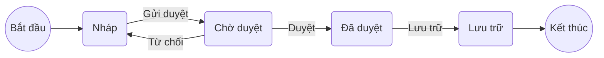

# Chuẩn sơ đồ trong artifact

Áp cho mọi artifact của PO và ba file thiết kế ở 2.43. Mục đích: phần nào có trạng thái, luồng rẽ nhánh hay phụ thuộc thì người đọc thấy được bằng hình, còn máy và agent của Dev vẫn đọc được bằng bảng.

## 1. Nguyên tắc

1. Bảng là nguồn chính, sơ đồ là bản dẫn xuất để đọc. Sơ đồ không chứa dữ kiện nào không có trong bảng hoặc trong câu chữ của mục. Cách này theo AWS AI-DLC: `functional-spec.md` là nguồn của luồng và máy trạng thái, sơ đồ quan hệ thực thể là bản dẫn xuất từ khối YAML (`core/aidlc-common/stages/construction/functional-design.md`).
2. Sửa bảng thì sửa sơ đồ trong cùng lần sửa. Với vòng đời trạng thái trong PRD, `po-tools.py check` so từng chuyển trạng thái giữa bảng và sơ đồ.
3. Sơ đồ viết bằng khối ` ```mermaid ` đặt ngay trong mục nó minh hoạ, không để ở phụ lục và không dùng ảnh. Repo đọc được trực tiếp; Lark dựng khối Mermaid thành bảng trắng khi publish.
4. Mỗi sơ đồ có một câu mô tả bằng chữ ngay dưới khối, trừ khi bảng ngay sau đã nói đủ. AWS yêu cầu phần mô tả này cho trường hợp sơ đồ không hiển thị được.
5. Không vẽ sơ đồ cho thứ một bảng ngắn đã đủ rõ. Sơ đồ có giá trị khi có trạng thái, có từ hai điểm rẽ nhánh trở lên, hoặc có từ ba thành phần phụ thuộc nhau trở lên.

## 2. Loại sơ đồ theo artifact

| Artifact | Mục | Sơ đồ | Khi nào | Cơ sở |
|---|---|---|---|---|
| PRD | 4. Vòng đời trạng thái | Sơ đồ trạng thái | Bắt buộc khi tính năng có đối tượng đổi trạng thái mà người dùng thấy, như đơn, lớp, chứng chỉ, yêu cầu duyệt | AWS: máy trạng thái trong `functional-spec.md`; `functional-design-guide.md` mục State Machine |
| PRD | 4. Mô tả giải pháp | Sơ đồ luồng nghiệp vụ tổng thể | Tuỳ chọn, khi giải pháp có nhiều bước hoặc nhiều vai nối tiếp | AWS: Workflows trong functional design |
| PRD | 5. Units | Sơ đồ phụ thuộc Unit | Khi có từ ba Unit | AWS: `unit-of-work-dependency.md` ở 2.7 |
| PRD | 6. Luồng chính của US | Sơ đồ luồng | Khi luồng có từ hai điểm rẽ nhánh | AWS: luồng có điểm quyết định trong functional design |
| `stories.md` | Units | Sơ đồ phụ thuộc Unit | Khi có từ ba Unit | Như trên |
| `scope-document.md` | Intent backlog, Units | Sơ đồ luồng giá trị: các bước từ nhu cầu tới kết quả, Unit nào phục vụ bước nào | Tuỳ chọn, khi có từ hai Unit | AWS: value stream map ở 1.4 Scope Definition |
| `related-features-map.md` | Bản đồ | Sơ đồ tính năng mới nối tới module, entity, mail bị chạm | Tuỳ chọn, khi bảng có từ sáu dòng | Bảng là nguồn |
| `impact-matrix.md` | 2. Current Situation | Sơ đồ phụ thuộc: thành phần bị chạm và quan hệ, vùng High tô màu | Khi có từ ba vùng bị ảnh hưởng | AWS: Component Diagram ở 2.6 Domain Design |
| `solution-options.md` | 2. Các option | Sơ đồ luồng cho từng option | Tuỳ chọn, khi các option khác nhau ở luồng xử lý | |
| `ux-design.md` | 2. Luồng và tương tác | Sơ đồ luồng màn, mỗi nút là một màn có mã `SCR` | Khuyến nghị | AWS: `user-flow.md` ở 1.6, `interaction-spec.md` ở 2.5 |
| `tech-design.md` | 1. Thành phần bị chạm; 4. API | Sơ đồ thành phần; sơ đồ tuần tự cho tích hợp | Tuỳ chọn, Tech PIC quyết | AWS: Component Diagram ở 2.6 |
| `test-design.md` | 2. Phủ tiêu chí chấp nhận | Không vẽ thêm; mỗi mũi tên của sơ đồ trạng thái trong PRD có ít nhất một ca, cộng ca chuyển trạng thái không hợp lệ | Khi PRD có vòng đời trạng thái | Kỹ thuật kiểm thử chuyển trạng thái |

Initiative Brief, Decision Brief, `decisions.md`, `traceability.md`, `state.md` không có sơ đồ. Knowledge base của domain: thực thể có vòng đời trạng thái nên có sơ đồ trạng thái theo cùng quy ước, để Impact Analysis thấy trạng thái nào bị chạm.

## 3. Sơ đồ trạng thái

Bảng chuyển trạng thái theo cột của AWS: Trạng thái hiện tại · Sự kiện · Ai kích hoạt · Điều kiện · Trạng thái sau · Hệ quả. Mỗi dòng một chuyển trạng thái; không viết dòng "mọi trạng thái", tách thành từng dòng.

Sơ đồ vẽ bằng `flowchart`, không dùng `stateDiagram-v2`, vì Lark dựng `stateDiagram-v2` mất nhãn mũi tên. Nút trạng thái dạng bo góc, nút bắt đầu và kết thúc dạng tròn, nhãn mũi tên là tên sự kiện, viết trên một dòng:



Sơ đồ trên: yêu cầu đi từ Nháp qua Chờ duyệt tới Đã duyệt; bị từ chối thì về Nháp; Lưu trữ là trạng thái cuối.

Quy tắc, theo `functional-design-guide.md` của AWS, `po-tools.py check` kiểm ba quy tắc đầu với PRD:
1. Mỗi dòng của bảng có đúng một mũi tên cùng trạng thái đầu, sự kiện, trạng thái sau trong sơ đồ, và ngược lại.
2. Mọi trạng thái đi tới được từ nút Bắt đầu.
3. Trạng thái không có đường ra thì nối tới nút Kết thúc; trạng thái chưa nối là trạng thái bị bỏ quên.
4. Mỗi sự kiện có người hoặc hệ thống kích hoạt rõ; điều kiện kiểm được.
5. Mỗi chuyển trạng thái có ít nhất một tiêu chí chấp nhận trong US liên quan; chuyển trạng thái bị cấm là một tiêu chí cho nhánh lỗi.

## 4. Sơ đồ luồng và sơ đồ phụ thuộc

Sơ đồ luồng dùng `flowchart TD`: nút hành động dạng chữ nhật, điểm rẽ dạng thoi `{"Câu hỏi?"}`, nhãn nhánh là câu trả lời. Sơ đồ phụ thuộc dùng `flowchart LR`: mỗi thành phần một nút, mũi tên đi từ thứ phải có trước tới thứ phụ thuộc vào nó; phụ thuộc phải một chiều, không có vòng.

## 5. Cú pháp an toàn

- Mã nút viết không dấu, chữ in hoa hoặc chữ thường, không khoảng trắng: `CHO`, `U1`. Nhãn tiếng Việt đặt trong ngoặc kép.
- Nhãn mũi tên viết một dòng. Không dùng `<br/>` trong nhãn mũi tên, vì Lark tách thành nút rác; `<br/>` trong nhãn nút thì dùng được.
- Mọi nút được khai báo trước khi dùng ở mũi tên, hoặc khai báo ngay trong mũi tên đầu tiên chạm tới nó.
- Tô màu bằng `style <mã> fill:#...,stroke:#...` khi cần đánh dấu vùng rủi ro hay Unit quan trọng; không dùng màu làm cách duy nhất để phân biệt, nhãn phải nói đủ.
