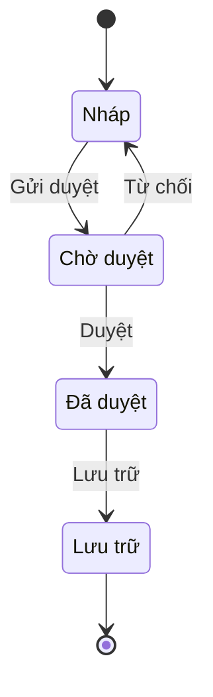

# Chuẩn sơ đồ trong artifact

Áp cho mọi artifact của PO, ba file thiết kế ở 2.43 và knowledge base của domain. Mục đích: phần nào có trạng thái, luồng rẽ nhánh, phạm vi hay phụ thuộc thì người đọc thấy được bằng hình, còn máy và agent của Dev vẫn đọc được bằng bảng.

## 1. Nguyên tắc

1. Bảng là nguồn chính, sơ đồ là bản dẫn xuất để đọc. Sơ đồ không chứa dữ kiện nào không có trong bảng hoặc trong câu chữ của mục. Cách này theo AWS AI-DLC: `functional-spec.md` là nguồn của luồng và máy trạng thái, sơ đồ quan hệ thực thể là bản dẫn xuất từ khối YAML (`core/aidlc-common/stages/construction/functional-design.md`).
2. Sửa bảng thì sửa sơ đồ trong cùng lần sửa. Với vòng đời trạng thái, `po-tools.py check` so từng chuyển trạng thái giữa bảng và sơ đồ.
3. Sơ đồ viết bằng khối ` ```mermaid ` đặt ngay trong mục nó minh hoạ, không để ở phụ lục và không dùng ảnh. Mermaid là văn bản nên so được khác biệt theo dòng trong git và hiển thị được trên các nền tảng git phổ biến.
4. Mỗi sơ đồ có một câu mô tả bằng chữ ngay dưới khối, trừ khi bảng ngay sau đã nói đủ. AWS yêu cầu phần mô tả này cho trường hợp sơ đồ không hiển thị được (`stage-protocol.md`, Mermaid diagram validation).
5. Không vẽ sơ đồ cho thứ một bảng ngắn đã đủ rõ. Sơ đồ có giá trị khi có trạng thái, có từ hai điểm rẽ nhánh trở lên, hoặc có từ ba thành phần phụ thuộc nhau trở lên.

BABOK v3 coi sơ đồ là một cách đặc tả yêu cầu: mục 7.1 Specify and Model Requirements chia mô hình theo nhóm người và vai, luồng hoạt động, năng lực, dữ liệu và thông tin, lý do. Mỗi loại sơ đồ dưới đây ứng với một kỹ thuật ở chương 10.

## 2. Loại sơ đồ theo artifact

| Artifact | Mục | Sơ đồ | Khi nào | Kỹ thuật BABOK | Cơ sở AWS |
|---|---|---|---|---|---|
| PRD | 4. Vòng đời trạng thái | Sơ đồ trạng thái | Bắt buộc khi tính năng có đối tượng đổi trạng thái mà người dùng thấy, như đơn, lớp, chứng chỉ, yêu cầu duyệt | 10.44 State Modelling | Máy trạng thái trong `functional-spec.md`; `functional-design-guide.md` mục State Machine |
| PRD | 4. Mô tả giải pháp | Sơ đồ luồng nghiệp vụ | Tuỳ chọn, khi giải pháp có nhiều bước hoặc nhiều vai nối tiếp | 10.35 Process Modelling | Workflows trong functional design |
| PRD | 5. Units | Sơ đồ phụ thuộc Unit | Khi có từ ba Unit | | `unit-of-work-dependency.md` ở 2.7 |
| PRD | 6. Luồng chính của US | Sơ đồ luồng | Khi luồng có từ hai điểm rẽ nhánh | 10.47 Use Cases and Scenarios | Luồng có điểm quyết định trong functional design |
| `stories.md` | Units | Sơ đồ phụ thuộc Unit | Khi có từ ba Unit | | Như trên |
| `scope-document.md` | Intent backlog, Units | Sơ đồ phạm vi hoặc luồng giá trị: các bước từ nhu cầu tới kết quả, Unit nào phục vụ bước nào | Tuỳ chọn, khi có từ hai Unit | 10.41 Scope Modelling | Value stream map ở 1.4 Scope Definition |
| `related-features-map.md` | Bản đồ | Tính năng mới nối tới module, entity, sự kiện bị chạm | Tuỳ chọn, khi bảng có từ sáu dòng | 10.41 Scope Modelling | |
| `impact-matrix.md` | 2. Current Situation | Sơ đồ phụ thuộc: thành phần bị chạm và quan hệ, vùng High tô màu | Khi có từ ba vùng bị ảnh hưởng | 6.1 Analyze Current State | Component Diagram ở 2.6 Domain Design |
| `solution-options.md` | 2. Các option | Sơ đồ luồng cho từng option | Tuỳ chọn, khi các option khác nhau ở luồng xử lý | 10.35 Process Modelling | |
| `ux-design.md` | 2. Luồng và tương tác | Sơ đồ luồng màn, mỗi nút là một màn có mã `SCR` | Khuyến nghị | | `user-flow.md` ở 1.6, `interaction-spec.md` ở 2.5 |
| `tech-design.md` | 1. Thành phần bị chạm; 3. Hợp đồng giữa Frontend và Backend; 4. Backend, Dữ liệu | Sơ đồ thành phần gồm cả ứng dụng Frontend và service Backend; sơ đồ tuần tự cho tích hợp nhiều bước; sơ đồ quan hệ thực thể | Tuỳ chọn, Tech PIC quyết | 10.15 Data Modelling, 10.42 Sequence Diagrams | Component Diagram ở 2.6; sơ đồ quan hệ thực thể ở 3.1 |
| `test-design.md` | 2. Phủ tiêu chí chấp nhận | Không vẽ thêm; mỗi chuyển trạng thái trong sơ đồ của PRD có ít nhất một ca, cộng ca chuyển trạng thái không hợp lệ | Khi PRD có vòng đời trạng thái | 10.44 State Modelling | |
| Knowledge base của domain | File module, file mô hình dữ liệu | Sơ đồ trạng thái cho thực thể có vòng đời; sơ đồ quan hệ thực thể | Theo `engine/standards/domain-kb.md` | 10.44, 10.15 | Reverse engineering ở 2.1 |

Initiative Brief, Decision Brief, `decisions.md`, `traceability.md`, `state.md` không có sơ đồ.

## 3. Sơ đồ trạng thái

Bảng chuyển trạng thái theo cột của AWS: Trạng thái hiện tại · Sự kiện · Ai kích hoạt · Điều kiện · Trạng thái sau · Hệ quả. Mỗi dòng một chuyển trạng thái; không viết dòng "mọi trạng thái", tách thành từng dòng.

Sơ đồ viết bằng `stateDiagram-v2`, ký pháp máy trạng thái của UML. Mỗi trạng thái khai báo một lần bằng `state "<tên>" as <MÃ>`; `[*]` ở đầu mũi tên là trạng thái bắt đầu, ở cuối mũi tên là trạng thái kết thúc; nhãn sau dấu hai chấm là tên sự kiện, trùng cột Sự kiện của bảng.



Sơ đồ trên: yêu cầu đi từ Nháp qua Chờ duyệt tới Đã duyệt; bị từ chối thì về Nháp; Lưu trữ là trạng thái cuối.

Quy tắc, theo mục State Machine Validation Rules trong `functional-design-guide.md` của AWS và BABOK 10.44. `po-tools.py check` kiểm ba quy tắc đầu:
1. Mỗi dòng của bảng có đúng một mũi tên cùng trạng thái đầu, sự kiện, trạng thái sau trong sơ đồ, và ngược lại.
2. Mọi trạng thái đi tới được từ trạng thái bắt đầu.
3. Trạng thái không có đường ra thì có mũi tên tới `[*]`; trạng thái chưa nối là trạng thái bị bỏ quên.
4. Mỗi sự kiện có người hoặc hệ thống kích hoạt rõ; điều kiện kiểm được.
5. Mỗi chuyển trạng thái có ít nhất một tiêu chí chấp nhận trong US liên quan; chuyển trạng thái bị cấm là một tiêu chí cho nhánh lỗi.

## 4. Sơ đồ luồng, phạm vi và phụ thuộc

Sơ đồ luồng dùng `flowchart TD`: nút hành động dạng chữ nhật, điểm rẽ dạng thoi `{"Câu hỏi?"}`, nhãn nhánh là câu trả lời. Luồng có nhiều vai thì dùng `subgraph` cho mỗi vai, theo cách chia làn của BABOK 10.35. Sơ đồ phụ thuộc dùng `flowchart LR`: mỗi thành phần một nút, mũi tên đi từ thứ phải có trước tới thứ phụ thuộc vào nó; phụ thuộc phải một chiều, không có vòng. Sơ đồ quan hệ thực thể dùng `erDiagram`. Sơ đồ tuần tự dùng `sequenceDiagram`.

## 5. Cú pháp

- Mã nút và mã trạng thái viết không dấu, không khoảng trắng: `CHO`, `U1`. Tên tiếng Việt đặt trong ngoặc kép.
- Mọi nút được khai báo trước khi dùng ở mũi tên, hoặc khai báo ngay trong mũi tên đầu tiên chạm tới nó.
- Tô màu bằng `style <mã> fill:#...,stroke:#...,color:#...` khi cần đánh dấu vùng rủi ro hoặc Unit quan trọng. Có `fill` thì phải có `color`, vì nơi hiển thị ở nền tối giữ màu chữ sáng trên nền ô sáng. Không dùng màu làm cách duy nhất để phân biệt, nhãn phải nói đủ.
- Nhãn tiếng Việt có dấu ngoặc, dấu gạch đứng, dấu ngoặc kép hoặc chữ `@` thì đặt trong ngoặc kép, ở cả nút lẫn mũi tên: `A["Mở màn (SCR1)"]`, `-->|"Có (đủ)"|`.
- Mỗi sơ đồ tối đa 20 nút. Nhiều hơn thì tách thành nhiều sơ đồ, mỗi sơ đồ một luồng hoặc một nhóm.
- Chỉ dùng năm dòng đầu khối: `flowchart`, `graph`, `stateDiagram-v2`, `sequenceDiagram`, `erDiagram`. Không dùng khối `%%{init}%%` vì màu và giao diện do nơi hiển thị quyết định, không dùng `click` vì GitHub bỏ qua liên kết trong sơ đồ. Các loại sơ đồ có hậu tố `-beta` chưa ổn định giữa các phiên bản Mermaid.

## 6. Lỗi cú pháp và cách kiểm

Sơ đồ sai cú pháp không hiển thị, người đọc chỉ thấy thông báo lỗi. AWS yêu cầu kiểm cú pháp và kiểm nút đã khai báo trước khi ghi sơ đồ vào file (`stage-protocol.md` mục 10, Mermaid diagram validation). `po-tools.py check` kiểm mọi khối Mermaid của artifact, `doctor` kiểm sơ đồ trong knowledge base, `selftest` kiểm sơ đồ mẫu của engine. Kết quả nằm ở nhóm cảnh báo Sơ đồ.

Bảng dưới gồm các lỗi đã thử trên Mermaid 11.12. Danh sách ban đầu lấy từ `references/guides/troubleshooting.md` của repo `spillwavesolutions/design-doc-mermaid` (giấy phép MIT). Khoảng một nửa lỗi ở đó không còn xảy ra trên Mermaid 11, như mã nút bắt đầu bằng `o` hoặc `x`, dấu hai chấm hoặc dấu `#` trong nhãn nút, dòng chú thích `%%` rỗng, nên không đưa vào.

| Loại sơ đồ | Viết sai | Viết đúng |
|---|---|---|
| `flowchart` | `A[Mở màn (SCR1)]`: nhãn có `( ) [ ] { } \| " @` mà không đặt trong ngoặc kép | `A["Mở màn (SCR1)"]` |
| `flowchart` | `-->\|Có (đủ)\|`: nhãn mũi tên có ký tự như trên | `-->\|"Có (đủ)"\|` |
| `flowchart` | `A[/api/lop]`: nhãn bắt đầu bằng `/` hoặc `\` bị đọc thành hình thang | `A["/api/lop"]` |
| `flowchart` | `B --> end`: `end` viết thường là từ khoá đóng `subgraph` | `B --> KET_THUC` |
| `flowchart` | `flowchart TD A --> B`: nút viết cùng dòng đầu | Dòng đầu chỉ có `flowchart TD` |
| `flowchart` | `subgraph` không có dòng `end` tương ứng | Mỗi `subgraph` một dòng `end` |
| `stateDiagram-v2` | `NHAP --> CHO : Gửi: duyệt`: nhãn sự kiện có dấu hai chấm | `NHAP --> CHO : Gửi duyệt` |
| `stateDiagram-v2` | `state "Nháp "mới"" as NHAP`: tên có ngoặc kép bên trong | `state "Nháp mới" as NHAP` |
| `stateDiagram-v2` | `class [*] tenlop`: gắn class cho `[*]` | Không tô `[*]` |
| `sequenceDiagram` | `FE->>BE Gửi`: thiếu dấu hai chấm trước nội dung | `FE->>BE: Gửi` |
| `sequenceDiagram` | `FE->>BE: Nhận; lưu`: dấu chấm phẩy trong thông điệp hoặc `Note` | `FE->>BE: Nhận, lưu` |
| `sequenceDiagram` | `alt`, `opt`, `loop`, `par` không có `end`; participant tên `end` | Mỗi khối một dòng `end` |
| `erDiagram` | `LOP { PK string ma }`: khoá đứng trước loại dữ liệu và tên | `LOP { string ma PK }` |
| `erDiagram` | `KHOA_HOC \|\|--o{ LOP : có(n)`: nhãn quan hệ có ký tự đặc biệt | `KHOA_HOC \|\|--o{ LOP : "có (n)"` |

Hai quy tắc ở mục 5 không phải lỗi cú pháp nhưng script vẫn báo: `fill` thiếu `color`, và sơ đồ quá 20 nút. Script kiểm tĩnh nên không thay được việc xem sơ đồ hiển thị trên GitHub. Người duyệt PR vẫn mở bản xem trước để thấy sơ đồ có đúng ý hay không.
