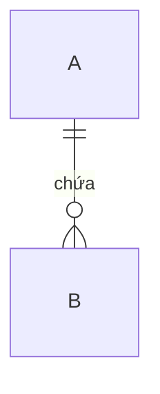

# Mô hình khái niệm: <tên sản phẩm>

Thực thể nghiệp vụ và quan hệ giữa chúng, theo kỹ thuật Concept Modelling của BABOK (10.11). Mức nghiệp vụ: không kiểu dữ liệu, không khoá.

Sơ đồ trên: <mô tả một câu>.

## Quan hệ chứa

| Thực thể | Chứa | Không chứa | Ghi chú |
|---|---|---|---|

## Nguyên tắc mô hình hoá

| Mã | Nguyên tắc | Vì sao |
|---|---|---|
| DP-01 | <ví dụ: quan hệ người với nội dung chỉ đi qua X> | |
