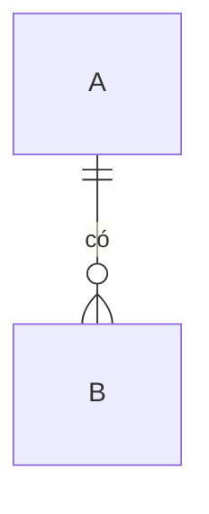

# Mô hình dữ liệu: <tên sản phẩm>

Thực thể dữ liệu và quan hệ, theo kỹ thuật Data Modelling và Data Dictionary của BABOK (10.15, 10.12). Nguồn: <schema, ERD, đặc tả API>.

## Thực thể

| Thực thể | Mô tả | Khoá | Quan hệ | Số thực thể trỏ tới | Tách theo tổ chức? |
|---|---|---|---|---|---|

## Thực thể dùng chung dễ vỡ

| Thực thể | Được dùng ở | Vì sao dễ vỡ |
|---|---|---|

## Field quan trọng <!-- tuỳ chọn -->

| Thực thể | Field | Kiểu | Giá trị hợp lệ | Ý nghĩa nghiệp vụ |
|---|---|---|---|---|
