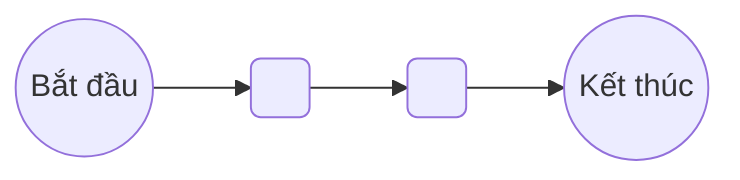

# [PRD] <Tên tính năng>

> Template PRD chuẩn của PO-Workflow, dùng chung cho mọi sản phẩm. Cơ sở và nguồn của từng mục: `engine/standards/adr/0004-template-prd-chuan.md`. Phần *in nghiêng* là hướng dẫn, xoá khi viết thật. Mục ghi tuỳ chọn mà không áp dụng thì xoá hẳn. Trạng thái tài liệu và người duyệt chỉ ghi ở frontmatter và `state.md`, không ghi trong thân.

| | |
| --- | --- |
| Mã tính năng | *<SP>-F<NNN>. Mã ngắn trong tài liệu đổi sang mã đầy đủ theo quy ước: US1 là US-APP-F012-01, AC1.1 là AC-APP-F012-01.1* |
| PO | |
| Design PIC · Tech PIC · QA PIC | |
| Mốc phát hành | *Sprint hoặc quý, nếu đã có* |
| Epic Jira | *Link* |
| Figma | *Link* |
| Tài liệu liên quan | *Initiative Brief, PRD liên quan, tài liệu đối tác. Link ba file thiết kế và Decision Brief ghi ở `intent.md`, không sửa PRD đã duyệt để thêm link* |

---

# Lịch sử phiên bản

| Phiên bản | Ngày | Người cập nhật | Nội dung | Phạm vi ảnh hưởng |
| --- | --- | --- | --- | --- |
| v0.1 | | | *Bản đầu* | |

*Mỗi change request thêm một dòng, ghi `CR<n>` ở cột Nội dung và US bị chạm ở cột Phạm vi ảnh hưởng.*

---

# 1. Bối cảnh và mục tiêu

*Tóm tắt từ `intent-statement.md` hoặc Initiative Brief đã duyệt, không viết lại nội dung mới. Người đọc cần hiểu vì sao làm tính năng này trước khi đọc yêu cầu.*

## Vấn đề

*Ai gặp, gặp khi nào, hậu quả là gì. Không mô tả giải pháp.*

## Bằng chứng <!-- tuỳ chọn -->

*Số liệu hoặc quan sát cho thấy vấn đề có thật, và cách người dùng đang xoay xở. Phần suy luận chưa kiểm chứng ghi vào mục 9 Giả định.*

## Mục tiêu

*Kết quả muốn đạt, mỗi dòng một mục tiêu có mã `O1`, `O2`. Ghi kết quả, không ghi danh sách việc làm.*

| Mã | Kết quả muốn đạt |
| --- | --- |
| O1 | |

## Các bên liên quan <!-- tuỳ chọn -->

| Bên liên quan | Liên quan thế nào |
| --- | --- |

---

# 2. Tiêu chí thành công

*Mỗi mục tiêu có ít nhất một tiêu chí đo được sau khi phát hành, không gắn với công nghệ. Ngưỡng chưa có số liệu nền thì ghi là đề xuất và ghi giả định ở mục 9. Có thể dùng khung HEART (Happiness, Engagement, Adoption, Retention, Task success) để tìm chỉ số; cột Nhóm HEART xoá được.*

| Mã | Tiêu chí | Cách đo | Ngưỡng | Mục tiêu | Nhóm HEART |
| --- | --- | --- | --- | --- | --- |
| SC1 | | | | O1 | |

---

# 3. Ngoài phạm vi

*Những gì tính năng không làm, ở cấp tính năng, kèm lý do một câu. Gồm cả thứ từng trong phạm vi nhưng bị loại theo change request nào. Người đọc trả lời được "tính năng có làm X không" mà không phải đọc hết các US.*

| Không làm | Vì sao |
| --- | --- |

---

# 4. Giải pháp tổng thể

*Lấy từ `solution-options.md` nếu có. Giải pháp ở mức nghiệp vụ, đủ để hình dung trước khi đọc từng US. Không sequence diagram, không cấu trúc bảng, không thuật toán, không thư viện; cách làm kỹ thuật do Tech PIC viết ở `tech-design.md`.*

## Mô tả giải pháp <!-- tuỳ chọn -->

*Giải pháp có nhiều bước hoặc nhiều vai nối tiếp thì thêm sơ đồ luồng nghiệp vụ, theo `engine/standards/diagrams.md` mục 4.*

## Ràng buộc nghiệp vụ cho cách làm <!-- tuỳ chọn -->

*Điều phải đúng với mọi cách làm, mỗi dòng có mã `C1`, `C2`. Dev quyết làm thế nào.*

| Mã | Ràng buộc |
| --- | --- |

## Vòng đời trạng thái <!-- tuỳ chọn -->

*Bắt buộc khi tính năng có đối tượng đổi trạng thái mà người dùng thấy, như đơn, lớp, chứng chỉ, yêu cầu duyệt; mỗi đối tượng một sơ đồ và một bảng. Mức nghiệp vụ. Bảng là nguồn chính, sơ đồ vẽ từ bảng theo " + STD + " mục 3: `flowchart`, nút Bắt đầu và Kết thúc dạng tròn, nhãn mũi tên là tên sự kiện. `po-tools.py check` so từng chuyển trạng thái giữa bảng và sơ đồ.*

| Trạng thái hiện tại | Sự kiện | Ai kích hoạt | Điều kiện | Trạng thái sau | Hệ quả |
| --- | --- | --- | --- | --- | --- |
| *<Trạng thái đầu>* | *<Sự kiện>* | *<vai hoặc hệ thống>* | *<điều kiện kiểm được>* | *<Trạng thái sau>* | *<thông báo, dữ liệu đổi theo>* |

## Dữ liệu cần lưu giữ <!-- tuỳ chọn -->

*Thông tin nghiệp vụ bắt buộc phải lưu và vì sao. Không khai bảng, cột, kiểu dữ liệu.*

| Thông tin | Vì sao phải lưu | Ràng buộc |
| --- | --- | --- |

---

# 5. Units

*Lấy từ `stories.md`. Nhóm US làm và phát hành độc lập được, để Dev biết bắt đầu từ đâu. Thứ tự là đề xuất, Dev quyết thứ tự thật. Từ ba Unit trở lên thì thêm sơ đồ phụ thuộc Unit lấy từ `stories.md`, theo " + STD + " mục 4. Profile S bỏ mục này.*

| Unit | Gồm US | Phụ thuộc | Phát hành độc lập được? |
| --- | --- | --- | --- |

---

# 6. Yêu cầu theo user story

*Quy ước mã: user story `US1`, `US2` liên tục; business rule `BR<US>.<n>` và tiêu chí chấp nhận `AC<US>.<n>`, duy nhất trong tài liệu, ổn định, không đánh lại. US chưa làm trong đợt này ghi rõ ở tiêu đề: `US3: Sao chép quy tắc, chưa làm`.*

## Danh sách user story <!-- tuỳ chọn -->

| US | User story | Ưu tiên | Unit | Nguồn |
| --- | --- | --- | --- | --- |
| US1 | | Must | U1 | *FR hoặc RC nguồn* |

## US1: <Tên user story> <!-- tuỳ chọn -->

### User story

*Một câu theo vai: "Là <vai>, tôi cần <việc>, để <kết quả>".*

**Ưu tiên:** *Must, Should hoặc Could, lấy từ `stories.md`; Story List đổi sang cột Priority trên Jira. Ghi thêm một câu lý do khi ưu tiên không phải Must hoặc khi ưu tiên từng được bàn lại.*

### Tiền điều kiện

*Trạng thái dữ liệu, quyền, cấu hình phải có trước. US khác phải xong trước thì ghi mã `US<n>`: story này chỉ đủ điều kiện giao Dev khi US đó đạt.*

### Luồng chính

*Đường vào màn, sau đó ba tới bảy bước: người dùng làm gì, hệ thống đáp gì. Nhánh rẽ đáng kể ghi ngắn ngay dưới luồng chính. Luồng có từ hai điểm rẽ nhánh thì thêm sơ đồ luồng, theo " + STD + " mục 4.*

### Business rule

*Mỗi rule một câu kiểm chứng được, viết theo một trong năm mẫu EARS:*
- *Luôn đúng: "<Đối tượng hoặc hệ thống> phải <điều phải đúng>".*
- *Theo sự kiện: "Khi <sự kiện>, hệ thống phải <phản hồi>".*
- *Theo trạng thái: "Trong khi <trạng thái>, hệ thống phải <phản hồi>".*
- *Hành vi không mong muốn: "Nếu <điều kiện không mong muốn>, hệ thống phải <phản hồi>".*
- *Tuỳ chọn: "Với <cấu hình hoặc tính năng> đang bật, hệ thống phải <phản hồi>".*

*Rule chạm tính năng có sẵn dẫn mã KB, ví dụ `BR-EDIT-07`. Hằng số ghi rõ cứng hay cấu hình được. Câu thông báo trên màn ghi ở bảng giao diện, rule chỉ trỏ tới.*

- `BR1.1` *…*

### Tiêu chí chấp nhận

*Mỗi dòng một tiêu chí có đạt hoặc không đạt, viết theo hành vi người dùng thấy: "Cho <tiền điều kiện>, khi <hành động hoặc sự kiện>, thì <kết quả quan sát được>. Theo `BR1.1`". Phần "Cho" bỏ được khi mục Tiền điều kiện đã đủ. Luồng chính và mỗi nhánh đáng kể có ít nhất một tiêu chí; mỗi US có ít nhất một tiêu chí cho nhánh lỗi hoặc bị từ chối; mỗi ngưỡng số có tiêu chí ở giá trị biên; mỗi BR có ít nhất một tiêu chí trỏ tới; NFR đo được thì thành tiêu chí. Validate của một màn gom thành một tiêu chí trỏ về bảng giao diện. Không viết tiêu chí cho điều không kiểm được.*

- `AC1.1` *Cho …, khi …, thì …. Theo `BR1.1`*

### Giao diện và validate

*Nơi duy nhất ghi field, validate và câu thông báo của màn. Cột Màn hình ghi tên màn; mã màn `SCR` do Design PIC đặt ở `ux-design.md`. Màn mới dùng dạng A, màn có sẵn được sửa dùng dạng B.*

| Màn hình | Thành phần | Field | Yêu cầu |
| --- | --- | --- | --- |
| | | | *định dạng · placeholder · options · mặc định · điều kiện disable · tooltip · validate · câu thông báo · hành vi khi thao tác* |

| Thay đổi | Màn hình | Field | Validate |
| --- | --- | --- | --- |

### Dữ liệu

*Thông tin mới hoặc bị đổi ở mức nghiệp vụ. Thông tin hiện có ghi là hiện có. US không chạm dữ liệu thì ghi "Không có".*

| Thông tin | Mới, đổi hay hiện có | Giá trị hợp lệ | Ghi chú |
| --- | --- | --- | --- |

### NFR <!-- tuỳ chọn -->

*NFR chỉ áp cho US này, có chỉ số đo. NFR chung ghi ở mục 7.*

### Trường hợp ngoại lệ

*Góc lấy từ Impact Matrix mục Coverage Gaps và từ `corner-checklist.md` của domain. Mỗi góc kết thúc bằng một trong ba cách: có luật, ghi mã BR hoặc AC; chuyển thành câu hỏi mở ở mục 10; hoặc ghi vào Ngoài phạm vi của US. Không có góc nào thì ghi "Không có góc nào từ Impact Matrix chạm US này". QA bổ sung góc ở `test-design.md`; góc làm đổi yêu cầu thì vào PRD qua change request.*

| Góc | Xử lý |
| --- | --- |

### Ngoài phạm vi của US

*Những gì US này không làm, dù người đọc có thể tưởng là có. Không có thì ghi "Không có".*

---

# 7. Yêu cầu phi chức năng

*NFR áp cho cả tính năng, mỗi NFR có chỉ số đo; nhóm theo hiệu năng, bảo mật, khả năng mở rộng, độ tin cậy, khả năng quan sát, khả năng sử dụng. NFR chỉ của một US ghi trong US đó; bảng này liệt kê mã US để người đọc tìm. Chưa có chỉ số thì ghi câu hỏi mở, không bỏ NFR.*

| Mã | Yêu cầu | Chỉ số đo | Áp dụng cho | Nguồn |
| --- | --- | --- | --- | --- |
| NFR1 | | | | |

---

# 8. Chuyển đổi và triển khai

*Yêu cầu chỉ cần trong giai đoạn đưa tính năng vào dùng. Lấy từ Impact Matrix mục Transition và mục Tenant. Dòng không áp dụng thì xoá.*

| Hạng mục | Yêu cầu | Nguồn |
| --- | --- | --- |
| Dữ liệu hiện có | *Dữ liệu cũ liên quan đang có hay rỗng, giữ, chuyển đổi hay bỏ* | |
| Cách bật | *Bật một lần hay theo đợt, điều kiện trước khi bật* | |
| Chạy song song | *Đường cũ và đường mới cùng chạy thế nào* | |
| Quay lui | *Tắt tính năng thì dữ liệu đã sinh xử lý ra sao* | |
| Tenant và cấu hình | *Hằng số cứng hay cấu hình theo tổ chức* | |
| Hướng dẫn người dùng | *User Guide cần viết hoặc sửa, đối tượng cần được báo* | |

---

# 9. Giả định

*Điều PRD đang coi là đúng nhưng chưa kiểm chứng. Mỗi giả định ghi hệ quả nếu sai, để người đọc biết rủi ro nằm ở đâu.*

| Mã | Giả định | Nếu sai thì | Nguồn |
| --- | --- | --- | --- |
| A1 | | | |

---

# 10. Câu hỏi mở

*Câu hỏi chưa có câu trả lời, gắn người trả lời. Điểm phụ thuộc thiết kế hay kỹ thuật ghi `[đề xuất]` trong PRD và gắn tên PIC ở đây. Khi trình duyệt, PRD còn tối đa 3 chỗ `❓PO`, mỗi chỗ có một dòng ở bảng này.*

| # | Nội dung | Người trả lời | Chặn việc gì |
| --- | --- | --- | --- |

---

# 11. Truy vết

| FR | US | BR |
| --- | --- | --- |

*Mọi FR có US, hoặc ghi Deferred, N/A kèm lý do. Mọi BR thuộc một US. Chi tiết ở `traceability.md`.*
