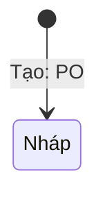

# [PRD] Cú pháp sơ đồ

## 4. Mô tả giải pháp

```mermaid
flowchart TD
    A[Mở màn (SCR1)] --> B{"Hợp lệ?"}
    B -->|Có (đủ)| C["Lưu (nháp)"]
    B --> end
    style C fill:#fdd,stroke:#c00
    style B fill:#dfd,stroke:#090,color:#000
```

Sơ đồ trên: luồng lưu nháp.

```mermaid
sequenceDiagram
    FE->>BE Gửi yêu cầu
    alt hợp lệ
    BE-->>FE: Đã nhận; lưu
```

Sơ đồ trên: gọi API.



Sơ đồ trên: tạo bản nháp.

```mermaid
erDiagram
    LOP { PK string ma }
    KHOA_HOC ||--o{ LOP : có(n)
```

Sơ đồ trên: dữ liệu lớp.

```mermaid
flowchat TD
    A --> B
```

Sơ đồ trên: gõ sai loại sơ đồ.
