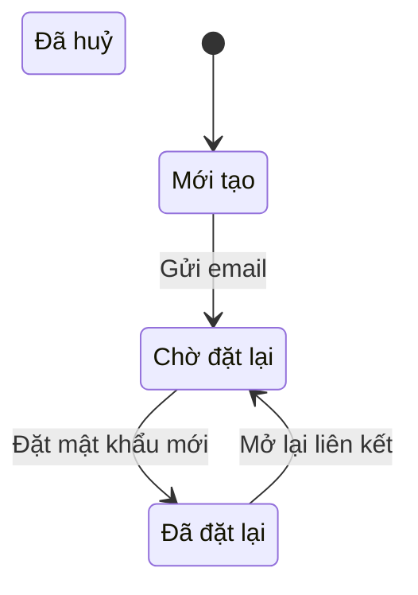

# [PRD] Đổi mật khẩu

| | |
| --- | --- |
| Mã tính năng | LMS-F904 |
| PO | PO mẫu |

---

# Lịch sử phiên bản

| Phiên bản | Ngày | Người cập nhật | Nội dung | Phạm vi ảnh hưởng |
| --- | --- | --- | --- | --- |
| v1.0 | 15/10/2026 | PO mẫu | Bản đầu | |

---

# 1. Bối cảnh và mục tiêu

## Vấn đề

Học viên quên mật khẩu phải nhờ vận hành đặt lại. ❓PO số lượt nhờ đặt lại mỗi tháng.

## Mục tiêu

| Mã | Kết quả muốn đạt |
| --- | --- |
| O1 | Học viên tự đổi và đặt lại mật khẩu |

---

# 4. Giải pháp tổng thể

## Vòng đời trạng thái

| Trạng thái hiện tại | Sự kiện | Ai kích hoạt | Điều kiện | Trạng thái sau | Hệ quả |
| --- | --- | --- | --- | --- | --- |
| Mới tạo | Gửi email | Hệ thống | Email đã xác minh | Chờ đặt lại | Gửi liên kết |
| Chờ đặt lại | Đặt mật khẩu mới | Học viên | Liên kết còn hạn | Đã đặt lại | |
| Chờ đặt lại | Hết hạn | Hệ thống | Quá thời hạn liên kết | Đã huỷ | |

---

# 5. Units

| Unit | Gồm US | Phụ thuộc | Phát hành độc lập được? |
| --- | --- | --- | --- |
| **U1 — Tự phục vụ** | `US1` · `US2` | - | Có |

---

# 6. Yêu cầu theo user story

## US1: Đổi mật khẩu khi đã đăng nhập

### User story

Là học viên, tôi cần đổi mật khẩu, để giữ tài khoản an toàn.

**Ưu tiên:** Must

### Tiền điều kiện

- Học viên đã đăng nhập

### Luồng chính

Học viên mở Hồ sơ, chọn Đổi mật khẩu, nhập mật khẩu cũ và mật khẩu mới, sau đó lưu.

### Business rule

- `BR1.1` Nếu mật khẩu cũ sai, hệ thống phải từ chối và giữ nguyên mật khẩu.

### Tiêu chí chấp nhận

- `AC1.1` Sai mật khẩu cũ · Theo `BR1.1`
  - Given học viên đã đăng nhập
  - When học viên nhập sai mật khẩu cũ và bấm Lưu
  - Then hệ thống báo lỗi và không đổi mật khẩu

### Giao diện và validate

Không có màn mới hoặc màn bị sửa.

### Dữ liệu

Không có.

### Trường hợp ngoại lệ

| Góc | Xử lý |
| --- | --- |
| Phiên đăng nhập hết hạn giữa chừng | Có luật: `BR1.1` |

### Ngoài phạm vi của US

Không có.

---

## US2: Đặt lại mật khẩu qua email

### User story

Là học viên, tôi cần đặt lại mật khẩu khi quên. ❓PO thời hạn của liên kết.

**Ưu tiên:** Should

### Tiền điều kiện

- Học viên có email đã xác minh ❓PO

### Luồng chính

Học viên bấm Quên mật khẩu, nhận email, mở liên kết, đặt mật khẩu mới. ❓PO

### Business rule

- `BR2.1` Khi liên kết đã hết hạn, hệ thống phải từ chối đặt lại mật khẩu.

### Tiêu chí chấp nhận

- `AC2.1` Khi mở liên kết đã hết hạn, hệ thống báo liên kết không còn hiệu lực. Theo `BR2.1`

### Giao diện và validate

Không có màn mới hoặc màn bị sửa.

### Dữ liệu

Không có.

### Ngoài phạm vi của US

Không có.

---

# 10. Câu hỏi mở

| # | Nội dung | Người trả lời | Chặn việc gì |
| --- | --- | --- | --- |
| 1 | Thời hạn của liên kết đặt lại ở US2 | PO | Có, chặn US2 |
| 2 | Có cần chặn đăng nhập sau nhiều lần nhập sai ở US1 không | PO | Không chặn |
